# Administration

This part is for the people who run Optiply Workflows: who gets in, what they can reach, how resources and secrets
are set up, and how the production server is deployed, backed up and repaired. It follows the User Guide. Everything
the User Guide explains (building workflows and apps, writing queries, the Database section, the API) is not repeated
here; where you need it, this part points you to the chapter.

Commands are shown for a Mac or Linux terminal with the Google Cloud CLI (`gcloud`) installed and signed in. No secret
value appears in this guide: where you need one, it shows the command that fetches it.

## A1. Being an admin

### Who is an admin

Admin powers come from two things together: being a member of the built-in **Admins** group **and** having an
**@optiply.nl** email address.

| Person | Member of Admins? | Email | What they are |
|---|---|---|---|
| A colleague | Yes | @optiply.nl | **Admin**: can do everything |
| An outside partner someone added to Admins | Yes | another domain | **Ordinary user**: only what is shared with them |
| Everyone else | No | any | Ordinary user: only what is shared with them or their groups |

The email rule is checked on every request, so it can't be worked around by adding someone to Admins. The domain is
the server's sign-in domain (`OIDC_ALLOWED_DOMAIN`, set to `optiply.nl` in production).

### What admins can do

- See and change **everything**: every workflow, app, resource, library query, module and component library, in every
  environment. Access grants don't apply to admins; they always have the highest level (Own).
- Open **Settings**, which nobody else sees (the sidebar link, the ⌘K entries and every `/settings/…` address are
  hidden or answer "No access to Settings" for everyone else).
- Let people in, turn them down, disable them, and manage groups and access.
- Manage folder-wide and "all of a kind" access, which owners of single objects can't.
- Make API keys and access tokens, environments' config vars, the Git connection, package registries and JDBC
  drivers.
- Read the audit log.
- Make a few resource choices that only admins may make (A3, "Choices only admins can make").

### The Settings pages

Settings is in the sidebar (admins only). A number on it, and on its **Users** tab, counts the people waiting for
approval.

| Group | Page | What it's for | Chapter |
|---|---|---|---|
| Access | **Users** | People: approve or reject requests, disable, open a person's page | A2 |
| Access | **Groups** | Groups, their members and what each group may reach | A2 |
| Access | **API keys** | Keys other systems use to call workflow webhooks | A5 |
| Access | **Access tokens** | Personal tokens for the components command-line tool | A5 |
| Platform | **Environments** | The environments (Production, Staging) | A4 |
| Platform | **Config vars** | Values per environment, including secrets | A4 |
| Platform | **Git** | The Git repository protected objects live in | A6 |
| Platform | **Python** | Extra Python package indexes | A7 |
| Platform | **npm registries** | Private npm registries | A7 |
| Platform | **JDBC drivers** | Uploaded database drivers | A7 |
| Monitoring | **Audit log** | Who did what, and when | A8 |

### Safety rails

The app keeps you from locking everyone out:

- **You can't remove yourself from Admins.** On the Admins group's page your own row says "Another admin can remove
  you". Ask another admin.
- **The last active admin can't be removed.** "Cannot remove the last active admin": at least one admin who can sign in
  (active and not disabled) must stay.
- **You can't disable your own account** ("You cannot disable your own account").

> **Tip:** Keep at least two admins, so that one can always help the other. Keep the group small too: admins can read
> every resource's data and choose where secrets are sent.

### Making someone an admin

1. Open **Settings → Groups → Admins**.
2. In **Add a member…**, pick the person, then **Add**.

They have admin powers on their next page. Someone waiting for approval can be approved straight into Admins as well
(A2). Only people with an @optiply.nl address get the powers.

To take admin powers away, open the Admins group and click the **×** next to the person (you'll be asked to confirm).

> **Note:** If every admin is locked out (all disabled, or the only admin left the company), a person with access to
> the production server can make one again from the command line. See A10, "Nobody can administer the app".

## A2. People and access

### How people get in

Everyone signs in through Optiply's own sign-in (Auth0, as Optiply's other internal tools): opening the app while
signed out goes straight there. What happens next depends on who they are:

1. **Someone new from Optiply** (an @optiply.nl account) asks to get in by signing in the first time. They
   don't get a session; the sign-in page says "Waiting for an admin's approval". Signing in again while waiting
   doesn't ask again.
2. **An admin approves them** (below). They click **Sign in again** on that page (or open the app again) and are in.
3. **Someone outside Optiply** is refused with "Only @optiply.nl accounts or invited people can sign in", unless an
   admin invited them (invitations are switched off for now; see below).

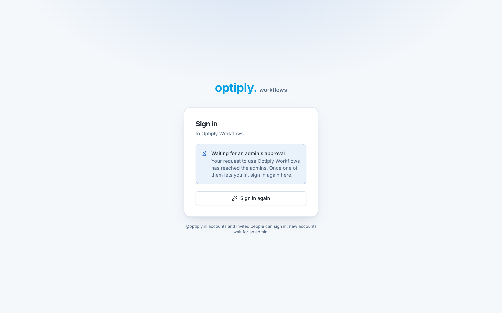

No email is sent to admins when someone asks to get in: the request shows in **Settings → Users** and as a count on
Settings in the sidebar. Check it now and then, or tell new colleagues to ping you.

A sign-in lasts a week; then people sign in again.

### Approving and rejecting requests

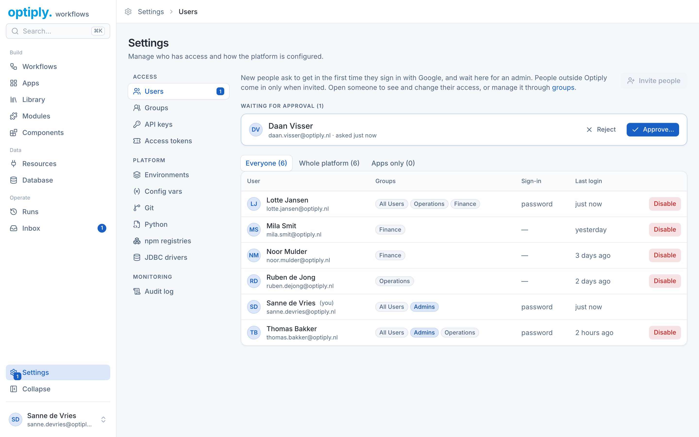

1. Open **Settings → Users**. People waiting are listed first, under **Waiting for approval (n)**, with when they
   asked.
2. To let someone in, click **Approve…**. Choose their **Access**: **Whole platform** (the default) or **Apps only**
   (see "Access to apps only" below). Then the groups they go into. **All Users** is always ticked; tick **Admins
   (can do everything)** only for colleagues who will administer the app (it isn't offered with Apps only). Click
   **Approve**.
3. To turn someone down, click **Reject** and confirm. They can't sign in or ask again. They stay in the list as
   **Not approved**, with an **Approve** button if you change your mind.

Approving gives a person only what their groups and their own grants allow. If nothing reaches them yet, they see a
welcome page that says nothing has been shared with them. Give them access (below), then ask them to reload.

### Invitations (switched off)

The **Invite people** button on Settings → Users is greyed out: "Not available yet: invitations need an email address
to be sent from". Invitations were made for people outside Optiply (partners, customers), who can't ask to get in by
themselves. The app has no email address to send them from yet, so the button is off until it does.

> **Note:** Sign-in goes through Optiply's Auth0. Whether someone from outside Optiply can sign in there at all
> depends on how Optiply's Auth0 is set up: check that with whoever manages it before switching invitations back on.

### Disabling and enabling people

To stop someone using the app (they left, or a laptop was lost):

1. Open **Settings → Users**.
2. On their row, click **Disable**.

Their sessions end at once, and their access tokens stop working. They can't sign in again ("Your account has been
disabled"). Their row is dimmed; **Enable** undoes it. What they built stays; nothing is deleted.

### A person's page

Click a name in Settings → Users to open their page.

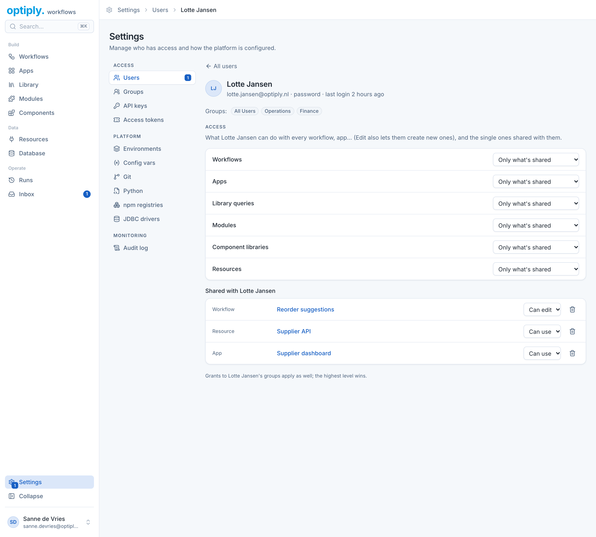

It shows:

- Their state, if it isn't simply active: **Disabled**, **Waiting for approval**, **Invited** or **Not approved**;
  **Apps only** when that is their access.
- Their email, how they sign in, and when they last signed in.
- **Groups**: each one links to the group's page.
- **Access type**: **Whole platform** or **Apps only**, which you can switch here at any time (see below).
- **Access**: what is granted to this person themselves (see "Permissions" below). Grants to their groups apply as
  well; the highest level wins. For an admin this section only says that admins can do everything. For someone with
  access to apps only it shows only the **Apps** row.

### Access to apps only

Some people should use one or two apps and nothing else: no workflows, resources, library or settings, and no way
into the platform from the app. Give them **Apps only**:

- When you approve them: **Approve…** → **Access: Apps only**.
- At any time later: open their page in Settings → Users and pick **Apps only** under **Access type** (you are asked
  to confirm). **Whole platform** gives them back everything their groups and grants allow.

Then share the apps with them as usual: the app's **Access** dialog, a group they're in, or **Apps** on their page.

What changes for them:

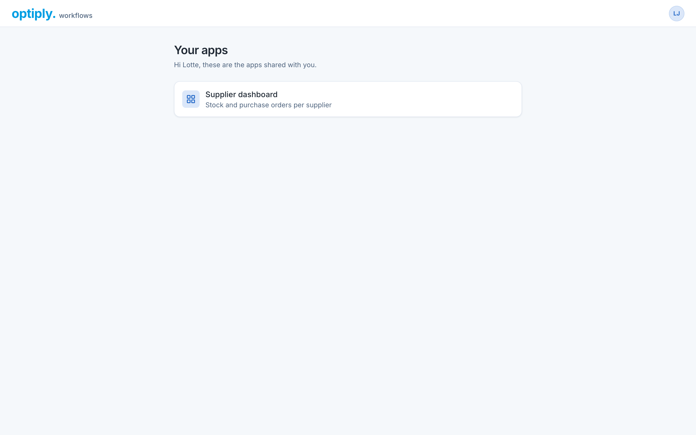

- They land on **Your apps**, a page of their own listing the apps shared with them. There is no sidebar.
- In an app, the account menu offers **Your apps** instead of **Open Optiply Workflows**. Typing any other address
  (Workflows, Settings, an app's editor) takes them back to Your apps.
- Only grants on **apps** (and app folders) count, and only as **Use**, even if Edit or Own was given. What **All
  Users** holds doesn't count for them: they don't get every new app automatically, only the ones you give them or
  their group.
- The server refuses them everything else, so nothing outside their apps is reachable even by hand.

What they can do inside an app: everything the app does. They run all the queries of the app's **published version**
(resource queries, workflow queries, library and module queries, the app's JavaScript), writes included, because a
published app runs its queries as the app: they don't need access to the resources or workflows behind it. They never
see the draft or the editor, and they can't send queries of their own. `current_user` is them. For a resource that signs
in per person (OAuth), the app asks them to connect their own account. So share an app only when everything its buttons
do is fine for them.

Rules: admins always have the whole platform, so someone in **Admins** can't be made Apps only (take them out of Admins
first), and someone with Apps only can't be added to Admins. You can't change your own access. A change counts from
the person's next click; it's recorded in the audit log as `user.access_changed`. Settings → Users has tabs to list
**Whole platform** or **Apps only** people, and an **Apps only** badge on their row.

### Groups

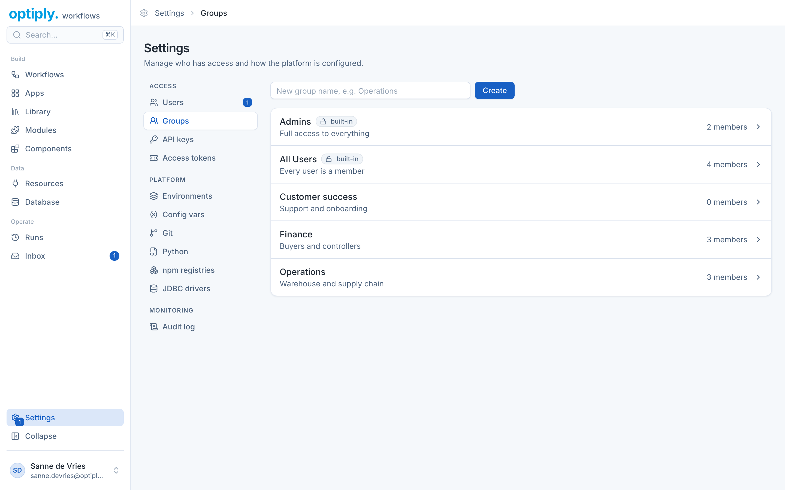

Two groups are built in and can't be renamed or deleted:

| Group | Members | Use it for |
|---|---|---|
| **All Users** | Everyone, automatically (you can't add or remove members) | What everyone may use: Use on the built-in REST API resource, and Use on every workflow, app, library query, module and component library when it's created. |
| **Admins** | Whoever you add | People who administer the app (with an @optiply.nl address) |

Make your own groups for teams or roles ("Customer Success", "Data", "Finance"):

1. **Settings → Groups**: type a name in **New group name** and click **Create**.
2. Open the group. Under **Add a member…**, pick a person and click **Add**. Repeat for each member. Only people who
   are in (active and not disabled) can be added.
3. In the group's **Access** section, give the group what it needs (next section).

To remove a member, click the **×** on their row. To delete a group, open it and click **Delete group**: its members
lose what the group gave them.

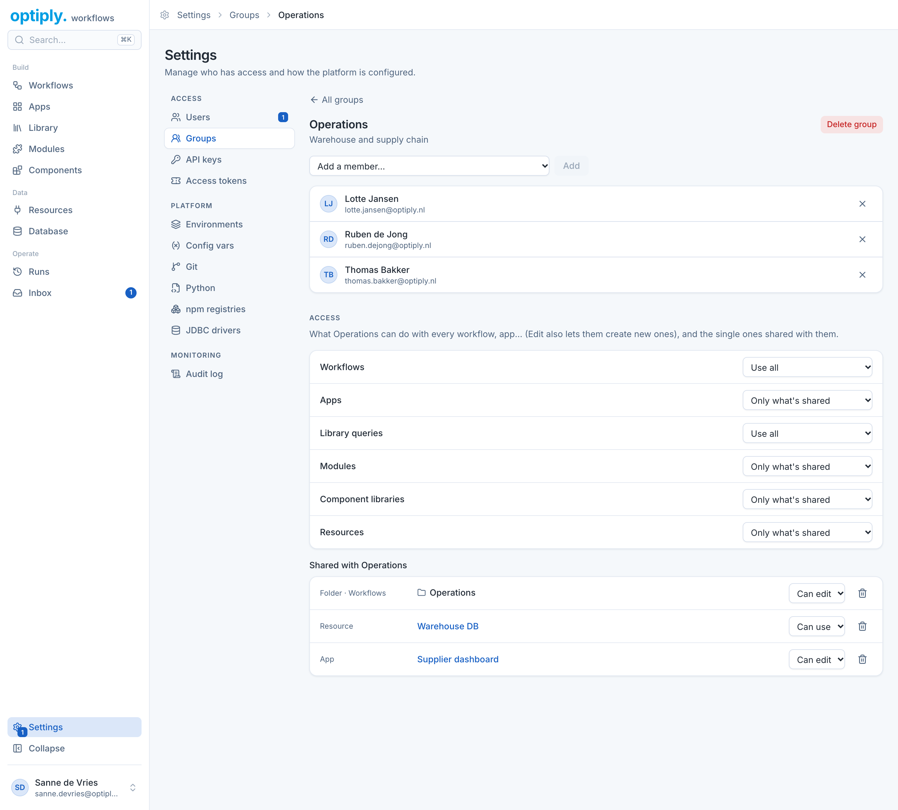

> **Tip:** Give access to groups rather than to single people. When someone joins a team, adding them to the group is
> all it takes, and the group's page shows in one place what the team can reach.

### Permissions

#### Levels

| Level | Workflows | Apps | Resources | Library queries, modules, component libraries |
|---|---|---|---|---|
| **Use** | Run it live and see its runs | Open the published app and use it | Run queries with it | Use it in an app |
| **Edit** | Also change the draft, test-run it, publish | Also change the draft and publish | Also change its settings | Also change, test and publish it |
| **Own** | Also delete it and manage who has access | The same | The same | The same |

A person's level is the **highest** of their own grants and all their groups' grants. There are no "deny" grants:
to take access away, remove the grant that gives it.

#### What a grant can be on

- **One object:** a single workflow, app, resource, library query, module or component library. Set on the object's
  **Access** button or tab (owners and admins).
- **A folder:** everything in that folder and its subfolders, now and later. Set with the folder's **Access** button
  in the list (admins only). A workflow folder's grants reach workflows only, an app folder's apps only, and so on.
- **All of a kind:** every workflow (or every app, every resource…), including new ones. Set on a group's or a
  person's page (admins only), in the **Access** section, one line per kind:

  | Choice | Means |
  |---|---|
  | *Only what's shared* | Nothing for the whole kind; only single grants and folders count |
  | *Use all* | Use on every one |
  | *Edit all, and create* | Edit on every one, and they may create new ones |
  | *Own all* | Own on every one |

  Below it, **Shared with …** lists every single grant this group or person holds, with links.

> **Important:** Creating something needs **Edit on all of that kind**. Someone who should build new workflows needs
> "Edit all, and create" on Workflows; Edit on a single workflow lets them change that one only. The **New …** buttons
> show only to people who may create.

#### Resources: per environment

A resource has separate settings in each environment (A4), and its grants can be for **All environments** or for one.
Someone with Use on a resource in Staging only can run queries against the staging database, not production.

- On a resource's **Access** tab, pick a group or person, an environment (or **All environments**) and a level, then
  **Grant**.
- **Resources → Access to all resources** (admins) gives a level on every resource, per environment.
- Creating resources (and resource folders) needs Edit on all resources **in all environments**.
- A person's page shows a resource grant for one environment as a badge such as "Can use in Staging".

Workflows, apps and the rest have no per-environment grants: their access applies everywhere.

#### Who can share

| Who | Can share |
|---|---|
| Admins | Anything: single objects, folders, all of a kind |
| An object's owners (Own) | That object, with its **Access** button (workflow, app, resource, library query, module, component library) |
| Everyone else | Nothing |

Only people who are in (active, not disabled) can be given access ("… can't sign in, so can't be given access").

The User Guide shows the Access dialog from a builder's side (chapters Workflows and Apps).

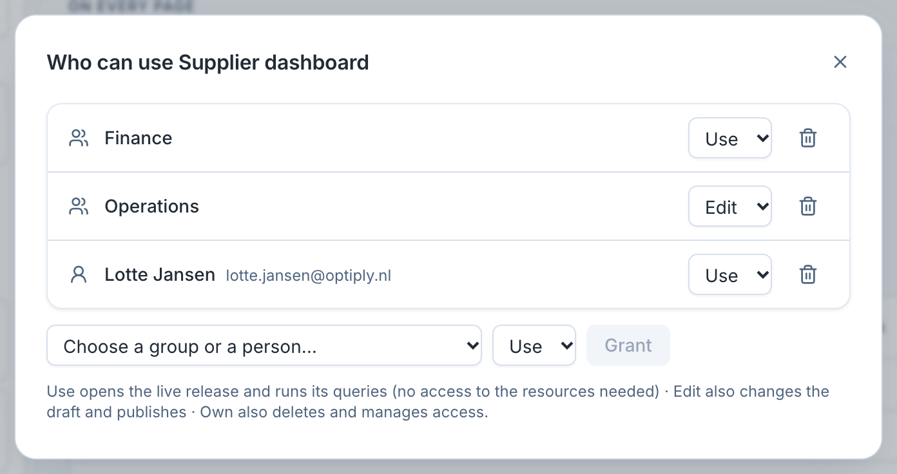

### What new things start with

Everything people create is shared with everyone at first, and admins change it afterwards:

| Who made it | All Users gets | The creator gets |
|---|---|---|
| A builder (not an admin) | **Use** | **Edit** (a grant to them personally) |
| An admin | **Use** | nothing extra (admins can do everything) |
| Git sync (a new object in the repository) | nothing: only admins see it until an admin **approves** it by sharing it (Access dialog) | — |

This applies to workflows, apps, library queries, modules and component libraries, created new, duplicated or imported
from Retool. Objects that arrive through Git sync are the exception: they wait for an admin to review them and share
them with the right people. Resources are not shared automatically: an admin decides who may use each one, per environment.

The server setting `SHARE_NEW_WITH_EVERYONE` (on unless set to `false` in `ow-env`) controls this.

To keep something private, open its **Access** dialog and remove the All Users grant (and give Use to the right group
instead). To let the creator share or move it themselves, give them **Own**.

### What people see

The sidebar and ⌘K show only the sections a person can reach. A section shows when any grant (theirs or a group's, on
one object, all of the kind, or a folder of that kind) reaches something in it:

| Section | Shows when they have… |
|---|---|
| Workflows, Runs | Any access to a workflow |
| Inbox | Any access to a workflow, or a User Task assigned to them or their group |
| Apps | Any access to an app |
| Library, Modules, Component libraries | Any access to one of that kind |
| Resources | Any access to a resource other than the built-in REST API (which everyone may call) |
| Database | Use on the built-in Database resource, in some environment |
| Settings | Admins only |

Someone with Use on one app sees only **Apps**; opening the app's address runs it, with no way into the editor. (To
keep them out of the platform altogether, give them **Apps only**: they see no sidebar at all, only Your apps.) An
app shared for Use but not yet published says "You can use this app once its owner publishes it".

A section's address typed in by hand says "No access to …". Changes to access reach a person on their next page
(within about 30 seconds) or when they reload.

### Common tasks

**Let a team use one app**

1. Make a group for the team (Settings → Groups) and add its members.
2. Open the app in its editor, click **Access**, choose the group, level **Use**, **Grant**.
3. Make sure the app is published (only owners and editors see drafts).

**Let a partner use one app and nothing else**

1. Approve them with **Access: Apps only** (or switch an existing person on their page).
2. Share the app with them for **Use** (the app's **Access** dialog), or with a group they're in.
3. Make sure the app is published. They find it on **Your apps** when they sign in.

**Let someone build workflows**

1. Add them to a builders' group.
2. On that group's page, set **Workflows** to *Edit all, and create*.
3. Give the group **Use** on the resources their workflows will query (resource **Access** tab), per environment if
   they should test against staging only.

**Let someone read the managed database tables in Staging only**

Open **Resources**, the built-in Database resource, **Access** tab: the person or group, environment **Staging**,
level **Use**, **Grant**. The Database section appears in their sidebar.

### Why can't someone…

| Problem | Look at | Fix |
|---|---|---|
| …sign in? | Their row in Settings → Users | Waiting: approve them. Not approved: **Approve**. Disabled: **Enable**. Outside @optiply.nl: they can't (invitations are off). |
| …see a section? | Their page's Access, and their groups' pages | Nothing of that kind reaches them: grant something |
| …open an app they were given? | The app's Access dialog; whether it's published | Publish it, or grant to the group they're actually in |
| …create a workflow (no **New workflow** button)? | Their page and groups: is Workflows on *Edit all, and create*? | Set it on a group they're in |
| …run a query against production? | The resource's Access tab | Their grant may be for Staging only |
| …give access to a colleague? | Their level on the object | Only owners and admins can share |
| …open Settings? | — | Settings is for admins only; do the change for them |
| …see the sidebar, or anything but their apps? | Their page: **Access type** | They have **Apps only**: switch to **Whole platform** if they should |
| …see an app shared with All Users? | Their page: **Access type** | Apps only ignores All Users: share it with them or a group of theirs |

## A3. Setting up resources

Builders use resources (User Guide, chapter Resources). This chapter is about setting them up safely: credentials,
access, tunnels, and the choices only admins may make.

### Who can create resources

Admins, and anyone with Edit on all resources in all environments. Most teams keep resource creation with admins or a
small group, because a resource holds credentials to real systems.

### Creating a resource

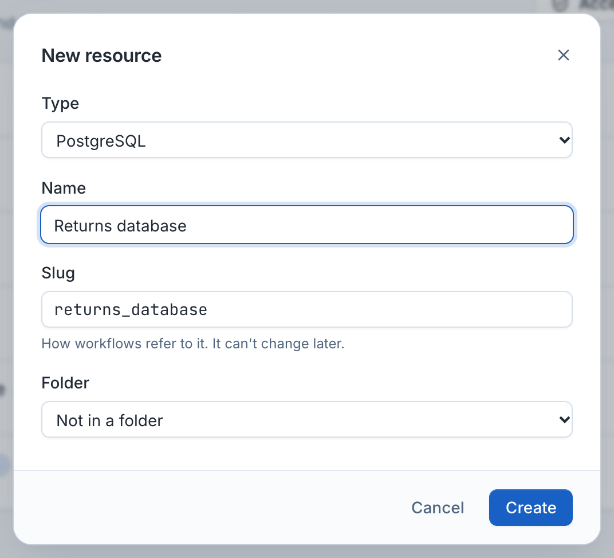

1. Open **Resources** and click **New resource**. Pick the type, a name and a folder.
2. The resource opens on its **Settings** tab, for one environment at a time. The environment buttons above the tabs
   switch between them; an environment without settings says "(not configured)".
3. Fill in the settings for **Production**. Click **Test connection**, then **Save**.
4. Switch to **Staging** and fill in its own settings (a test database, a sandbox account). Leave it unconfigured if
   there is nothing to point it at.
5. Open the **Access** tab and grant Use to the groups that need it, per environment.

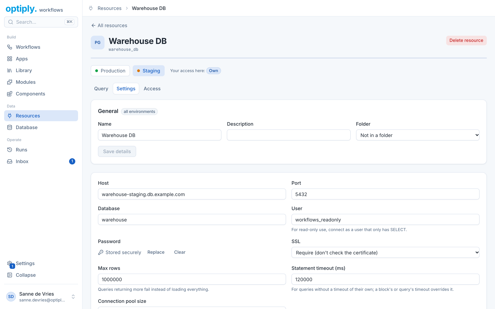

The **Query** tab is a playground for trying a query against the chosen environment.

### Secrets

Passwords, tokens, keys and client secrets are **write-only**:

- They are encrypted before they are stored, with the server's encryption keys (A9). They never come back to the
  browser, appear in logs or go into Git.
- A stored secret shows as **Stored securely**, with **Replace** and **Clear**. There is no way to read it back: keep
  the original in Optiply's password manager if you'll need it again.
- An environment with settings but a missing secret says "(needs secrets)" on its button, and the form says what to
  add.

> **Important:** The encryption keys live only in the production secret store (A9). A database backup without them
> has no usable secrets. Never change or delete them by hand.

### OAuth sign-in resources

Some resources sign in through the service's own consent screen (OAuth): Google Sheets, Gmail, Slack, HubSpot,
Microsoft Teams, Salesforce, Snowflake (JDBC), SDK resources and generic REST APIs.

1. Register an OAuth app (client) with the provider.
2. In the resource, fill in the client ID, the client secret and the scopes.
3. Copy the **Redirect URI** shown under the form into the provider's app. It is built from the app's own address, so
   it changes if the address changes (A9, "Moving to workflows.optiply.nl").
4. Choose **Accounts**:

   | Choice | What happens |
   |---|---|
   | **One shared account** | Someone with Edit connects one account per environment; every query uses it. |
   | **Each person's own account** | Each person connects their own; a query runs as whoever runs it. Workflows using such a resource can't be published (a live run has nobody to act as). |

5. **Save**, then **Connect account** (or **Connect your account**). The panel shows the connected account, when it
   was connected and its scopes. **Disconnect** removes it and revokes it at the provider where possible.

> **Tip:** For a shared account, connect a team mailbox or service user rather than your own account, so nothing
> breaks when you leave. A Google OAuth client for Optiply's own use should have an **Internal** consent screen: no
> Google review is needed then.

### SSH tunnels

A PostgreSQL, MySQL, Microsoft SQL Server, JDBC, GraphQL or REST resource can reach a database or API that isn't
on the internet through an SSH server (a "bastion"), with up to two jump hosts before it. The app makes the tunnel
itself; nobody has to keep a terminal open.

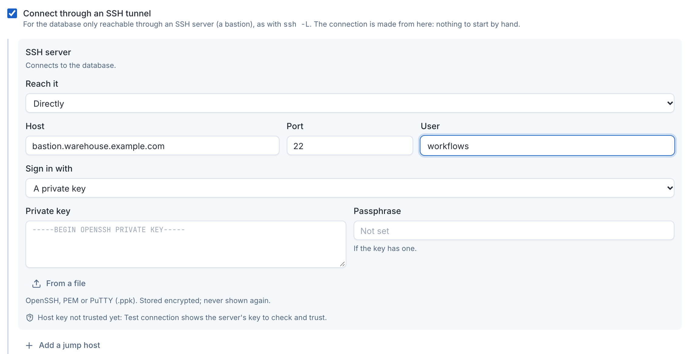

1. **Make a key for the app alone**, not someone's own key:

   ```bash
   ssh-keygen -t ed25519 -C optiply-workflows -f optiply-workflows
   ```

   OpenSSH, PEM and PuTTY (`.ppk`) keys work; a password works too.
2. **On the SSH server**, as the user the app signs in as: add the public key to `~/.ssh/authorized_keys` and allow
   forwarding for that user (`AllowTcpForwarding yes`, and `PermitOpen db.internal:5432` to allow only what's needed).
   The user needs no shell.
3. **In the resource's settings** (each environment): the database's host and port **as the SSH server sees them**
   (`localhost` means the SSH server itself), then **Connect through an SSH tunnel**: the SSH server's host, port,
   user and private key. **Save.**
4. **Trust the host key.** Click **Test connection**. It shows the SSH server's host key fingerprint (`SHA256:…`).
   Ask whoever runs the server to confirm it (`ssh-keygen -lf /etc/ssh/ssh_host_ed25519_key.pub` on the server). If
   it matches, click **Trust this key**, then **Save**.

> **Important:** If Test connection ever says a host key **changed**, don't trust the new one until the server's owner
> confirms they replaced it. Otherwise something may be sitting between the app and the server.

#### Through Google Cloud IAP

For a Google Cloud VM with no public SSH port, the app can reach the SSH server through Google's Identity-Aware Proxy
(what `gcloud compute start-iap-tunnel` does, but inside the app).

1. Note the VM's project, zone, instance name and SSH port. A firewall rule must let IAP's range `35.235.240.0/20`
   reach that port.
2. Choose the Google identity that opens the tunnel. It needs the **IAP-secured Tunnel User** role
   (`roles/iap.tunnelResourceAccessor`) on the VM or its project.

   | Identity | How | Who may choose it |
   |---|---|---|
   | **A service account key** | A JSON key for a service account made for the app alone, pasted into the resource (stored encrypted) | Anyone with Edit |
   | **The server's own identity** | The production VM's service account (A9). Only works when the server allows it (`GOOGLE_SERVER_IDENTITY=allow`) | Admins only |

3. In the settings: **Reach it: Through Google Cloud IAP**, the project, zone, instance and port, then the SSH user and
   key as before. **Save**.
4. **Test connection** shows a line for IAP first ("Google Cloud IAP to project/zone/instance:22 · as …"), then the
   host key to trust, then the database.

#### When a tunnel fails

Test connection reports each step. The common messages:

| It says | What to do |
|---|---|
| Host key isn't trusted yet | Check the fingerprint and trust it |
| Host key changed | See the Important note above |
| Signing in as *user* was refused | The public key isn't in that user's `authorized_keys`, or the user or password is wrong |
| Couldn't connect, or didn't answer in time | The host or port, or a firewall between the app and the SSH server |
| Couldn't open a connection to *host:port* | The SSH server can't reach the database, or forwarding is off for the user |
| Google IAP refused the identity | The identity lacks the IAP-secured Tunnel User role, or its key was deleted |
| Google IAP couldn't find the VM, or connect to its port | The project, zone or instance name, or the firewall rule for `35.235.240.0/20` |

A tunnel that drops is noticed within about 45 seconds and connected again on the next query; nothing needs
restarting.

### Choices only admins can make

Some settings reach further than one person's credentials, so only admins may choose them (or point them somewhere
else). Editors can keep such settings and change the rest of the resource.

| Setting | Why it's admin-only |
|---|---|
| An SSH tunnel through IAP with **the server's own Google identity** | It may reach VMs no one's key does |
| Google Sheets or Gemini (Vertex AI) with **the server's own Google identity** | The same identity, other Google services |
| Gmail with **a Workspace service account with domain-wide delegation** | One key can act as any mailbox of the domain |
| S3 with **the server's own AWS credentials**, or another region or role with them | They may reach what no one's key does |
| An S3 resource's own **Endpoint** (another S3-compatible store) | Signed requests and data go there |
| An SDK resource's **Allow a private network address** | Lets the SDK reach Optiply's internal network |

> **Note:** The production server currently allows no server identity unless `GOOGLE_SERVER_IDENTITY=allow` is set
> in its settings (A9), and it doesn't allow the server's AWS credentials at all.

### Private networks

To protect internal systems, resources refuse private addresses (this network, `localhost`, internal names) unless
told otherwise:

- **REST, GraphQL and several service resources** have **Allow private network addresses** (or **Allow a private
  network address**) in their settings, for a system inside Optiply's network. Anyone with Edit can tick it.
- **The built-in REST API resource** never reaches a private address, except hosts an admin lists in the server
  setting `REST_API_PRIVATE_HOSTS` (comma-separated names or `*.internal.example` patterns; A9, "Changing a server
  setting"). For anything more, make a REST resource.
- Traffic that goes **through an SSH tunnel** reaches the SSH server's network; the private-network rule doesn't
  apply to it.

### The built-in resources

Two resources come with the app. Their settings can't be changed.

| Resource | What it is | Who may use it at first |
|---|---|---|
| **REST API** (`rest_api`) | Any public URL, with the query's own sign-in; secrets come from secret config vars | Everyone (All Users has Use) |
| **Database** | The app's own managed tables (the Database section), one set per environment, each with its own database user | Admins only |

Narrow or widen either on its **Access** tab, as for any resource.

### JDBC resources and the JDBC runner

A JDBC resource queries databases that need a Java driver: **Oracle, Snowflake and ClickHouse** are built in, and
admins can upload others (A7). Queries run in a small Java service, the **JDBC runner**, next to the app.

- **Read-only** is a resource setting: only statements that read are sent. It guards against mistakes, not against a
  determined user: for real safety, sign in as a database user that can only read.
- Put passwords and keys in the sign-in fields or the secret properties, never in the URL.
- An Oracle wallet zip and a Snowflake private key are stored encrypted like any secret.
- JDBC resources can use SSH tunnels and IAP like PostgreSQL; also list the **hosts to reach through the tunnel**.

### SDK resources

An SDK resource calls a company's Python or JavaScript package. The package is installed by the package builder and
every call runs in a sandbox whose only way out is to the resource's **Allowed hosts**.

- Pin package versions (`acme-sdk==1.4.2`).
- Private packages come from the indexes and registries in A7.
- **Allow a private network address** is admin-only (see above).
- **Test connection** installs the packages (the first time can take a minute) and describes the client.

### AI resources and budgets

AI resources (Anthropic, OpenAI-compatible providers and Gemini) call a language model.

- **One key per environment.** Give Staging a key with a low spend limit at the provider.
- **Token budget per run**: the most input and output tokens all AI calls of one workflow run may use together. A call
  that would start over the budget fails with `ai_budget`. Set a budget on every AI resource used by workflows that run
  by themselves (schedules, webhooks, loops).
- **Apps and the playground have no budget** (each query is one call): keep an eye on spending at the provider.
- **Hide prompts in run history**: turn it on when prompts contain personal data. Otherwise everyone who can see a run
  sees the prompts that were sent.
- Gemini on Vertex AI can use the server's own Google identity (admins only).

> **Tip:** Set a monthly spend limit in the provider's own console as well. The run budget limits one run, not the
> month.

## A4. Environments and config vars

### Environments

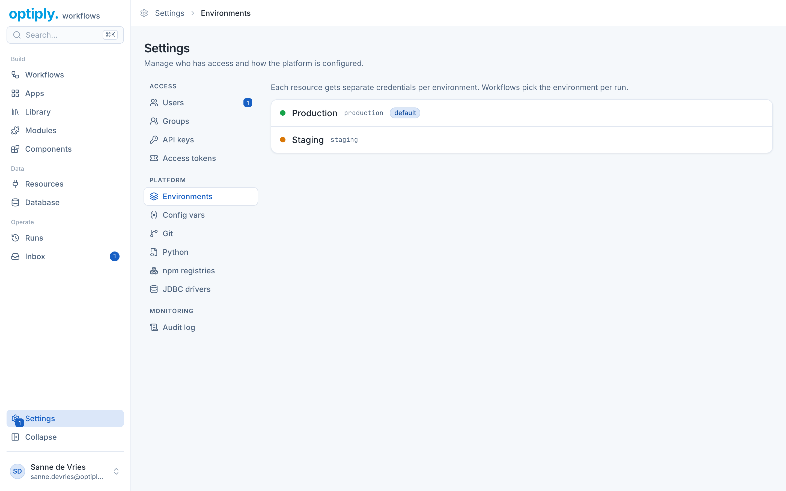

The app has two environments: **Production** (the default) and **Staging**. They can't be added to or changed in the
app.

**Staging is for admins only** (the "Admins only" badge). Everyone else doesn't see it anywhere: not in the environment
choices of workflows, apps and the Database, not on a resource's settings. They can't run, query or set credentials
there, nor see the runs made there; a grant for "every environment" doesn't reach it. Only admins can grant anything in
Staging, or publish a workflow whose schedule or webhook names it. A webhook that runs in every environment (an
API-key webhook by default) runs in Production only; it runs in Staging only when its settings name it. Production is
always the default, and the default environment can never be made admins-only.

- Every resource has **separate settings per environment**: production credentials in Production, test credentials
  in Staging.
- A workflow runs in one environment at a time (its settings choose it; User Guide, chapter Workflows), and its
  queries use that environment's settings of each resource.
- Config vars have a value per environment.
- The managed Database has its own tables per environment.

### Config vars

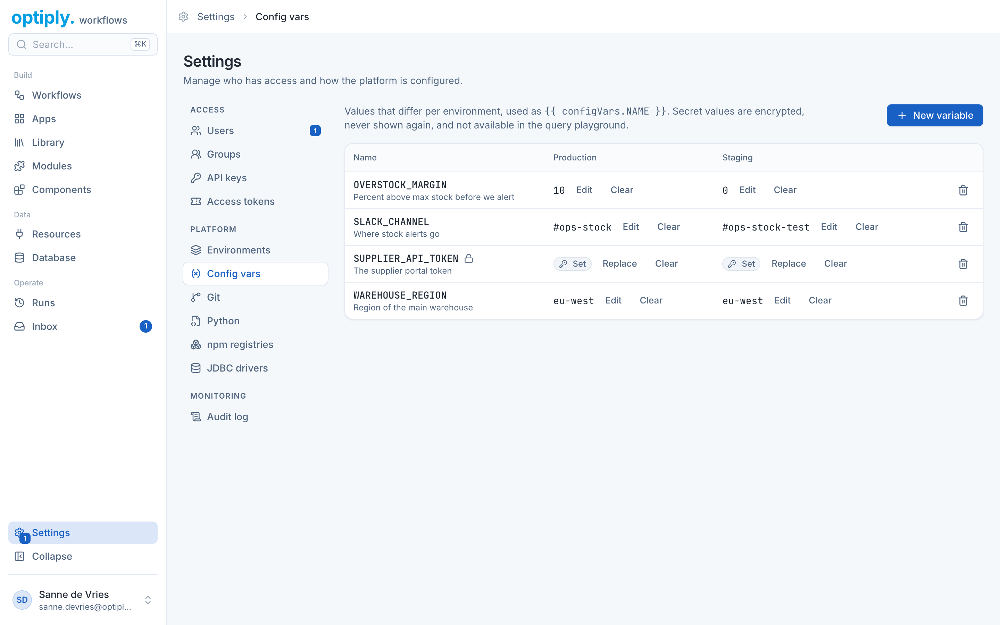

Config vars are named values that differ per environment, used in workflows, apps and resources as
`{{ configVars.NAME }}`. Only admins create and change them.

**To create one:**

1. **Settings → Config vars → New variable.**
2. **Name**: letters, digits and underscores, e.g. `API_BASE_URL`. **Description**: what it's for.
3. Tick **Secret** for anything sensitive (a token, a signing secret). This can't be changed later.
4. Click **Create**.
5. In the table, click **Set** in each environment's column, type the value and **Save**.

| | Plain | Secret |
|---|---|---|
| Stored | As is | Encrypted, like resource secrets |
| Shown | In the table, editable | Only **Set** or **Not set**; **Replace** or **Clear** |
| Available to | Drafts, published releases, the playground | **Published runs only**: a draft run or the playground gets nothing |

> **Important:** Because secret config vars reach published runs only, a builder can't test a call that needs one
> from a draft. Tell builders to publish first, or give them a test value through a plain variable in Staging.

Secret config vars also hold the passwords and tokens for:

- webhook signature secrets (a workflow's webhook trigger names the variable);
- private Python package indexes and npm registries (A7), where the **default environment's** value is used.

Delete a variable with the bin icon; it is removed in every environment, and anything using it gets nothing.

If Git sync is set up (A6), a variable can be protected in Git like a workflow; secret values never go into Git.

## A5. API keys and personal access tokens

There are two kinds of credentials for programs. Both are shown **once** when made, stored only as a hash, and can't
be read back.

| | API keys | Access tokens |
|---|---|---|
| For | Other systems calling workflow webhooks (and reading the runs they started) | The components command-line tool (`ow-components`) |
| Sent as | The `X-Api-Key` header | `Authorization: Bearer owpat_…` |
| Acts as | The key itself, limited to its workflows and environments | The person who made it, limited to component libraries |
| Made by | Admins (Settings → API keys) | The person themselves (Settings → Access tokens) |

### API keys

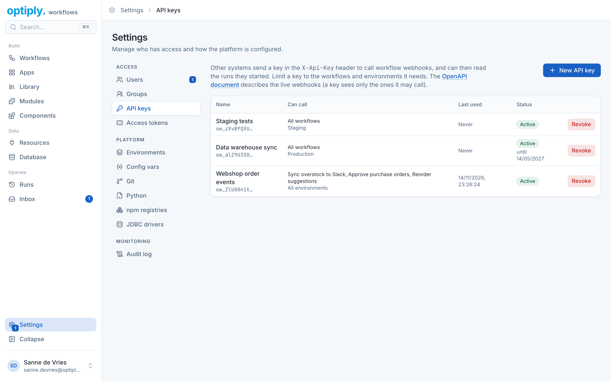

Webhook triggers ask for an API key by default (User Guide, chapters Workflows and The API). Since only admins can
make keys, builders ask you for one.

1. **Settings → API keys → New API key.**
2. **Name**: who or what uses it, e.g. "Shopify order sync".
3. **Workflows**: untick **All workflows** and tick only the workflows this caller needs.
4. **Environments**: untick **All environments** and tick only the ones it needs (often just Production).
5. **Expires** (optional): the key stops working after this day.
6. Create it. Copy the key from the box ("Copy the key now: it won't be shown again"), then click **I've copied it**.
7. Hand the key over through the password manager, never by chat or email.

The table shows each key's **Name**, what it **Can call**, when it was **Last used**, and its **Status** (Active,
Expired, Revoked). **Revoke** stops a key at once; there is no undo, so make a new one if needed.

The OpenAPI document linked on the page describes the live webhooks; a caller with a key sees only the ones its key may
call. Everything a key can call, and how, is in A11.

> **Tip:** One key per calling system. When a partner's integration is retired or a key leaks, you revoke one key
> without breaking the others.

### Personal access tokens

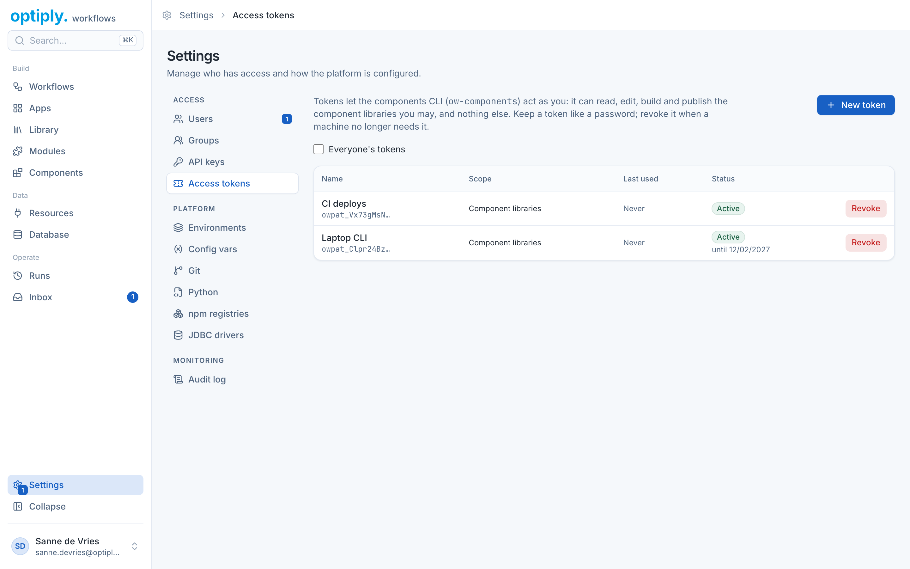

A token lets the components command-line tool act as the person who made it: it can read, edit, build and publish the
component libraries that person may, and nothing else.

1. **Settings → Access tokens → New token.**
2. **Name**: where it's used ("my laptop", "components repo CI"). **Expires**: 30 days, 90 days, a year or never.
   The scope, **Component libraries**, is the only one.
3. **Create token**, copy it, **I've copied it**.

The page lists your own tokens; tick **Everyone's tokens** to see everyone's, with whose they are, and **Revoke** any
of them. Disabling a person also stops their tokens.

> **Note:** Settings is only open to admins, so at the moment only admins can make access tokens, and a token always
> acts as its maker. You can't make one on someone else's behalf: a token you make acts with your admin rights on
> component libraries. Keep tokens short-lived, and revoke them when a machine no longer needs them.

## A6. Git sync

Git sync is optional. When it is set up, **protected** workflows, apps, library queries, modules, resources and config
vars live in a Git repository: changes go through pull requests (GitHub) or merge requests (GitLab), and merging into
the **deploy branch** deploys them to this instance. Builders' side of it is in the User Guide.

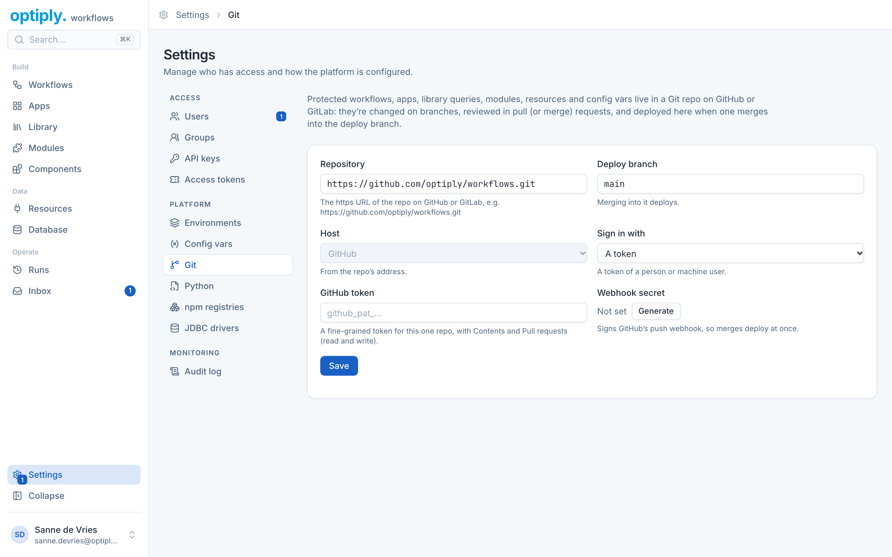

### Connecting a repository

1. Get credentials for the repository:
   - **GitHub, a token:** a fine-grained personal access token for this one repository with **Contents** and **Pull
     requests**, read and write. Better from a machine user than a person.
   - **GitHub, a GitHub App** (preferred: it isn't tied to a person): an App with Contents and Pull requests (read and
     write) and Metadata (read), installed on the repository only; note its App ID and generate a private key.
   - **GitLab:** a project access token with the Developer role and the **api** and **write_repository** scopes.
2. **Settings → Git**: the repository's https URL, the **deploy branch**, the host (GitHub or GitLab), **Sign in with**,
   and the token or the App's ID and private key. **Save**.
3. **Test connection**: it checks both git and the host's API, and warns when the credentials can't push or open
   requests.
4. Optional but recommended: **Generate** a webhook secret (copy it before saving), save, and add a push webhook on
   the host pointing at `https://<the app's address>/api/git/webhook` with that secret. Merges then deploy within
   seconds instead of within a minute.

Credentials are stored encrypted and never shown again. Pointing the repository at another server asks for them
again.

### Keeping it working

- **Deploy problems** (for example a commit naming a resource this instance lacks) show to admins as a banner and as
  a count on the Git tab. Deploys retry by themselves every few minutes and when the instance changes.
- Branch protection on the deploy branch is expected: the app pushes to its own branches and opens requests.
- Common errors: "Authentication failed" (an expired or revoked token), "The GitHub App isn't installed on …",
  "The token needs Pull requests (read and write)". Fix the credentials in Settings → Git and test again.
- Settings changes are in the audit log (`git.settings_updated`), without secret values.

## A7. Package registries and drivers

### Python package indexes

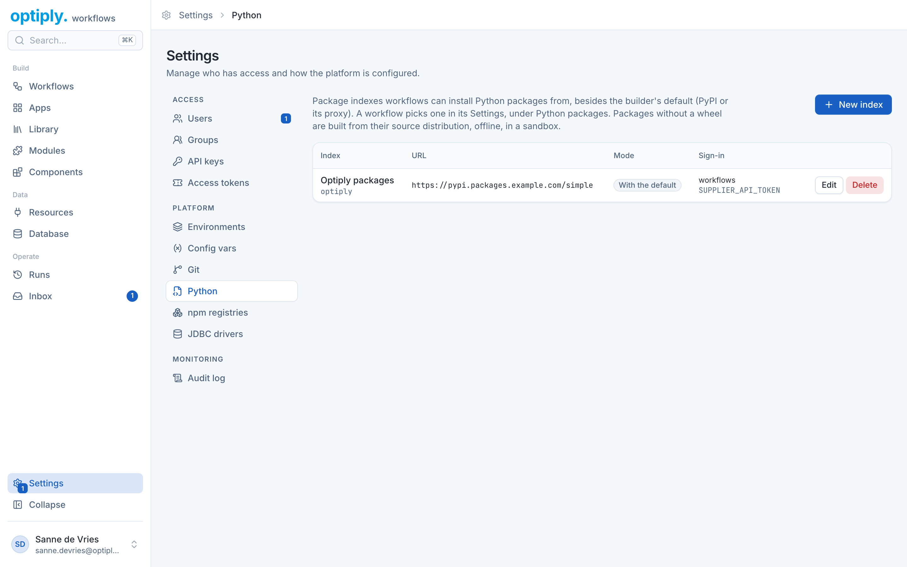

Workflows can install Python packages from PyPI. For private packages, add an index:

1. Create a **secret config var** with the index's password or token, with a value in the **default environment**
   (Production). One value serves every environment.
2. **Settings → Python → New index**: **Name**, **Slug** (workflows name the index by it; it can't change later),
   **URL** (the simple index, without credentials), **Mode**, **Username** (optional; some indexes use `__token__`),
   **Password** (the config var).
3. **Test** it, then save.

| Mode | Means |
|---|---|
| **With the default index** | Searched beside PyPI. A public package with the same name and a higher version would win, so builders should pin private packages exactly (`name==1.2.3`). |
| **Instead of the default index** | The only index for workflows that pick it, so it must also mirror PyPI (Artifactory, Nexus, GitLab with PyPI forwarding). |

Builders pick the index in a workflow's Python package settings. An index can't be deleted while a workflow's draft or
live version uses it. Packages without a ready-made wheel are built offline in a sandbox.

### npm registries

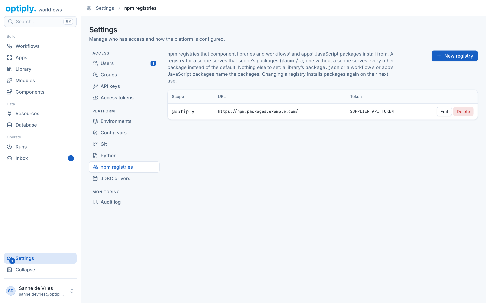

The same registries serve workflows' and apps' JavaScript packages, component libraries and JavaScript SDK
resources.

1. Create a **secret config var** with the registry's token (value in the default environment).
2. **Settings → npm registries → New registry**: a **Scope** (`@acme`: that scope's packages come from this
   registry; empty: every package without a registry of its own, replacing the public registry), the **URL**, and the
   **Token** config var.
3. **Test** it (it asks the registry who the token belongs to), then save.

> **Important:** Whoever defines registries and indexes chooses which secret goes to which address, and **Test** sends
> it. Only point secrets at registries you trust.

### JDBC drivers

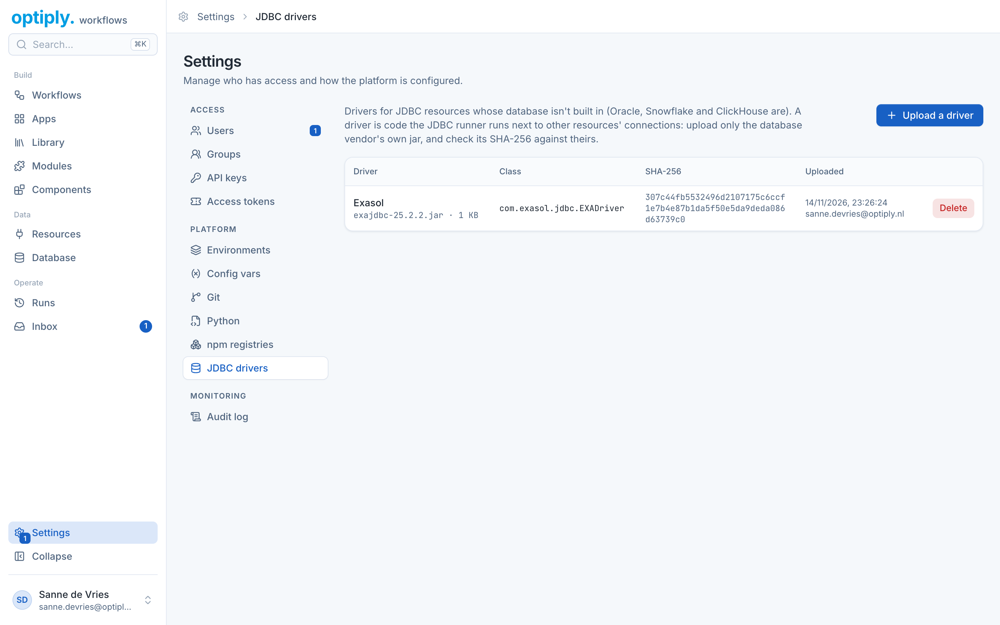

For a database the built-in JDBC drivers don't cover (DB2, Exasol, SAP HANA, Teradata, Databricks…):

1. Download the vendor's own driver jar: the single ("shaded", "all") jar, up to 100 MB. A driver that needs other jars
   beside it won't load.
2. **Settings → JDBC drivers → Upload a driver**: a **Name** (how resources list it, e.g. "IBM DB2 12"), the **Driver
   class** from the vendor's documentation (e.g. `com.ibm.db2.jcc.DB2Driver`), and the **Jar**.
3. Compare the SHA-256 the page shows with the one the vendor publishes.

> **Important:** A driver is code that runs on the server next to other resources' connections. Upload only jars from
> the database vendor.

A driver can't be deleted while a resource uses it.

## A8. The audit log

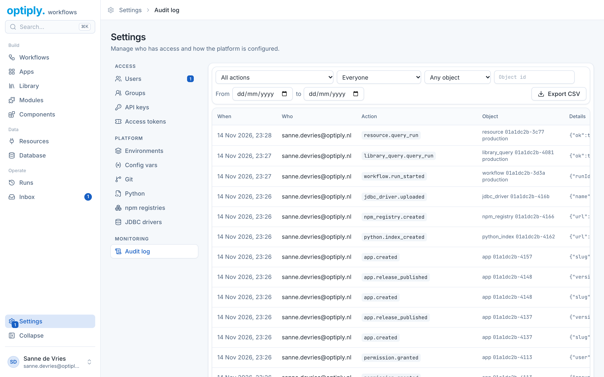

**Settings → Audit log** records who did what, and when: sign-ins and failed sign-ins, people approved, rejected or
disabled, group membership, access granted and revoked, resources and config vars created or changed, workflows and
apps published, runs started and cancelled, API keys and tokens made and revoked, Git events, package indexes and
drivers, and more. Secret values are never recorded.

- **Filter** by action (**All actions**), person (**Everyone**), object type (**Any object**), an object id, and a
  date range (**From**, **To**). **Clear** resets the filters.
- The table shows **When**, **Who**, **Action**, **Object** and **Details**, 50 at a time; load more at the bottom.
- **Export CSV** downloads what the filters show (the export itself is recorded too).

Useful actions to filter on:

| Action | When |
|---|---|
| `auth.login`, `auth.login_failed` | Sign-ins |
| `user.requested`, `user.approved`, `user.rejected`, `user.disabled`, `user.enabled` | People coming in or being stopped |
| `user.access_changed` | Someone switched between Whole platform and Apps only (`from`, `to`) |
| `group.member_added`, `group.member_removed` | Group membership (including Admins) |
| `permission.granted`, `permission.revoked` | Access changes |
| `resource.config_saved`, `resource.oauth_connected` | A resource's settings or account changed |
| `config_var.updated` | A config var's value changed |
| `workflow.release_published`, `app.release_published` | New versions published |
| `api_key.created`, `api_key.revoked`, `access_token.created` | Credentials made or stopped |

The audit log isn't removed by the run history clean-up. For questions the page can't answer, use the read-only
database access and the ready-made queries in A9.

## A9. Running production

### The setup

Production is the app at **https://104-196-197-26.sslip.io** (a temporary address until `workflows.optiply.nl`
exists). It runs on Google Cloud, in the project **`optiply-workflows`**:

| Part | What and where |
|---|---|
| The server | One VM, **`ow-prod`**: an **e2-micro** (2 shared CPUs, 1 GB of memory), Debian 12, zone `us-east1-b`, 30 GB standard disk |
| Its address | Static IP `ow-prod-ip` (104.196.197.26) |
| What runs on it | Docker Compose, from `/opt/ow`: the app (web, API and worker in one process), PostgreSQL, the Python executor and package builder, the SDK runner, the JDBC runner, and **Caddy**, which serves HTTPS with a Let's Encrypt certificate it renews itself |
| Settings and secrets | Google **Secret Manager**: `ow-env` (every setting and secret the server reads) and `ow-db-readonly` (the read-only database user's password) |
| Images | **Artifact Registry** `us-east1-docker.pkg.dev/optiply-workflows/ow`, the 3 newest versions kept |
| Builds | **Cloud Build** |
| Backups | Bucket `gs://optiply-workflows-backups`, a database dump every night at 03:00 UTC, each kept 30 days |
| The VM's identity | Service account `ow-vm-prod@optiply-workflows.iam.gserviceaccount.com` |
| Firewall | Ports 80 and 443 open to everyone; SSH only through IAP; nothing else |

> **Important:** **The budget is €5 a month at most.** Everything above was chosen to fit Google Cloud's free tier: one
> e2-micro VM in a US region, a 30 GB standard disk, 5 GB of storage, 1 GB of outgoing traffic a month. A budget alert
> warns at 50 %, 90 % and 100 % of €5, but **it doesn't stop spending**. Before adding or resizing anything, check its
> price and get approval.

The server is small, so it is tuned for it: the app runs one process, PostgreSQL uses little memory, each runner
runs one job at a time, and the VM has compressed swap in memory plus a 1 GB swap file.

### The access you need

To do anything below you need a Google account with rights in the `optiply-workflows` project (ask a project owner)
and the `gcloud` CLI. Commands in this chapter use:

```bash
gcloud config set project optiply-workflows
```

To open a shell on the server (through IAP; there is no public SSH port):

```bash
gcloud compute ssh ow-prod --zone us-east1-b --tunnel-through-iap --project optiply-workflows
```

On the server, every Docker command uses the production Compose file. For example, to see what runs:

```bash
sudo docker compose -f /opt/ow/docker-compose.prod.yml ps
```

### Deploys

#### Automatic deploys

Production is updated **once a day, on weekdays at 18:00 Amsterdam time**. Merging into `main` doesn't deploy by
itself: everything merged during the day goes out together at 18:00 (it may start a few minutes late). Nobody's
computer needs to be on: it all runs in GitHub and Google Cloud. The **Deploy** workflow in GitHub Actions:

1. takes the newest commit on `main` whose CI (the tests) passed. If production already runs it, it stops: nothing new
   to deploy. Changes to the documentation alone never run CI, so they never cause a deploy;
2. builds the images on Cloud Build, tagged with the commit's 7-character hash (about 8 minutes);
3. copies the deployment files to the VM;
4. runs `/opt/ow/deploy.sh <tag>` there, which fetches the settings from Secret Manager, pulls the images, runs the
   database migrations and restarts what changed;
5. checks `https://104-196-197-26.sslip.io/api/health` for up to 3 minutes. If it doesn't answer 200, it **rolls back**
   to the previous version and the run fails.

Deploys run one at a time; a newer one waits for the running one. GitHub signs in to Google Cloud without a stored
key, and only the `main` branch may deploy. When a scheduled deploy fails, GitHub emails the person who last changed
the schedule; production has already rolled back by then.

> **Note:** the repository is public, so GitHub switches the schedule off after 60 days without any activity in it.
> If production stops updating, check **Actions** → **Deploy**: if it says the workflow is disabled, click **Enable
> workflow**.

#### Deploying or rolling back by hand

For an urgent fix that can't wait for 18:00, or to roll back. In GitHub: the repository's **Actions** tab →
**Deploy** → **Run workflow** (on `main`).

- Leave **tag** empty to build and deploy the head of `main`. This doesn't wait for CI: check that CI on `main` is
  green first.
- Enter a tag to deploy a version that was already built, for example to roll back. Tags are 7-character commit hashes
  (the first production version is `s54a`).

> **Note:** Artifact Registry keeps only the **3 newest** versions. To go back further, the older commit must be
> built again (see below).

On the server, the version running and the one before it are in two files:

```bash
cat /opt/ow/.current-tag /opt/ow/.previous-tag
```

To roll back from the server itself:

```bash
sudo /opt/ow/deploy.sh $(cat /opt/ow/.previous-tag)
```

Migrations only ever add to the database, so an older version runs on a newer database. If a migration ever doesn't
work that way, restore the backup taken before it (below).

#### Building and deploying from your machine

Only when GitHub Actions can't be used. From a clean checkout of the commit you want:

```bash
TAG=$(git rev-parse --short=7 HEAD)
gcloud builds submit --project optiply-workflows --region us-east1 \
  --config deploy/cloudbuild.yaml --substitutions _TAG=$TAG .
```

Then on the server: `sudo /opt/ow/deploy.sh <tag>`. If files in `deploy/` changed in that commit, copy them to
`/opt/ow` first (with `gcloud compute scp … --tunnel-through-iap`, then `sudo cp`), as the Deploy workflow does.

### Changing a server setting

Every setting (the address, sign-in, encryption keys, runner tokens, `REST_API_PRIVATE_HOSTS`,
`GOOGLE_SERVER_IDENTITY`, `WORKER_CONCURRENCY`…) is one line in the secret **`ow-env`**. To change one:

1. On a trusted machine, fetch the current version into a file only you can read:

   ```bash
   umask 077
   gcloud secrets versions access latest --secret=ow-env --project optiply-workflows > ow.env
   ```

2. Edit the line you need. Don't touch `ENCRYPTION_KEYS` or `ENCRYPTION_KEY_CURRENT` (see the Important note below).
3. Add it as a new version and delete the local file:

   ```bash
   gcloud secrets versions add ow-env --data-file=ow.env --project optiply-workflows
   rm ow.env
   ```

4. Apply it: deploy the current version again (**Run workflow** with the current tag, or on the server
   `sudo /opt/ow/deploy.sh $(cat /opt/ow/.current-tag)`).
5. When it works, destroy old versions you no longer need (Secret Manager is free for up to 6 active versions):

   ```bash
   gcloud secrets versions list ow-env --project optiply-workflows
   gcloud secrets versions destroy <version number> --secret=ow-env --project optiply-workflows
   ```

> **Important:** The **encryption keys** in `ow-env` decrypt every stored secret (resource credentials and secret config
> vars). If they're lost or changed, those secrets can't be read again, from the live database or from any backup.
> They are kept apart from the backups on purpose. Rotating them is a developer's job (a `rekey` command exists).

### Backups and restore

A dump of the whole database goes to `gs://optiply-workflows-backups` every night at 03:00 UTC and is deleted after 30
days. It holds everything: workflows, apps, resources (secrets encrypted), people, access, run history, the audit log
and the managed Database tables. It does **not** hold the encryption keys.

**Check that backups are happening:**

```bash
gcloud storage ls -l gs://optiply-workflows-backups/
```

The newest file should be from last night. On the server, the backup's log is `/var/log/ow-backup.log`. To take one
now (before a risky change, say): `sudo /opt/ow/backup.sh` on the server.

**To restore a backup** (this replaces the live data with the backup's; everything since the backup is lost):

1. Take a backup of the current state first: `sudo /opt/ow/backup.sh` on the server.
2. On your machine, download the dump you want (the server can write to the bucket but not read it):

   ```bash
   gcloud storage cp gs://optiply-workflows-backups/ow-<date>.dump .
   ```

3. Copy it to the server:

   ```bash
   gcloud compute scp ow-<date>.dump ow-prod:/tmp/ --zone us-east1-b --tunnel-through-iap --project optiply-workflows
   ```

4. On the server, stop the app so nothing writes, then restore:

   ```bash
   sudo docker compose -f /opt/ow/docker-compose.prod.yml stop app
   sudo docker compose -f /opt/ow/docker-compose.prod.yml exec -T postgres \
     pg_restore -U ow -d optiply_workflows --clean --if-exists --no-owner < /tmp/ow-<date>.dump
   ```

5. Start everything again (this also brings the database up to date with migrations):

   ```bash
   sudo /opt/ow/deploy.sh $(cat /opt/ow/.current-tag)
   ```

6. Check `https://104-196-197-26.sslip.io/api/health`, sign in, and open a resource's **Test connection** to confirm
   secrets still decrypt. Delete the dump from `/tmp` and from your machine.

After a restore, runs that were under way at backup time resume from their last finished block; schedules catch up
with one run; webhook calls made while the app was down failed and their callers must retry.

> **Tip:** Practise a restore every quarter on a copy, not on production: restore a dump into a local PostgreSQL and
> look around. The steps are in `docs/runbooks/backup.md`.

### Looking at the data

The app's own pages answer most questions: Settings → Users (people, groups, last sign-in) and Settings → Audit log.
For anything else, connect a database app (TablePlus, DBeaver, pgAdmin) as the **read-only** user:

1. Open a tunnel and keep the terminal open:

   ```bash
   gcloud compute ssh ow-prod --zone us-east1-b --tunnel-through-iap --project optiply-workflows \
     -- -N -L 5433:127.0.0.1:5432
   ```

2. Connect to host `localhost`, port `5433`, database `optiply_workflows`, user **`ow_readonly`**. The password:

   ```bash
   gcloud secrets versions access latest --secret=ow-db-readonly --project optiply-workflows
   ```

`ow_readonly` can read every table, including the managed Database tables (`owdb_production`, `owdb_staging`), and
nothing else: its sessions are read-only, a query stops after 60 seconds, and it may hold 5 connections at most.

Ready-made queries are in **`docs/runbooks/common-queries.sql`** in the repository: people and access (who is waiting,
who is an admin, who has access to what), workflows and runs (failed runs, runs per day, what is running now), apps,
resources (which use SSH tunnels), config vars (without secret values), the audit log, and the database's size.

> **Note:** The `ow_readonly` user was made by hand on the server; database users aren't part of a backup. On a new
> server (moving to Europe, say) it must be made again.

### Moving to workflows.optiply.nl

Planned; not done yet. Whoever manages optiply.nl's DNS must take part.

1. Add a DNS **A record** `workflows.optiply.nl` → `104.196.197.26` (the static IP `ow-prod-ip`).
2. Change two lines in `ow-env` (see "Changing a server setting"): `SITE_ADDRESS=workflows.optiply.nl` and
   `PUBLIC_URL=https://workflows.optiply.nl`.
3. In Optiply's Auth0 (`optiply.eu.auth0.com`) → **Applications** → **Optiply Workflows**, add
   `https://workflows.optiply.nl` to **Allowed Callback URLs** and **Allowed Logout URLs** (the app signs in and out at
   the site's root). Whoever manages Optiply's Auth0 does this.
4. Change the health check address in the repository's `.github/workflows/deploy.yml` (the `SITE` line) to
   `https://workflows.optiply.nl`, and merge it. Otherwise the next deploy checks the old address, fails and rolls
   back.
5. Deploy by hand (**Run workflow**, tag empty) rather than waiting for 18:00. Caddy gets a certificate for the new name by itself.
6. Afterwards: everyone signs in again; webhook URLs given to other systems change; every **OAuth resource's redirect
   URI** changes, so register the new one with each provider and reconnect accounts if asked.

### Giving the server more memory

If the app is slow and the server swaps a lot (see A10), the VM can be made bigger. **This is not free** (about €13 a
month for 2 GB, €25 for 4 GB) and goes over the €5 budget: get approval first.

```bash
gcloud compute instances stop ow-prod --zone us-east1-b --project optiply-workflows
gcloud compute instances set-machine-type ow-prod --machine-type e2-small --zone us-east1-b --project optiply-workflows
gcloud compute instances start ow-prod --zone us-east1-b --project optiply-workflows
```

(`e2-small` is 2 GB, `e2-medium` 4 GB.) The app is offline for a few minutes. Then raise `WORKER_CONCURRENCY`,
`PYTHON_MAX_CONCURRENT`, `SDK_MAX_CONCURRENT` and `JDBC_HEAP_MB` in `ow-env` and deploy again.

### Moving to Europe

The free VM exists only in US regions; an e2-micro in Europe costs about €7 a month, over the budget. If approved: a
new VM in a European region (for example `europe-west4`) set up as the first one was (`deploy/vm-setup.sh` and
`docs/runbooks/deploy.md`), a backup restored on it, the `ow_readonly` user made again, the address moved (DNS, or a new
sslip.io name with the steps above), then the old VM deleted. About an hour of work, a few minutes offline.

### Reaching Optiply's production databases (pending)

Several resources query Optiply's own production PostgreSQL databases. Those databases are reached through an SSH
server called **`bastion`** (Google Cloud project `clear-veld-186016`, zone `europe-west1-c`) that has no public SSH
port, so the resources go **through Google Cloud IAP with the server's own identity**.

On the production VM, the server's identity is the service account
`ow-vm-prod@optiply-workflows.iam.gserviceaccount.com`. It **doesn't yet have** the IAP-secured Tunnel User role on
`bastion`, and granting it needs rights in `clear-veld-186016`. Until then, these resources can't connect from
production. A decision is pending; the options are in a separate document:

| Option | What | Then, in the app |
|---|---|---|
| **A** | Someone with rights in `clear-veld-186016` grants `roles/iap.tunnelResourceAccessor` on `bastion` to `ow-vm-prod@optiply-workflows.iam.gserviceaccount.com` | Make sure `ow-env` has `GOOGLE_SERVER_IDENTITY=allow`, deploy, then **Test connection** on one of the resources: the IAP line should say "as ow-vm-prod@…" |
| **B** | A dedicated service account with that role, and its JSON key | In each of the resources, switch the IAP identity to **A service account key** and paste the key; **Test connection**, **Save** |

For option A, the admin of `clear-veld-186016` can use the console (Security → Identity-Aware Proxy → **SSH and TCP
resources** → tick `bastion` → **Add principal** → role **IAP-secured Tunnel User**), which limits it to that VM. From
the command line Google doesn't accept this role on a single VM, so it goes on the project with a condition: SSH to
the bastion's internal address only.

```
IP=$(gcloud compute instances describe bastion --project=clear-veld-186016 \
  --zone=europe-west1-c --format='value(networkInterfaces[0].networkIP)')
gcloud projects add-iam-policy-binding clear-veld-186016 \
  --member=serviceAccount:ow-vm-prod@optiply-workflows.iam.gserviceaccount.com \
  --role=roles/iap.tunnelResourceAccessor \
  --condition="expression=destination.ip == '$IP' && destination.port == 22,title=bastion-ssh-only"
```

`ow-env` already has `GOOGLE_SERVER_IDENTITY=allow` (set when production was created).

## A10. Troubleshooting for admins

For problems builders meet (a query that fails, a run that stops), see the User Guide, chapter Troubleshooting.

### The app is down

1. Check health: `curl -s https://104-196-197-26.sslip.io/api/health` should answer `{"ok":true}`.
2. Open a shell on the server (A9) and see what runs:

   ```bash
   sudo docker compose -f /opt/ow/docker-compose.prod.yml ps
   ```

3. Read the recent logs of the app, and of Caddy if the address doesn't answer at all:

   ```bash
   sudo docker compose -f /opt/ow/docker-compose.prod.yml logs --since 1h app
   sudo docker compose -f /opt/ow/docker-compose.prod.yml logs --since 1h caddy
   ```

4. Restart the app: `sudo docker compose -f /opt/ow/docker-compose.prod.yml restart app`. If it was a bad version,
   roll back (A9).
5. If the VM itself doesn't answer, restart it in the Google Cloud console (Compute Engine → VM instances → `ow-prod` →
   Reset). Everything starts again by itself.

| Symptom | Likely cause |
|---|---|
| The address doesn't load at all, Caddy's log shows certificate errors | DNS or the firewall for ports 80/443; Let's Encrypt must reach the server |
| The app container keeps restarting | A setting in `ow-env` is wrong or missing: its log starts with "Invalid configuration" and names it |
| `migrate` failed, the app doesn't start | Its log (`logs migrate`) says why; roll back, or restore the backup from before |

### A deploy failed

- Open the failed run in GitHub (**Actions → Deploy**). The build step links to the Cloud Build log.
- **The build failed**: production wasn't touched. Fix it on a branch and merge again.
- **The health check failed**: the workflow has already rolled back to the previous version. Look at the app's logs
  for why the new version didn't come up.
- **"Not a valid image tag"**: a hand-run deploy's tag may only contain letters, digits, `.`, `_` and `-`.
- **The tag doesn't exist**: only the 3 newest versions are kept; build it again (A9).

### Sign-in problems

| Message or symptom | Cause | Fix |
|---|---|---|
| Auth0 says "Callback URL mismatch" | The Auth0 application doesn't list the site's address | Add `https://<address>` to **Allowed Callback URLs** and **Allowed Logout URLs** in Auth0 → Applications → Optiply Workflows |
| "Only @optiply.nl accounts or invited people can sign in" | A personal Gmail or a partner's account | Sign in with the @optiply.nl account |
| "Waiting for an admin's approval" | New person | Approve them in Settings → Users |
| "Your request to use Optiply Workflows was not approved" | They were rejected | **Approve** on their row |
| "Your account has been disabled" | Disabled | **Enable** on their row |
| "Login session expired, please try again" | The sign-in took too long, or cookies are blocked | Try again; allow cookies for the site |
| "Sign-in failed" | The server couldn't complete the sign-in with Auth0 | The app's log says "OIDC code exchange failed": check `OIDC_ISSUER` and `OIDC_CLIENT_ID` in `ow-env` against the Auth0 application. `OIDC_CLIENT_SECRET` must **not** be set: Auth0 refuses a secret for this kind of application |
| Everyone is signed out at once | Normal after a change of address or of `SESSION_SECRET` | Sign in again |

### Nobody can administer the app

If no working admin is left, someone with access to the server can make one. On the server:

```bash
sudo docker compose -f /opt/ow/docker-compose.prod.yml exec app \
  node dist/cli/create-admin.js --email someone@optiply.nl --name "Someone"
```

It asks for a password (at least 12 characters). The person is made an active member of Admins, also over a waiting or
rejected account. Password sign-in is off in production, so they then sign in through Optiply's sign-in as usual. Use an
@optiply.nl address: other addresses get no admin powers.

### A resource can't connect

Open the resource, pick the environment, and click **Test connection**: it reports each step (IAP, each SSH hop, the
database or API).

| Symptom | Where to look |
|---|---|
| Fails at the IAP step | The identity's IAP-secured Tunnel User role; the VM's project, zone and name; the firewall rule for `35.235.240.0/20` on the target VM (A3) |
| "The server's identity isn't allowed here" | `GOOGLE_SERVER_IDENTITY=allow` isn't set in `ow-env` |
| Fails at an SSH hop | A3, "When a tunnel fails" |
| A private address is refused | The resource's private-network setting, or `REST_API_PRIVATE_HOSTS` for the built-in REST API (A3) |
| "This instance has no JDBC runner", or the runner isn't reachable | `sudo docker compose -f /opt/ow/docker-compose.prod.yml ps jdbc-runner` and its logs |
| The database refuses the app's address | Production calls out from `104.196.197.26`; the database's own firewall or allowlist must accept it |
| Works in Staging, not Production | The two environments have separate settings and secrets; compare them |

### Disk and memory on the small server

The server has 1 GB of memory and a 30 GB disk.

```bash
free -m                                   # memory and swap
sudo docker stats --no-stream             # memory per container
df -h /                                   # disk
sudo docker system df                     # what Docker uses
```

- **Memory:** a lot of swap in use and a slow app mean the server is too small for the load. Short term: ask builders
  to spread heavy schedules, keep Python and SDK work small. Long term: a bigger VM (A9, with approval).
- **Disk:** each deploy removes images older than a week, and container logs are capped. If the disk fills anyway,
  `sudo docker image prune -af` removes unused images. Run history is the database's biggest part; it is cleaned up
  after 30 days (`RUN_RETENTION_DAYS`). The ready-made query "The biggest tables" (A9) shows what grows.
- **Traffic:** the free tier includes 1 GB of outgoing traffic a month. Large downloads from apps count; watch the
  billing page if usage grows.

### Restoring after a mistake

A deleted workflow, a broken resource or wrong data in the Database tables can be undone only with a backup, and a
restore replaces **everything** since that backup. Before restoring the whole server for one object, consider:

- **Published versions** of workflows and apps can be restored from their history (User Guide, chapters Workflows and
  Apps).
- **Git sync** (if set up) holds protected objects; reverting the commit deploys the old version.
- Otherwise, follow A9, "Backups and restore", and tell everyone first: their work since the backup is lost.

## A11. API reference

Everything Optiply Workflows answers over HTTP, for admins and for the developers of systems that call it. Builders'
step-by-step version (calling a workflow, waiting for the reply, idempotency) is chapter 8 of the User Guide; this
chapter is the full list, with who may call what.

### Basics

- **Address:** every path below is relative to your instance, for example
  `https://104-196-197-26.sslip.io/api/v1/runs/<runId>`. HTTPS only.
- **Format:** JSON in and out, unless a section says otherwise (CSV exports, the live events stream, a JDBC jar).
- **Errors** (the `/api/v1` paths) look like this, with an HTTP status that says what kind of problem it is:

  ```json
  { "error": { "code": "not_found", "message": "Run not found" } }
  ```

  `code` is stable (`invalid_request`, `unauthorized`, `forbidden`, `not_found`, `method_not_allowed`,
  `already_finished`, `body_too_large`, `unsupported_media_type`, `rate_limited`, `unavailable`…); `message` is for
  people. Some errors add `details`.
- **Ids** are UUIDs. Workflows are named in paths by their **slug** (lowercase, as in the editor's address).
- **Environments** are named by slug (`production`, `staging`) in `?environment=`. Without it, the default
  environment (Production) is used.

### How callers sign in

| Who calls | How it signs in | What it may call |
|---|---|---|
| **Another system** (a script, a scheduler, a partner) | An **API key** (`ow_…`, made by an admin, A5): the `X-Api-Key` header, or `Authorization: Bearer ow_…` | The webhooks of the workflows and environments the key is limited to, and the runs they started: the routes marked **API key** below |
| **A service that signs its calls** (Stripe, GitHub, Slack, HubSpot, Shopify, Amazon SNS…) | The service's **signature**, checked with a signing secret kept in a secret config var | Only that workflow's webhook |
| **Anyone** | Nothing: a webhook set to **Public** | Only that workflow's webhook. Use it only for workflows that are safe for anyone to start |
| **A person in the browser** | A **session**: the `ow_session` cookie set when they sign in (through Optiply's Auth0) | The routes marked **Session**, as far as their access goes. Not meant for scripts: in production sign-in is through Auth0 only, so a script can't get a session |
| **The components tool** (`ow-components`) | A **personal access token** (`owpat_…`, A5): `Authorization: Bearer owpat_…` | Component libraries only, through the web app's internal API. It can't start workflows |
| **Monitoring** | The **metrics token** (`METRICS_TOKEN` in `ow-env`): `Authorization: Bearer <token>` | `GET /metrics` only |
| **GitHub / GitLab** | The Git webhook secret (Settings → Git) | `POST /api/git/webhook` only |

People whose access is **apps only** (A2) get `403` with "Your account can only use the apps shared with you" from
every Session route.

### All endpoints

| Method and path | Signs in with | What it does |
|---|---|---|
| `GET`, `POST`, `PUT`, `PATCH`, `DELETE` `/api/v1/workflows/<slug>/webhook` | API key, signature or public (the webhook's setting) | Start a run of the workflow's live release |
| same methods, `/api/v1/hooks/<alias>` | as above | The same, through the webhook's alias |
| `GET /api/v1/runs/<runId>` | API key or session | A run's status and result |
| `POST /api/v1/runs/<runId>/cancel` | API key or session | Cancel a run |
| `GET /api/v1/runs/<runId>/children` | API key or session | The runs this run started |
| `GET /api/v1/openapi.json` | API key or session | An OpenAPI 3.1 description of the webhooks the caller may call |
| `GET /api/v1/runs` | Session | Recent runs of every workflow you can see |
| `GET /api/v1/workflows/<slug>/runs` | Session | One workflow's runs |
| `POST /api/v1/workflows/<slug>/runs` | Session | Start a manual run (the draft or the live release) |
| `POST /api/v1/workflows/<slug>/blocks/<block>/runs` | Session | Run one block of the draft (the editor's **Run block**) |
| `GET /api/v1/runs/<runId>/blocks` | Session | Every block's status and timing |
| `GET /api/v1/runs/<runId>/blocks/<key>` | Session | One block with its data |
| `GET /api/v1/runs/<runId>/blocks/<loop>/iterations` | Session | A loop's iterations |
| `GET /api/v1/runs/<runId>/logs` | Session | The run's logs |
| `GET /api/v1/runs/<runId>/events` | Session | Live status, as server-sent events |
| `GET /api/v1/database/export.csv` | Session (Use on the Database) | A managed table as CSV |
| `POST /api/v1/database/import` | Session (Use on the Database) | Import a CSV into a managed table |
| `GET /api/v1/audit/export.csv` | Session (admins) | The audit log as CSV |
| `POST /api/v1/jdbc-drivers` | Session (admins) | Upload a JDBC driver jar |
| `POST /api/git/webhook` | Git webhook secret | A push to the deploy branch starts a Git deploy |
| `GET /api/health` | Nothing | `200 {"ok": true}` when the server and its database answer |
| `GET /metrics` | Metrics token | Prometheus metrics |

The web app itself talks to the server through an internal API at `/api/trpc` (and `/api/collab` for editing
together, `/api/auth/…` for signing in, `/api/oauth/…` for connecting accounts). Those are not a public contract: they
change with the app, so don't build on them.

### Starting a run: the webhook

`<METHOD> /api/v1/workflows/<slug>/webhook` (or `/api/v1/hooks/<alias>`).

The workflow must be **published with its webhook enabled**. The webhook's settings (the workflow's trigger, User Guide
4.11) decide the rest:

- **Methods:** POST by default; GET, PUT, PATCH and DELETE when the webhook allows them. Others get `405` with an
  `Allow` header.
- **Alias:** `/api/v1/hooks/orders/:orderId` style. Parts starting with `:` become `startTrigger.pathParams`.
- **Query:** `?environment=<slug>` picks the environment (if the webhook runs there); every other parameter arrives as
  `startTrigger.urlParams`.
- **Body:** up to 10 MB; JSON, `application/x-www-form-urlencoded`, `multipart/form-data` (files arrive with name,
  type, size and base64 content) or plain text. It arrives as `startTrigger.data`; headers as `startTrigger.headers`
  (without the API key). A **body schema** set on the webhook is checked first (`400` if the body doesn't match).
- **Request headers:**

| Header | Effect |
|---|---|
| `X-Api-Key: ow_…` (or `Authorization: Bearer ow_…`) | The API key, for webhooks that ask for one |
| `Prefer: respond-async` | Answer `202` at once instead of waiting for the run |
| `Idempotency-Key: <up to 255 characters>` | A repeat with the same key (same workflow and environment) gets the first run's reply instead of a new run, marked `Idempotent-Replayed: true`. Ignored by public webhooks |

- **The reply:** the call waits up to the webhook's **Wait for the reply** (at most 5 minutes):

| What happens | Status and body |
|---|---|
| A Response block runs | Its status, headers and body |
| The run finishes without a Response block | `200 {"runId", "status": "succeeded"}` |
| The run fails first | `500 {"runId", "status", "error": {"code", "message"}}`, or the error handler's Response |
| It takes longer, pauses (a wait, a user task), or `Prefer: respond-async` | `202 {"runId", "status"}` with the run's address in `Location` |

  Every reply has `X-Run-Id`. Follow a `202` with `GET /api/v1/runs/<runId>`.
- **Limits:** a webhook can have a rate limit; past it, `429` with `Retry-After` (seconds).
- **Errors:** `400` (body, schema, or a resource not set up in that environment), `401` (no key, a bad key, or a
  signature that doesn't match), `403` (the key may not start this workflow in this environment), `404` (no live
  webhook at that address, or no such environment), `405`, `413`, `415`, `429`, `500`. Every refusal is listed on the
  webhook's **Refused calls** in the editor.

### Following a run

**`GET /api/v1/runs/<runId>`** (API key or session) answers `{ "run": { … } }`:

| Field | Meaning |
|---|---|
| `id` | The run's id |
| `workflow` | `{ id, slug, name }` |
| `environment` | The environment's slug |
| `version` | `live` (a release) or `draft` |
| `status` | `queued`, `running`, `waiting` (a wait or a user task), `succeeded`, `failed`, `cancelled` |
| `triggerType` | What started it: `webhook`, `manual`, `schedule`, `workflow` (another workflow), `app`, `git` |
| `input` | What it started with (the webhook's `startTrigger`, or a manual run's input) |
| `response` | The Response block's reply (`status`, `headers`, `body`), once there is one |
| `error` | Why it failed: `{ code, message, … }` |
| `parentRunId` | The run that started this one, if any |
| `targetBlocks` | For a single-block run, the block(s) it ran |
| `recoveries` | How many times it was picked up again after a server stopped mid-run (it fails after 3) |
| `createdBy`, `apiKeyId` | Who started it: a person's id, or the API key's |
| `createdAt`, `startedAt`, `finishedAt` | Timestamps (ISO 8601, UTC) |

Secret values are hidden in `input`, `response` and block data. A key sees only runs of its own workflows and
environments; a person only runs of workflows they can see. Anything else is `404`.

Poll every few seconds until `status` is `succeeded`, `failed` or `cancelled`, or, in the browser, use the events
stream below.

**`POST /api/v1/runs/<runId>/cancel`** (API key or session): a queued or waiting run is cancelled at once (`200`,
`status: cancelled`); a running one is stopped by the server running it (`202`, still `running`: follow it until
`cancelled`). The runs it started are cancelled too. `409 already_finished` if it had finished. A person needs Edit on
the workflow to cancel a draft run, Use for a live one.

**`GET /api/v1/runs/<runId>/children`** (API key or session): `{ "runs": [ … ] }`, the runs this run started (Workflow
blocks, loops that run a workflow, agent tool calls), oldest first, as far as the caller may see them.

**`GET /api/v1/openapi.json`** (API key or session): an OpenAPI 3.1 document of the live webhooks the caller may call,
with their methods, body schemas and sign-in. Import it into Postman, Insomnia or a code generator.

### Runs in the browser (session)

These answer a signed-in person, as far as their access goes. They're what the Runs page and the workflow editor use.

**`GET /api/v1/runs?limit=50&before=<runId>&status=failed`**: recent runs of every workflow you can see, newest first.
`limit` 1–200 (default 50); `status` one of the run statuses; `before` the `next` of the previous page. Answers
`{ "runs": [ … ], "next": "<runId>" | null }`.

**`GET /api/v1/workflows/<slug>/runs?limit=&before=`**: the same for one workflow.

**`POST /api/v1/workflows/<slug>/runs?environment=staging`**: start a manual run. Body (all optional):

```json
{ "input": { "orderId": 123 }, "version": "live" }
```

`version` is `draft` (default, needs Edit) or `live` (needs Use); `draftId` runs a Git branch draft instead. Answers
`202 { "run": { … } }`. Audited as `workflow.run_started`.

**`POST /api/v1/workflows/<slug>/blocks/<block>/runs?environment=`**: run one block of the draft, reusing the results of
the blocks before it from an earlier run. Body (optional): `fromRunId` (default: the latest finished run in that
environment), `input`, `testInput`, `draftId`. Answers `202 { "run": { … } }`.

**`GET /api/v1/runs/<runId>/blocks`**: `{ "blocks": [ … ] }`, every block without its data, in the order they started:

| Field | Meaning |
|---|---|
| `key` | The block's name |
| `status` | `pending`, `running`, `succeeded`, `errored` (failed, and the run went on through its error path), `failed`, `skipped`, `waiting`, `cancelled`, `interrupted` (its server stopped mid-block; it runs again) |
| `attempt` | Which try (retries count up) |
| `port` | The output it took (a branch's `true`/`false`, `error`…) |
| `error` | Why it failed |
| `metadata` | Block-specific details (rows affected, HTTP status, timings) |
| `sizeBytes` | The size of its data |
| `startedAt`, `finishedAt` | Timestamps |

**`GET /api/v1/runs/<runId>/blocks/<key>`**: one block with its `data` (secrets hidden). `404` if it hasn't run.

**`GET /api/v1/runs/<runId>/blocks/<loop>/iterations?offset=0&limit=100&status=failed`**: a loop's finished iterations
in order, without data: `{ "iterations": [ { "index", "status", … } ], "total" }`. `limit` up to 1000; `status`
`succeeded`, `errored` or `failed`. Read one iteration's data with `GET /api/v1/runs/<runId>/blocks/<loop>[<index>]`.

**`GET /api/v1/runs/<runId>/logs?after=0&limit=500`**: `{ "logs": [ { "id", "blockKey", "level", "message", "at" } ],
"next" }`, in order. Poll with `after` set to `next`. `limit` up to 1000.

**`GET /api/v1/runs/<runId>/events`**: live status as server-sent events (`text/event-stream`):

| Event | Data |
|---|---|
| `snapshot` | First: `{ run, blocks }`, as the two calls above |
| `block` | `{ key, status, attempt, port }` when a block changes |
| `iterations` | `{ key, count }` as a loop goes on |
| `run` | `{ status }` when the run changes |
| `end` | Once the run is final; then the stream closes |

A comment line (`: ping`) every 15 seconds keeps the connection open. `503` if live events aren't available.

### Database, audit log and drivers (session)

**`GET /api/v1/database/export.csv?environmentId=<id>&table=<name>&selection=<json>`**: a managed table as CSV
(`text/csv`, a download named after the table). `selection` is the Database page's sort and filters, as JSON (optional).
Needs Use on the Database in that environment. Audited.

**`POST /api/v1/database/import`**: the Database page's **Import**. The body (`Content-Type:
application/x-ow-csv-import`) is one line of JSON saying where the rows go and how the columns map, a line break, then
the CSV. All rows or none. It's shaped by the import wizard; use the wizard rather than building it by hand.

**`GET /api/v1/audit/export.csv?action=&objectType=&objectId=&actorUserId=&since=&until=`**: the audit log as CSV,
newest first, up to 100,000 rows. Admins only. `since` and `until` are dates or date-times (`until` is exclusive). The
export itself is audited (`audit.exported`). Settings → Audit log's **Export CSV** builds this address from its filters.

**`POST /api/v1/jdbc-drivers?name=<name>&className=<driver class>&fileName=<file>.jar`**: upload a JDBC driver, the jar
as the body (`Content-Type: application/java-archive`, up to 100 MB). Admins only. Settings → JDBC drivers does this;
listing and deleting are on that page.

### Operations

**`GET /api/health`**: `200 {"ok": true}` when the server runs and its database answers. No sign-in. The deploy's health
check and any uptime monitor use it.

**`GET /metrics`**: Prometheus metrics (`ow_http_requests_total`, run and block counts and durations, schedule fires,
refused webhook calls, open SSH tunnels). `Authorization: Bearer <METRICS_TOKEN>`;
without it, `401`.

**`POST /api/git/webhook`**: for GitHub or GitLab, set up as described in A6. A push to the deploy branch starts a deploy
(`202 {"deploy": "requested"}`); other events and branches are answered and ignored; `404` until a webhook secret is
set.

### Examples

Start a run in Staging without waiting, then follow it:

```sh
curl -i -X POST 'https://<your address>/api/v1/workflows/sync-orders/webhook?environment=staging' \
  -H 'X-Api-Key: <API key>' \
  -H 'Prefer: respond-async' \
  -H 'Content-Type: application/json' \
  -d '{"orderId": 123}'
# HTTP/1.1 202 … X-Run-Id: 0193…  {"runId": "0193…", "status": "queued"}

curl 'https://<your address>/api/v1/runs/0193…' -H 'X-Api-Key: <API key>'
# {"run": {"id": "0193…", "status": "succeeded", "response": {…}, …}}
```

Cancel it, and list what it started:

```sh
curl -X POST 'https://<your address>/api/v1/runs/0193…/cancel' -H 'X-Api-Key: <API key>'
curl 'https://<your address>/api/v1/runs/0193…/children' -H 'X-Api-Key: <API key>'
```

Get the webhooks a key may call, as OpenAPI:

```sh
curl 'https://<your address>/api/v1/openapi.json' -H 'X-Api-Key: <API key>' -o optiply-workflows.json
```

Check that production is up, and read its metrics:

```sh
curl https://<your address>/api/health
curl https://<your address>/metrics -H "Authorization: Bearer $METRICS_TOKEN"
```
