# Optiply Workflows — User Guide

## 1. Introduction

Optiply Workflows is Optiply's own platform for internal tools. With it you can connect to databases and APIs, automate
back-office processes, build small web apps on top of your data, and keep simple tables, all in one place and all
behind your Optiply Google account.

If you have used Retool, much of it will feel familiar: the ideas are the same, and Retool workflows and apps can be
imported.

This guide is for everyone who builds or uses workflows and apps. It starts with the ideas you need, then walks
through each part of the platform. Admins have a separate guide that adds the admin chapters (people, groups,
settings) to this one.

### 1.1 The main ideas

**Resources.** A resource is a saved connection to something outside the platform: a database (such as PostgreSQL or
BigQuery), an API (such as a REST API), or a service (such as Slack or HubSpot). The connection details and
passwords are stored once, encrypted, and never shown again. Workflows and apps then use the resource by name, so
nobody needs to know the password.

**Workflows.** A workflow is an automated process drawn as blocks on a canvas: query a database, run some code, make a
decision, send a message, reply to the caller. Workflows run in the background. They start from a webhook (another
system calls a URL), on a schedule, by hand, from an app, or from another workflow.

**Apps.** An app is a small web page built from components (tables, forms, buttons, charts) and queries. People open
it at its own address and use it like any internal tool.

**The Database.** A built-in database where you can create simple tables and fill them in, like a spreadsheet, and use
them from workflows and apps.

**Environments.** The platform has two environments: **Production** (the default) and **Staging**. A resource has
separate settings for each environment, for example a staging database and a production database. When a workflow
runs, or an app is opened, you choose the environment, and every resource it uses connects to that environment's
settings. This lets you try things on staging data first. **Staging is for admins only:** if you aren't an admin,
you don't see it and everything you do runs in Production.

**Drafts and published versions.** Workflows and apps have a **draft**, which is what you edit, and **releases**,
which are published versions with a number such as `v1.2.0`. One release is **live**. Webhooks, schedules and the
people using an app always get the live release; your edits don't affect them until you publish again. If a new
release causes trouble, you can make an older one live again.

**Access levels.** Everything is shared with a person or a group at one of three levels:

| Level | What it lets you do |
|---|---|
| **Use** | Run it or open it. For a workflow: run the live release and see its runs. For an app: open the published app. For a resource: run queries on it. |
| **Edit** | Everything Use allows, plus change the draft, run the draft and publish. |
| **Own** | Everything Edit allows, plus delete it and decide who else has access. |

If you have access through several grants (yourself and your groups), the highest one counts. Admins can do
everything.

**Everything new is shared with everyone.** When you create a workflow, app, library query, module or component
library (or duplicate one), everyone gets **Use** on it and you get **Edit**. An admin can change that afterwards, for
example to keep something private or to make you its owner.

**Folders.** Workflows, apps, resources and the other kinds of objects can be sorted into folders. Folders can be
nested. Access given on a folder applies to everything inside it.

### 1.2 What you'll find where

| Section | What's in it |
|---|---|
| **Workflows** | Your automated processes |
| **Apps** | The internal tools you build or use |
| **Library** | The Query Library: queries written once and reused |
| **Modules** | Pieces of an app that you build once and place in many apps |
| **Components** | Libraries of custom components for apps |
| **Resources** | Connections to databases, APIs and services |
| **Database** | The built-in tables |
| **Runs** | Every run of the workflows you can see |
| **Inbox** | Tasks that workflows are waiting for you to complete |
| **Settings** | Platform settings, for admins only |

## 2. Getting started

### 2.1 Signing in

Open your Optiply Workflows address in your browser. At the time of writing that is
`https://104-196-197-26.sslip.io`; it will later move to `workflows.optiply.nl`.

1. Click **Continue with Google**.
2. Choose your **@optiply.nl** Google account.

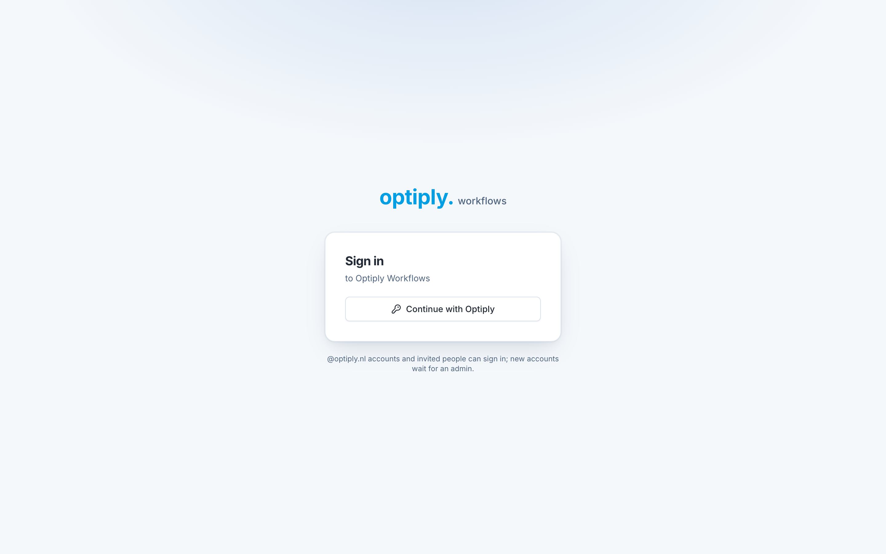

Only @optiply.nl accounts (and people an admin has invited) can sign in. Your session lasts a week; after that you
sign in again.

### 2.2 Waiting for approval

The first time you sign in, you don't get in straight away. Your request goes to the admins, and you see
**Waiting for an admin's approval**.

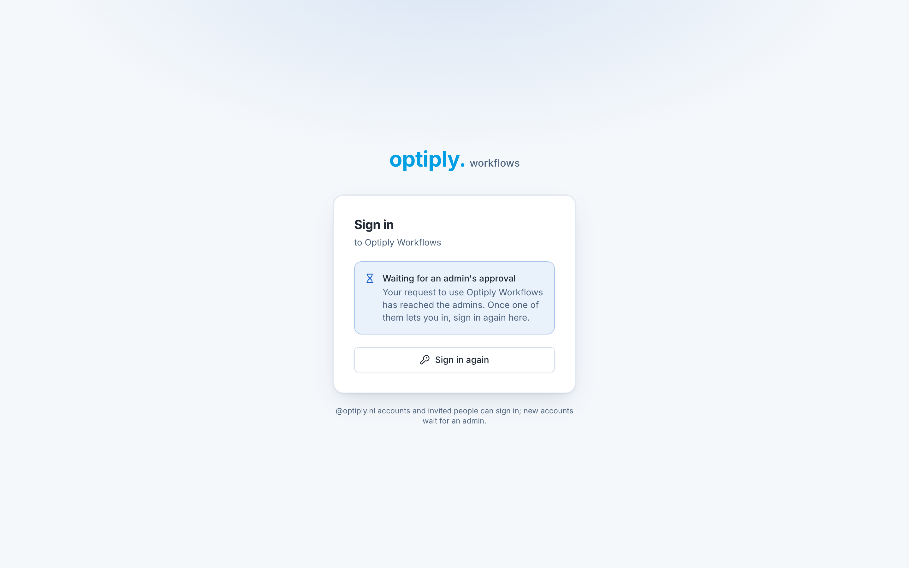

When an admin approves you, sign in again on the same page. No email is sent, so if it's urgent, let an admin know
you're waiting. Signing in again while you wait doesn't send a second request.

### 2.3 Finding your way around

The sidebar on the left holds the sections, in three groups:

- **Build:** Workflows, Apps, Library, Modules, Components
- **Data:** Resources, Database
- **Operate:** Runs, Inbox

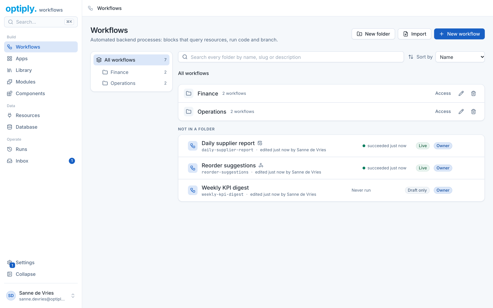

**You only see the sections where something has been shared with you.** If you can use one app and nothing else, you
see only **Apps**. **Runs** appears together with Workflows. **Inbox** appears with Workflows, or as soon as a task is
assigned to you. **Database** appears when you may use the built-in database. **Settings** is only for admins.

If an admin gave you access to **apps only**, there is no sidebar: you land on **Your apps**, the apps shared with you.

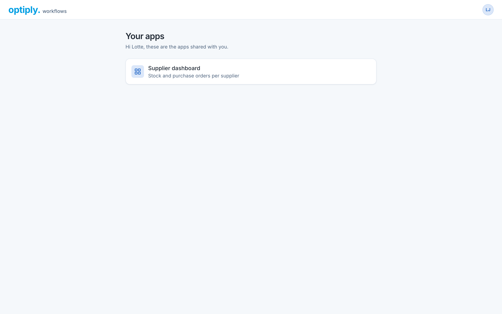

Click one to open it; the account menu in the app (your avatar, top right) has **Your apps** to come back. Other pages
of the platform aren't open to you; ask an admin if you need more.

If nothing has been shared with you yet, you see a welcome page saying so. Ask an admin for access to the workflows or
apps you need. New access shows up on your next page change, or after a reload.

Other things in the sidebar:

- **Collapse** / **Expand sidebar** at the bottom makes the sidebar narrow or wide. Editors start with it collapsed.
- The **Inbox** shows a number when you have open tasks.
- Your avatar at the bottom opens the account menu.

### 2.4 Search (⌘K)

Press **⌘K** (Mac) or **Ctrl K** (Windows and Linux), or click **Search…** in the sidebar.

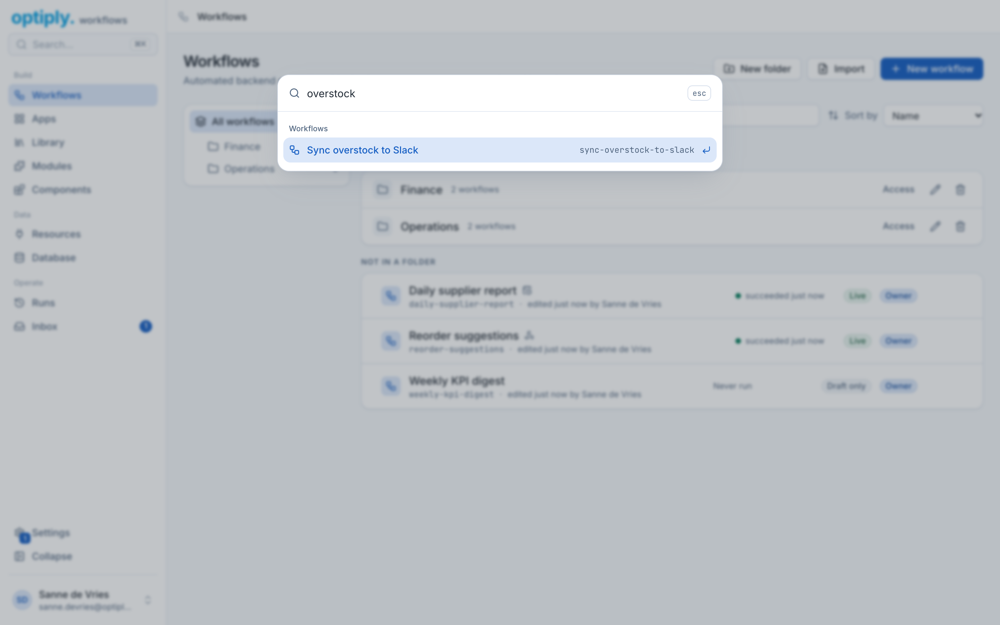

- With nothing typed, it lists the sections you can open and a few actions (themes, sign out).
- Type to search workflows, apps, resources, library queries, modules and component libraries by name or slug. Words
  can be in any order: "orders sync" finds "Sync orders".
- Use the arrow keys and **Enter** to open a result. **Esc** closes the palette.

If you can edit an app, search opens its editor; otherwise it opens the app itself.

### 2.5 Your account menu and the theme

Click your avatar at the bottom of the sidebar.

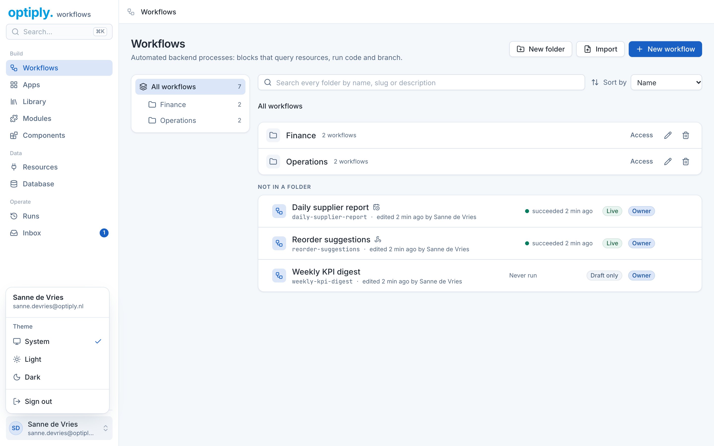

- **Theme:** **System** (follow your computer's setting), **Light** or **Dark**. The choice is kept in this browser.
- **Sign out.**

Inside a published app, the same menu is under your avatar at the top right, with an extra item to open Optiply
Workflows (or **Your apps**, if your access is to apps only).

### 2.6 Slugs, names and lists

Most objects have a **name** (for people, can change) and a **slug** (for addresses and references, lowercase, such as
`sync-orders`). The slug is filled in from the name when you create something, and **it can't change later**, so pick
it with care.

Every list (Workflows, Apps, Resources and so on) has:

- a search box that searches every folder by name, slug or description;
- a **Sort by** choice (for example by name or by last edited);
- a folder tree on the left once folders exist. Items outside any folder are listed under **Not in a folder**;
- a badge per row with your access: **Can run** / **Can use**, **Can edit** or **Owner**.

**Only people who may create something see the New … button.** Being able to create workflows (or apps, resources …)
is something an admin gives you. If you need it, ask an admin.

## 3. Resources

A resource is a saved connection to a database, an API or a service. Workflows and apps use resources to read and
write data. You need **Use** on a resource (in an environment) to run queries on it, and **Edit** to change its
settings.

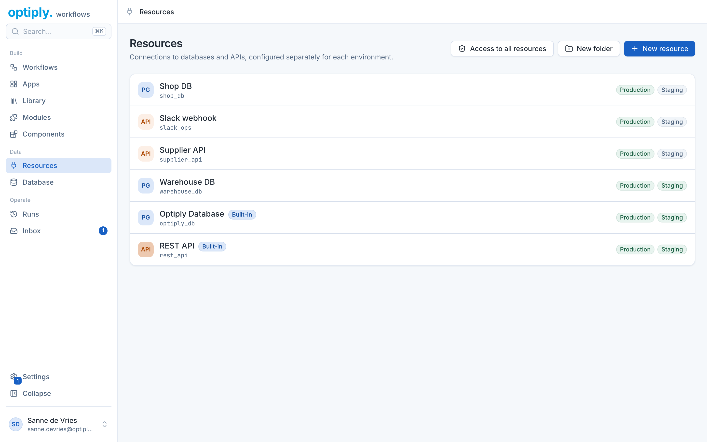

### 3.1 The kinds of resources

When you create a resource, you pick its **Type**. The types are grouped like this:

| Group | Types |
|---|---|
| **Databases** | PostgreSQL, MySQL, Microsoft SQL Server, BigQuery, JDBC (built in: Oracle, Snowflake and ClickHouse; admins can add other drivers) |
| **APIs** | REST API, GraphQL, OpenAPI, SDK (Python or JavaScript) |
| **Storage** | Amazon S3 (and S3-compatible stores) |
| **Services** | Slack, HubSpot, SendGrid, Google Sheets, Stripe, Airtable, Jira, Notion, Salesforce, Gmail, Microsoft Teams |
| **AI** | Anthropic, OpenAI-compatible, Gemini |

A **database** resource runs SQL. An **API** resource sends requests. A **service** or **AI** resource offers ready-made
**actions**, so you fill in a form instead of building requests by hand:

| Service | Actions |
|---|---|
| Slack | Send, edit or delete a message; list channels; list people; find a person by email; upload a file; call any method |
| HubSpot | Search records; get, create, update or archive a record; create or update many; associate two records; call any endpoint |
| SendGrid | Send an email; call any endpoint |
| Google Sheets | Read, append or update rows; clear a range; spreadsheet info; add or delete a sheet; create a spreadsheet; call any endpoint |
| Stripe | List, search, get, create, update or delete objects; call any endpoint |
| Airtable | List, get, create, update, upsert or delete records; tables and fields; call any endpoint |
| Jira | Search issues (JQL); get, create, update, move, comment on or assign an issue; call any endpoint |
| Notion | Query a database; get, create, update or archive a page; add or read content; search; call any endpoint |
| Salesforce | Query (SOQL); search; get, create, update, upsert or delete a record; describe an object; call any endpoint |
| Gmail | Send an email; search emails; get an email, a thread or an attachment; change labels; move to trash; create a draft; list labels; call any Gmail API |
| Microsoft Teams | Post to a channel; reply in a thread; send a chat message; post through the webhook; list teams, channels, channel messages, chats or members; call any Graph API |
| Amazon S3 | List objects; get, put, delete or copy objects; object details; presigned URL; list buckets |
| AI (all three) | Generate text; summarize; extract JSON; classify; agent (workflows only) |
| SDK | Call a method; run code; describe the client |

The **"call any …"** actions are there for everything the ready-made actions don't cover.

**AI actions** in brief:

- **Generate text:** a prompt and an optional system prompt; the result is the text.
- **Summarize:** short, medium or long, as prose or bullets.
- **Extract JSON:** you give a JSON Schema and get data that matches it.
- **Classify:** you give 2 to 100 labels and get the label (or labels) with a reason.
- **Agent:** the model may call other workflows as tools. It runs only inside workflows.

The run view shows each AI call's model, tokens, cost and the prompts sent, unless the resource hides prompts. An admin
can set a token budget per run.

### 3.2 Built-in resources

Two resources exist from the start. Nobody can change or delete them; they show a **Built-in** badge.

- **REST API** (slug `rest_api`): call any public URL without setting up a resource first. Each query gives its full
  URL and its own sign-in (none, bearer token, basic auth or API key). Put secrets in config vars and refer to them as
  `{{ configVars.NAME }}`. Everyone may use it.
- **Optiply Database** (slug `optiply_db`): the tables of the Database section (chapter 7). An admin decides who may use
  it, per environment.

### 3.3 Creating a resource

You can only create resources if an admin has given you that right; otherwise ask an admin to create it, or to give you
access to an existing one.

1. In **Resources**, click **New resource**.
2. Choose the **Type**, then a **Name** (for example "Orders database") and check the **Slug**. Workflows and apps refer
   to the resource by its slug; it can't change later.
3. Optionally choose a **Folder**, then click **Create**.
4. On the resource page, fill in the settings for the environment shown (Production or Staging) and click **Save**.
5. Click **Test connection** to check them. It tests what's in the form, even before you save.
6. Switch to the other environment at the top of the page and repeat steps 4–5.

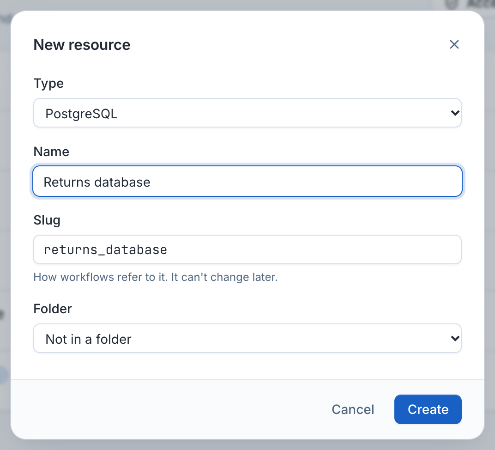

### 3.4 The resource page

At the top you see the environment buttons, each marked **(not configured)** or **(needs secrets)** where that
applies, and **Your access here**. Below them are the tabs:

- **Query:** the playground (see 3.6).
- **Settings:** a **General** card (name, description, folder; the same in every environment) and the settings of the
  environment you picked.
- **Access:** who may use, edit or own it (owners only).

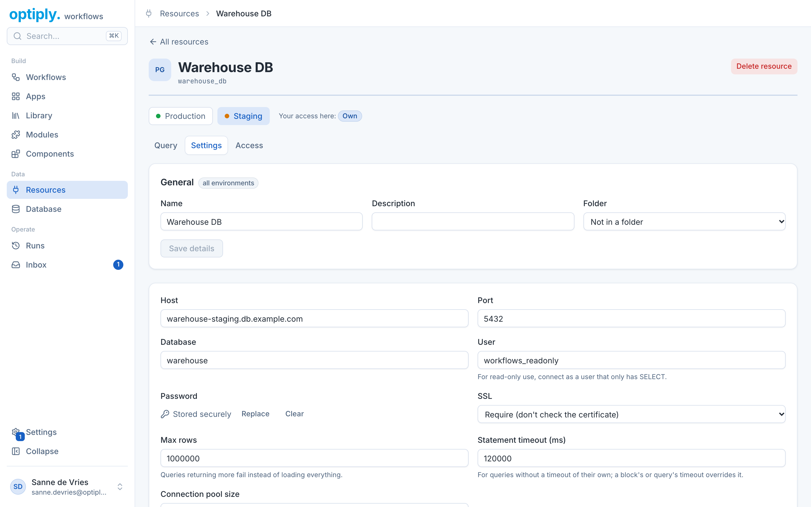

Things to know about the settings:

- **Secrets** (passwords, keys, tokens) show as **Stored securely**, with **Replace** and **Clear**. Nobody can read a
  stored secret back.
- **Remove from this environment** deletes the settings of one environment. **Delete resource** (owners) removes the
  resource everywhere.
- A REST API resource has a base URL, default headers and parameters, and an **Authentication** choice: None, API key,
  Bearer token, Basic auth, OAuth 2.0 client credentials, OAuth 2.0 sign-in (authorization code) or Custom auth flow.

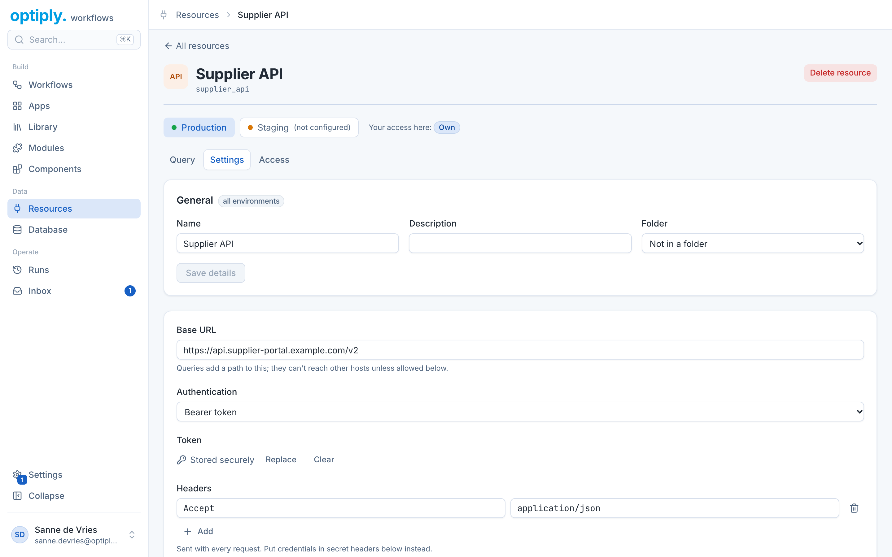

### 3.5 Resources that sign in with an account (OAuth)

Some resources sign in as an account instead of using a key: Slack, HubSpot, Google Sheets, Gmail, Microsoft Teams,
Salesforce, and REST, GraphQL, OpenAPI and SDK resources set to OAuth sign-in. They use one of two modes:

- **One shared account:** someone with Edit clicks **Connect account** once, and every query uses that account.
- **Each person's own account:** everyone connects their own account with **Connect your account**. Queries then run as
  the person who runs them. **Workflows that use such a resource can't be published**, because a published workflow
  has nobody behind it. Apps can use them: each person using the app connects their own account.

The account card shows **Connected**, **Needs reconnecting** or **Not connected**. If a provider stops accepting the
connection, click **Reconnect**.

### 3.6 The playground

The **Query** tab lets you try a query on the resource without building anything.

1. Pick the environment at the top.
2. Write the SQL, or fill in the request or action form.
3. Optionally fill in **Test values**: JSON that your `{{ }}` expressions can read.
4. Click **Run** (or press ⌘/Ctrl + Enter).

The result shows success or failure, the time taken and up to 500 rows, as a table or as JSON (**Show as JSON** /
**Show as table**). Your draft is remembered in this browser.

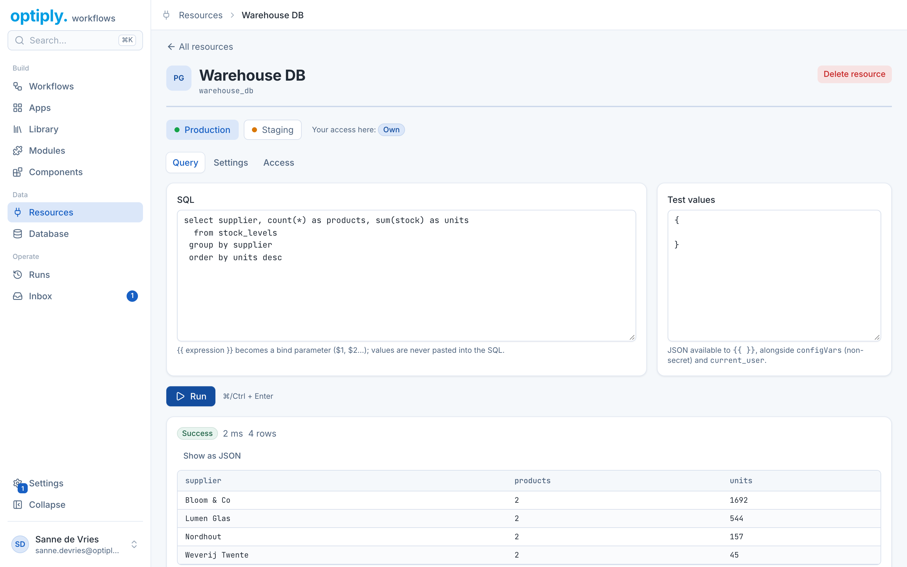

> **Tip:** In SQL, `{{ value }}` never pastes text into your query. It becomes a bind parameter, so it is safe from SQL
> injection. Because of this, don't put `{{ }}` inside quotes: write `where name = {{ name }}`, not
> `where name = '{{ name }}'`. In PostgreSQL, use `= ANY({{ ids }})` to match a list.

### 3.7 SSH tunnels

Some databases and APIs can only be reached through an SSH server (a "bastion"). PostgreSQL, MySQL, SQL Server, JDBC,
REST, GraphQL and OpenAPI resources have a **Connect through an SSH tunnel** option per environment. You can reach the
SSH server directly or through Google Cloud IAP, and add jump hosts.

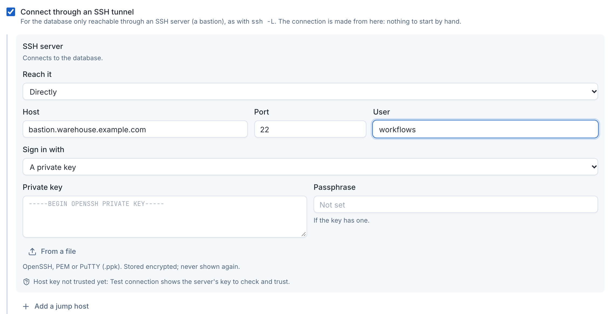

Setting up tunnels usually needs details only an admin or the infrastructure team has. See the admin guide.

### 3.8 Asking for a resource or for access

- **You need a new connection:** ask an admin (or someone allowed to create resources) for it. Say what it is, which
  environments you need, and who should be able to use it.
- **You see a resource but can't run queries on it:** you don't have Use in that environment. Ask the resource's owner
  or an admin.
- **You don't see a resource at all:** nothing about it has been shared with you.

## 4. Workflows

A workflow is a set of **blocks** connected on a canvas. It starts at the **start trigger**, and data flows along the
connections: each block can read the results of the blocks before it.


### 4.1 Creating a workflow

1. In **Workflows**, click **New workflow**.
2. Enter a **Name** (for example "Sync orders").
3. Check the **Slug**. It's used in webhook addresses and can't change later.
4. Optionally pick a **Folder**.
5. Click **Create workflow**. The editor opens.

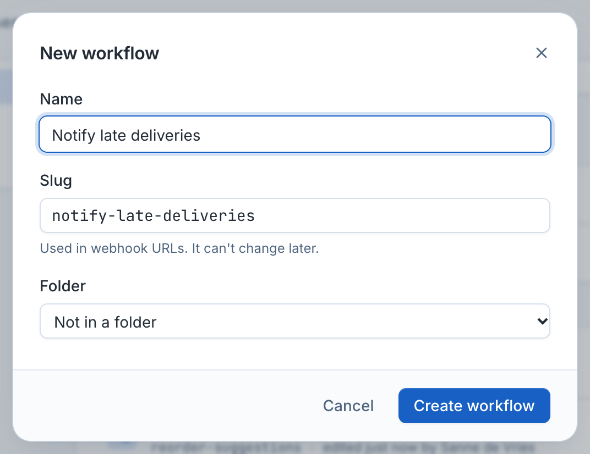

### 4.2 Importing from Retool

You can bring over workflows built in Retool.

1. In Retool, open the workflow and use its menu: **Export to JSON**.
2. Here, in **Workflows**, click **Import** and choose or drop one or more export files.
3. Each file shows **New** (a new workflow) or **Updates …** (it replaces the draft of one imported earlier). Tick
   **Make a copy instead** to leave the earlier one alone.
4. Under **Resources**, pick for each Retool resource the resource here that connects to the same database or API.
   Your choices are remembered for next time.
5. Under **Workflows it runs**, pick the matching workflows (or **Pick one later**).
6. Choose a **Folder for new ones** and click **Import**.

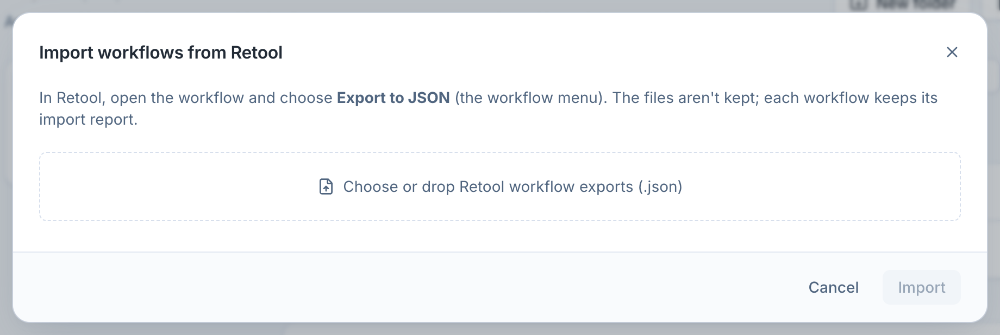

After importing:

- Open the workflow and click **Imported from Retool** in the status bar to read the import report: what changed,
  what to check, and problems to fix.
- Secrets found in the export (for example an `Authorization` header) are replaced by config vars named
  `RETOOL_SECRET_1` and so on. Ask an admin to create them with the real values.
- Blocks that nothing led to in Retool are not imported.
- Retool's lodash, moment, numbro, Papa and uuid libraries are built in here; nothing to load.
- Test the workflow, then publish it.

> **Note:** Export files can contain secrets. Don't put them in chat or Git.

### 4.3 The editor

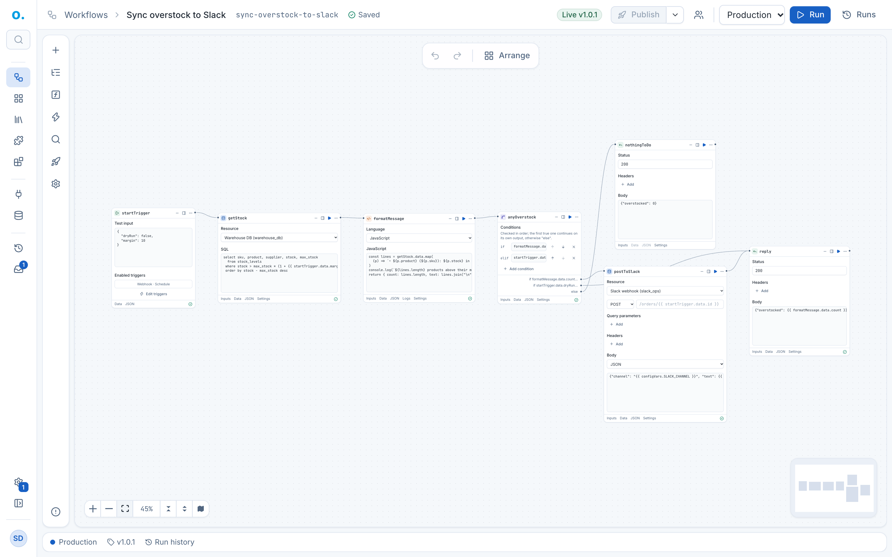

**The top bar**, from left to right:

- the slug and the **save status**. Editing is saved automatically: **Saving…**, **Saved**, and
  **Offline: changes will sync** when your connection drops;
- the avatars of other people in the editor;
- **Read only** if you only have Use;
- the release status: **Live vX.Y.Z** or **Not published**, and **Unpublished changes** when the draft differs from the
  live release;
- **Publish** and its ▾ menu;
- **Access** (the people icon, owners only);
- the **Environment** that the Run button uses;
- **Run**, which runs the draft;
- **Runs**, which opens the run panel.

**The left rail** opens panels:

| Panel | What it's for |
|---|---|
| **Blocks** | Add blocks |
| **Outline** | A list of all blocks, with a filter |
| **Functions** | Reusable sub-flows (see 4.8) |
| **Triggers** | Webhook and schedules (see 4.11) |
| **Code search** | Search all code and SQL, with match case, whole word and regular expressions |
| **Releases** | Published versions, compare, make live |
| **Settings** | Run timeout, packages, concurrency |
| **Problems** | Errors and warnings to fix before the workflow can run |

**The canvas** has an undo and redo bar and **Arrange** (arrange the blocks automatically). At the bottom you'll find
the zoom, **Collapse all blocks** / **Expand all blocks** and the minimap.

#### Adding and connecting blocks

1. Select the block you want to continue from.
2. Open **Blocks** and click a block type. It's added to the right of the selected block and connected to it. You can
   also drag a block type onto the canvas.

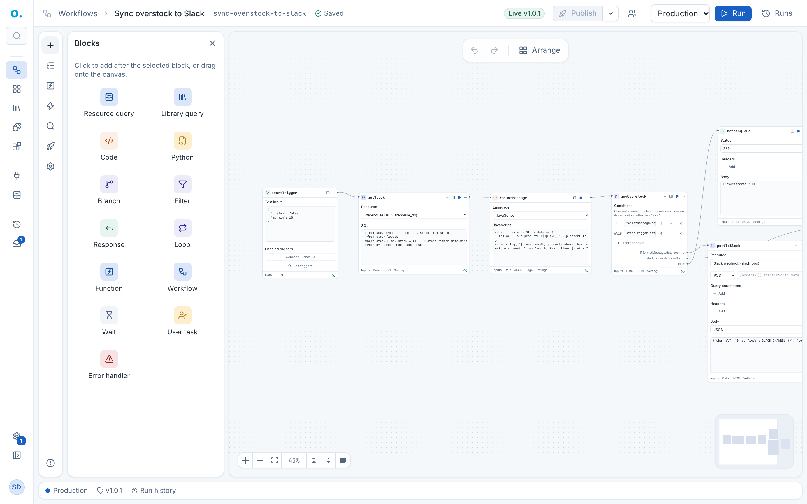

To connect blocks by hand, drag from a block's output (on its right side) to another block. Outputs are labelled
**on success**, **on error**, **if …** and **else**. Dragging a connection onto empty canvas opens the block list to add
a block there. Hover over a connection and click the red × to remove it.

#### Working with blocks

- **Rename:** double-click the block's name. Every reference to it is updated.
- **Minimize block** / **Expand block** to keep the canvas tidy.
- **Resize:** drag a block's right edge to make it wider; drag the bottom edge of its result area to make it taller.
- **Open in the side panel** shows the block's settings in a wide panel on the right.
- **▶** runs just this block (see 4.9).
- The **⋯** menu has **Run with previous blocks**, **Rename**, **Duplicate**, **Copy**, **Switch to …** (for example
  turn a code block into a loop) and **Delete**.
- Every block has a **Description** field. Use it to explain what the block does for whoever reads the workflow next.

#### Selecting, copying and undoing

| Shortcut | What it does |
|---|---|
| Click, ⌘/Ctrl-click, or drag a box | Select one or several blocks |
| ⌘C / ⌘V (Ctrl+C / Ctrl+V) | Copy and paste blocks, also between workflows |
| ⌘D (Ctrl+D) | Duplicate the selection |
| Delete / Backspace | Delete the selection (the start trigger can't be deleted) |
| ⌘Z (Ctrl+Z) | Undo |
| ⇧⌘Z (Ctrl+Shift+Z or Ctrl+Y) | Redo |

Undo only undoes your own changes, never someone else's. Inside a code field, ⌘Z works on the text.

#### Editing together

Several people can edit the same workflow at the same time. You see their avatars in the top bar, their mouse
pointers with their names on the canvas, the blocks they have selected outlined in their colour, and their cursors in
code fields. Changes merge as people type, so nobody overwrites anyone else.

### 4.4 The block types

| Block | What it does |
|---|---|
| **Start trigger** | Where every run begins. Holds the **Test input** for the Run button and shows which triggers are on. There is exactly one. |
| **Resource query** | Runs a query on a resource: SQL on a database, a request on an API, or an action on a service or AI resource. |
| **Library query** | Runs a published query from the Query Library, with its parameters (see chapter 6). |
| **Code** | Runs JavaScript. Returns data for the next blocks. |
| **Python** | A code block in Python, with pandas and numpy. No network access. |
| **Branch** | Chooses a path: the first true condition continues on its own output, otherwise **else**. |
| **Filter** | Keeps the items of a list that match a condition. |
| **Loop** | Runs code, a query, a function or a workflow once for each item of a list. |
| **Function** | Calls one of the workflow's functions (reusable sub-flows). |
| **Workflow** | Starts another workflow's live release, and either waits for its answer or just starts it. |
| **Response** | Sends the reply to the webhook caller (status, headers, body). |
| **Wait** | Pauses the run for a while, or until a date and time. |
| **User task** | Asks a person to fill in a form or make a choice in their Inbox, and waits for the answer. |
| **Error handler** | Runs when the workflow fails, so you can notify someone or answer the caller. |

#### Resource query

Choose the **Resource**; the rest of the form depends on its type:

- **Databases:** an **SQL** field. Values in `{{ }}` are sent as bind parameters, never pasted into the SQL.
- **REST:** method, path or URL, **Query parameters**, **Headers** and **Body** (No body, JSON, Form, Multipart, Raw).
- **GraphQL:** **Query**, **Variables**, **Operation name**, **Headers**.
- **OpenAPI:** pick an operation and fill in its form.
- **Services and AI:** pick an action and fill in its fields.

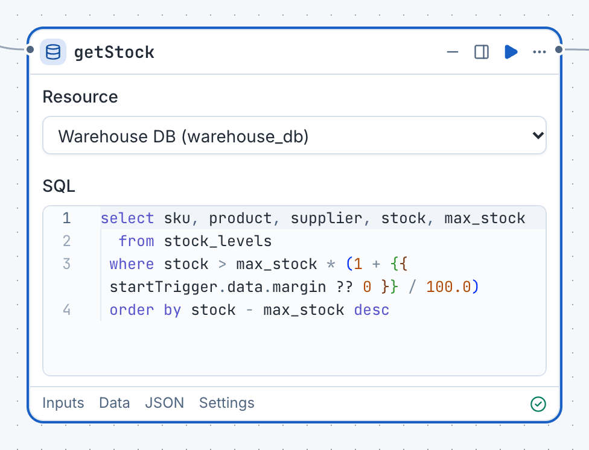

The query's result is its `.data`, for example `query1.data` (rows for SQL).

#### Code (JavaScript)

The code is the body of an async function: use other blocks' results, `await`, and `return` the data.

```js
const rows = query1.data
const total = rows.reduce((sum, r) => sum + Number(r.amount), 0)
return { count: rows.length, total }
```

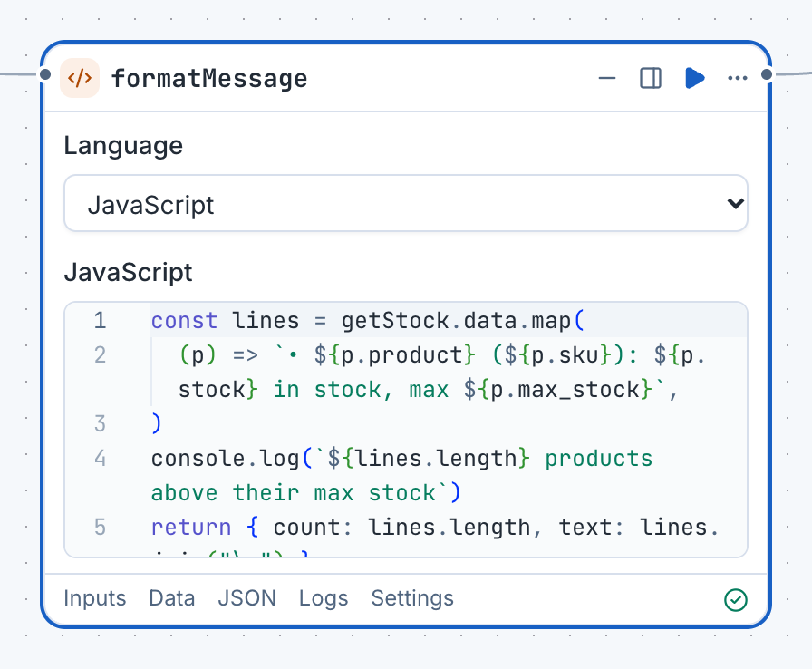

Use `console.log(...)` to write to the run's logs. You can call the workflow's functions with
`await myFunction(a, b)`, and call web addresses with `fetch` (but prefer a REST resource for anything that needs
credentials).

#### Python

Add a **Python** block (or set **Language** to Python on a code block). The code is a function body too: read other
blocks as variables (`query1.data`, `startTrigger.data`) and `return` the data.

```python
import pandas as pd
df = pd.DataFrame(query1.data)
summary = df.groupby("supplier")["amount"].sum().reset_index()
return summary
```

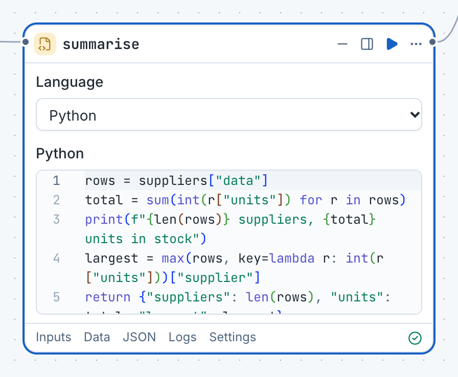

- numpy, pandas, python-dateutil and pytz are always available. A workflow can add more packages in its **Settings**.
- A returned pandas DataFrame becomes a list of rows; dates become text.
- `print()` goes to the run's logs.
- Python has **no network access**: it can't call APIs or the workflow's functions. Fetch data with a resource query
  block first, then process it in Python.

#### Branch

Add conditions under **Conditions**. They're checked in order; the first one that's true continues on its own output,
and if none is true the run continues on **else**. Each condition is a JavaScript expression **without** `{{ }}`, for
example `query1.data.length > 0`. Use **Add condition**, **Move up** and **Move down**.

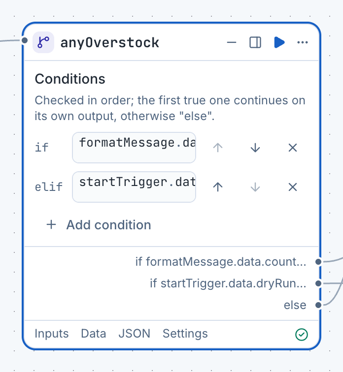

Blocks on a path that wasn't taken are **skipped**. A block where several paths meet again runs if at least one of
them reached it.

#### Filter

**Items** is a `{{ }}` that gives a list (for example `{{ query1.data }}`). **Keep items where** is a JavaScript
expression using `value` (the item) and `index`, for example `value.status === 'open'`.

#### Loop

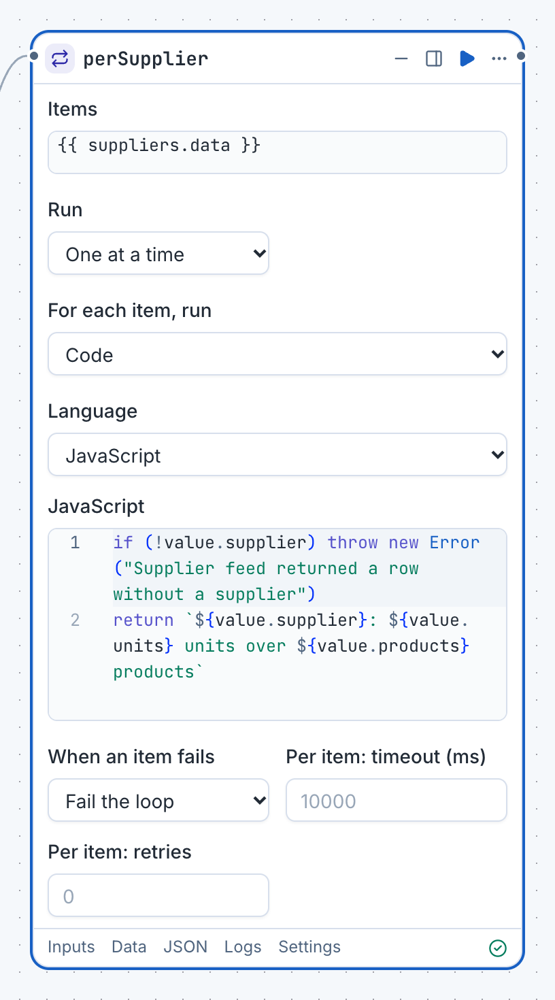

1. **Items:** a `{{ }}` that gives a list.
2. **Run:** **In parallel** (with **At once**, default 10, at most 50), **One at a time**, or **In batches** (with
   **Batch size** and **Pause between batches (ms)**).
3. **For each item, run:** Code, A resource query, A library query, A function or A workflow. Inside, `value` is the
   current item and `index` its position.
4. **When an item fails:** **Fail the loop**, or **Leave null and go on**.
5. Optionally a **Per item: timeout (ms)** and **Per item: retries**.

The loop's data is a list in the same order as the items. The run panel shows the iterations page by page, with a
filter for errored and failed ones. A loop can handle up to 100,000 items.

#### Function and Workflow

- **Function** calls one of this workflow's functions (4.8) with values for its parameters.
- **Workflow** starts another workflow's **live release** in the same environment. **Input** (JSON with `{{ }}`) becomes
  the other workflow's `startTrigger.data`. Under **Then**, choose **Wait for it; its Response body is the result**, or
  **Start it and go on; the result is its run id**. The other workflow must be published.

#### Response

Sets the reply to a webhook call: **Status** (default 200), **Headers** and **Body**, for example
`{"total": {{ code1.data }}}`. The first Response block that runs sends the reply; the run then carries on with any
remaining blocks. When this workflow is called by another workflow's Workflow block, the body is the result.

#### Wait

**For a while** (an amount in seconds, minutes, hours or days) or **Until a date and time**. A wait can last at most 60
days. Waiting time doesn't count toward the run's timeout.

#### User task

A user task puts a task in someone's Inbox and pauses the run until they answer.

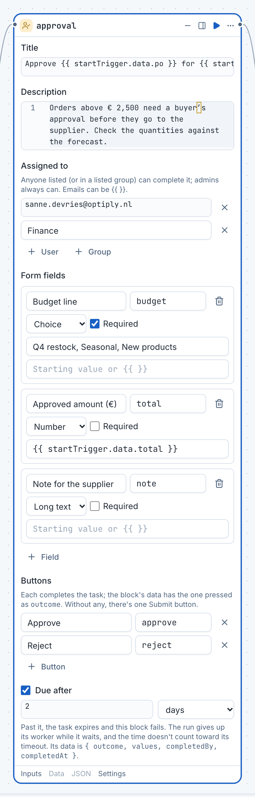

- **Title** and **Description**: what the person is asked. Both can use `{{ }}`.
- **Assigned to:** **+ User** (an email address, or a `{{ }}`) and **+ Group** (a group name). Anyone listed, or in a
  listed group, can complete it.
- **Form fields:** each has a label, a name, a type (**Text**, **Long text**, **Number**, **Checkbox**, **Choice**),
  **Required**, and a starting value.
- **Buttons:** the outcomes, for example Approve and Reject. Without any, there's one Submit button.
- **Due after:** optional. Past it, the task expires and the block fails.

The block's data is `{ outcome, values, completedBy, completedAt }`. Follow it with a Branch on `task1.data.outcome`.

#### Error handler

Add it with **Add global error handler** in a block's ⋯ menu. It runs when the workflow fails: when a block that stops
the run on failure fails, or when the run times out. Blocks after it read `errorHandler1.data`, which holds
`{ block, code, message }`. Typical use: send a Slack message. A Response block after the error handler answers the
webhook caller instead of the default error reply. The run still counts as failed.

### 4.5 Using data from other blocks

Blocks reach each other's results by name. A block can only read blocks **before** it on the canvas (its ancestors).

| Name | What it holds |
|---|---|
| `startTrigger.data` | The input: the webhook body, the test input, or the input from an app or another workflow |
| `startTrigger.headers` | The webhook request's headers |
| `startTrigger.pathParams` | Values from `:name` parts of the webhook alias |
| `startTrigger.urlParams` | The webhook URL's query parameters |
| `query1.data` | A block's result |
| `query1.error` | A block's error (`code`, `message`), when it failed and the run continued |
| `configVars.NAME` | A config var of the run's environment |
| `workflowContext` | The run's details: `runId`, `name`, `environment`, `triggerType` and more |
| `idempotencyKey` | The caller's Idempotency-Key, or the run id |
| `value`, `index` | The current item, in loops and filters |
| `params` | The arguments, inside a function |

In fields that are not code (SQL, request fields, the Response body, loop items), write expressions inside
`{{ }}`: `{{ startTrigger.data.orderId }}`. In code blocks and branch conditions, write plain JavaScript without
`{{ }}`.

**Config vars** are values set per environment by an admin, such as an API base address or a token. Secret config vars
are only filled in for published runs; in draft runs from the editor they're empty.

**Libraries** you can use in JavaScript without importing anything: `_` (lodash), `dayjs`, `moment`, `numbro`, `Papa`
(Papa Parse, for CSV) and `uuid`. Extra npm packages can be added under **JavaScript packages** in the workflow's
**Settings** and imported at the top of the code.

> **Tip:** Run the workflow once. Autocomplete then knows the shape of each block's data and suggests field names.

### 4.6 Error handling, retries and timeouts

Every block has a section **Timeout, retries and failure**:

| Setting | Default | What it does |
|---|---|---|
| **Timeout (ms)** | 10,000 (10 s); longer for loops, waits, tasks, functions and workflow calls | How long the block may take |
| **Retries** | 0 (up to 10) | How many times to try again after a failure |
| **Retry interval (ms)** | 1,000 | The pause between tries |
| **Double the interval after each retry** | off | Waits longer each time, up to 60 s |
| **On failure** | **Stop the run** | Or **Continue on the error output** |

With **Continue on the error output**, the block gets a red **on error** output. Connect it to blocks that should run
when it fails. To run a block whatever happens, connect both outputs to it.

The whole run has a **Run timeout** in the workflow's **Settings**: 15 minutes by default, at most 6 hours. Time spent
in Wait blocks, user tasks and waiting for another workflow doesn't count.

### 4.7 Workflow settings

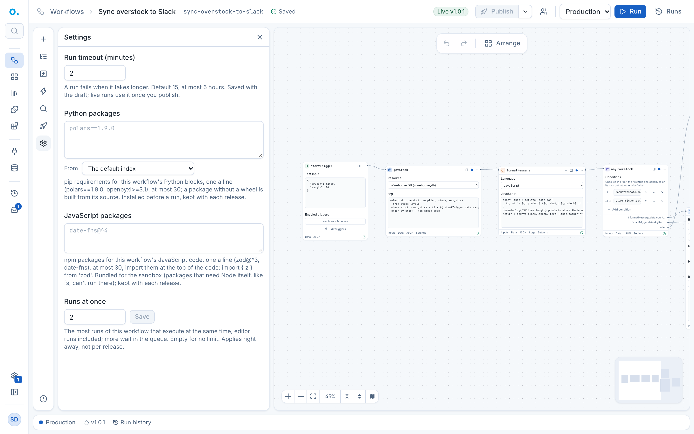

- **Run timeout (minutes):** see above.
- **Python packages:** extra pip packages, one per line, and where they come from. Click **Install now** and wait for
  the install to finish.
- **JavaScript packages:** extra npm packages, one per line.
- **Runs at once:** the most runs of this workflow allowed at the same time (empty means no limit). Others wait their
  turn. Useful when an API allows only a few calls at once.
- **Git:** **Protect in Git** (see 4.15).

### 4.8 Functions

A function is a reusable sub-flow inside a workflow, for example "look up a customer".

1. Open **Functions** in the rail, type a name (for example `lookupCustomer`) and click **New function**.
2. The canvas now shows **Editing function …**. Add blocks as usual. Inside, blocks read the arguments as
   `params.name`.
3. Under the function's settings, add **Parameters** and choose what it **Returns** (by default the last block).
4. Click **Workflow** (or **Back to the workflow**) to return.

Call it from a **Function** block, from a loop, or from JavaScript with `await lookupCustomer(id)`. Functions can't
contain Response, Wait, User task or Error handler blocks.

### 4.9 Testing your workflow

1. Click the start trigger and fill in its **Test input**: the JSON that the Run button sends as `startTrigger.data`.
2. Choose the **Environment** in the top bar.
3. Click **Run**. The draft is saved and run.

Each block then shows its result at the bottom, with the tabs **Inputs**, **Data**, **JSON**, **Logs** (for code
blocks) and **Settings**. Lists of objects show as a table, with **Copy as JSON** and **Download as JSON**.

The **Run** button is disabled while there are problems to fix; open **Problems** in the rail to see them.

**Running one block:** click **▶** on a block to run just that block. It reuses the results of the blocks before it
from the latest run (if that run used the same test input). Use **Run with previous blocks** in the ⋯ menu to run the
earlier blocks again too. This is the quickest way to work on a single query or piece of code.

### 4.10 The run panel

Click **Runs** in the top bar (or **Run history** in the status bar) to open the run panel. It shows the last 20 runs,
the blocks of the chosen run with their status and time, and the details of the chosen block.

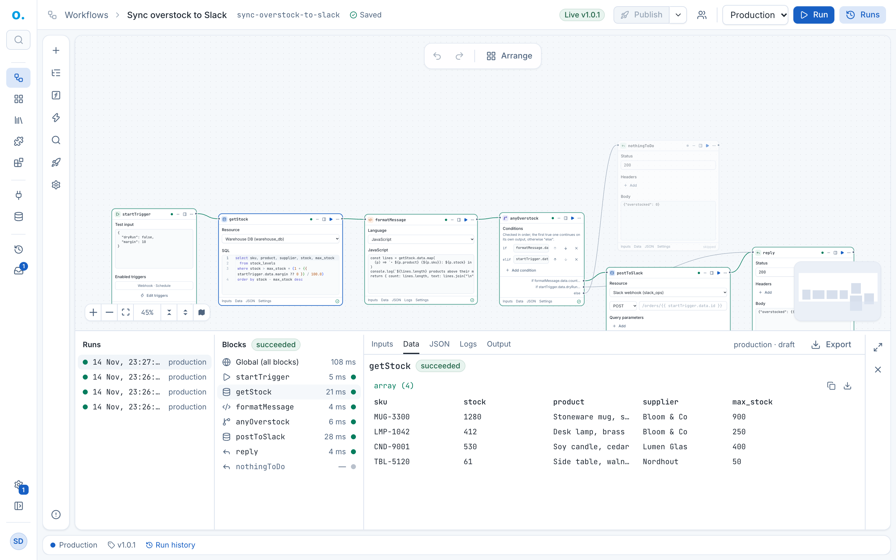

The detail tabs are **Inputs**, **Data**, **JSON**, **Logs** and **Output**. **Export** downloads the whole run as JSON.
While a run is still going, **Cancel** stops it.

The **Logs** tab lists everything written with `console.log` or `print()`, plus errors, with a filter and timestamps.

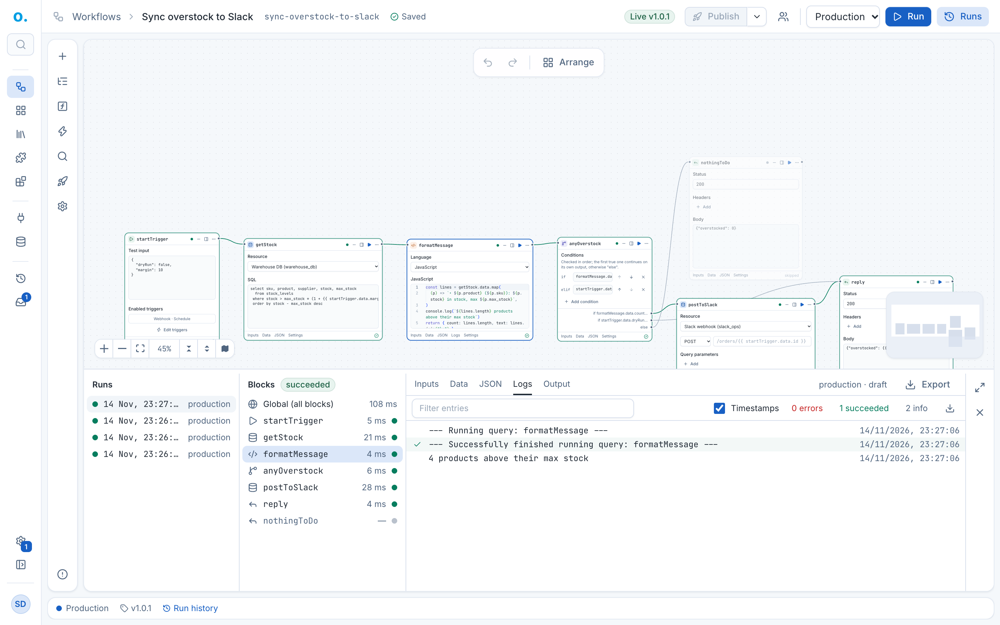

### 4.11 Triggers: how a workflow starts

A workflow starts in one of these ways:

| How | Which version runs |
|---|---|
| **Run** in the editor | The draft |
| A **webhook** call | The live release |
| A **schedule** | The live release |
| An **app** (a workflow query) | The live release |
| **Another workflow** (a Workflow block, a loop, or an AI agent) | The live release |

Open **Triggers** in the rail (or **Edit triggers** on the start trigger) to set up the webhook and schedules.

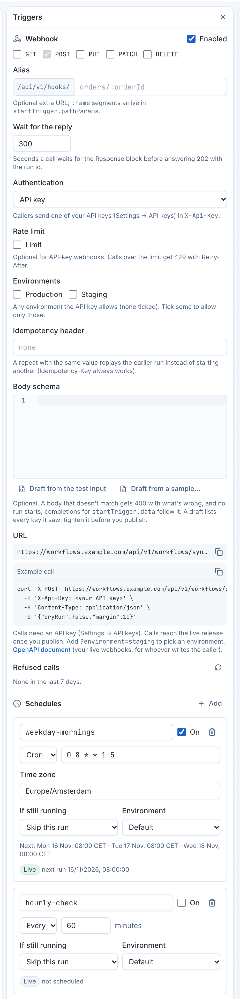

> **Important:** Triggers only work once you **publish**. Changes to triggers in the draft take effect with the next
> release.

#### Webhook

A webhook gives the workflow a web address that other systems can call. Tick **Enabled**, then:

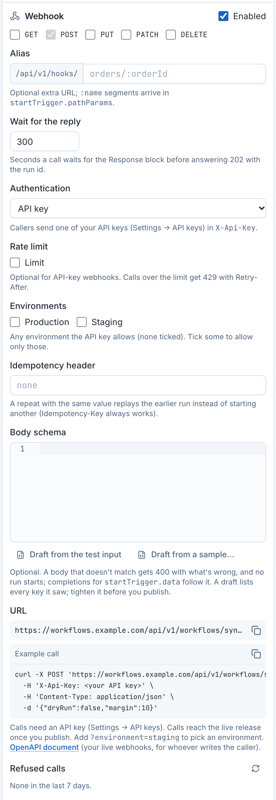

- **Methods:** which HTTP methods it accepts: GET, POST (the default), PUT, PATCH, DELETE.
- **URL:** the address is `<your address>/api/v1/workflows/<slug>/webhook`. Use **Copy URL**, or **Copy curl** for a
  ready-made example call.
- **Alias:** an optional extra address under `/api/v1/hooks/`, for example `orders/:orderId`. Parts starting with `:`
  arrive in `startTrigger.pathParams`.
- **Wait for the reply:** how many seconds a caller waits for the Response block (0–300, default 300). If the run takes
  longer, the caller gets `202` with the run id and can check on the run later (see chapter 8).
- **Authentication:**
  - **API key** (the default): callers send a key in the `X-Api-Key` header. Admins create the keys.
  - **Signature (Stripe, GitHub, Slack, …):** for services that sign their calls: Stripe, GitHub, Slack, HubSpot,
    Shopify, Amazon SNS or Custom HMAC. The signing secret is a secret config var (ask an admin to create it).
  - **Public (no authentication):** anyone with the address can call it. Use only when you have to; it's always rate
    limited.
- **Rate limit:** how many calls are allowed per period. Signed and public webhooks always have one (default 60 per 60
  seconds); callers over the limit get `429`.
- **Environments:** which environments callers may pick with `?environment=staging`. Without one, the default
  environment (Production) is used.
- **Idempotency header:** a request header to treat as the idempotency key. Callers can always send `Idempotency-Key`.
- **Body schema:** an optional JSON Schema the body must match. A body that doesn't match is refused with `400` and no
  run starts. **Draft from the test input** writes a first version for you.
- **Refused calls:** the calls refused in the last 7 days, with the reason. Look here first when a caller says the
  webhook doesn't work.

#### Schedules

Under **Schedules**, click **Add**.

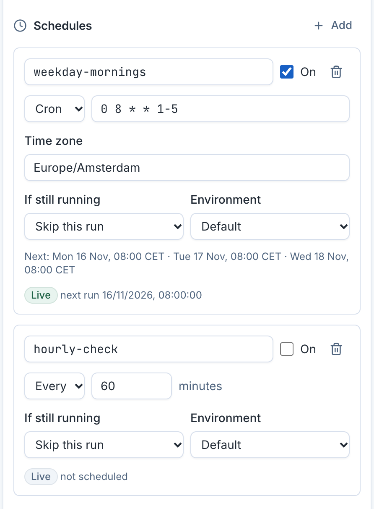

- **Cron** (for example `0 3 * * *` for every day at 03:00, or `@daily`) or **Every** N **minutes** (at least 1).
- **Time zone:** for cron schedules; default Europe/Amsterdam (summer and winter time are handled).
- **If still running:** what happens when the previous run hasn't finished yet: **Skip this run** (default),
  **Queue it**, or **Run both**.
- **Environment:** **Default** (Production) or a named environment.
- **On:** switch a schedule off without removing it.

**Next:** shows the next three times it will run. Until you publish, the card says **Runs once you publish**. If the
platform was down when a schedule was due, it catches up with one run, not one run per missed time.

A workflow can have several schedules, for example one for Production and one for Staging.

### 4.12 Publishing, comparing and rolling back

When your draft works:

1. Click **Publish**.
2. Choose the **Version**: **Patch** (fixes), **Minor** (new behaviour that stays compatible), **Major** (changes callers
   must adapt to), or **Custom**. The first release is v1.0.0.
3. Add **Release notes** (optional, but helpful for whoever rolls back later).
4. Check the summary of triggers and click **Publish vX.Y.Z**.

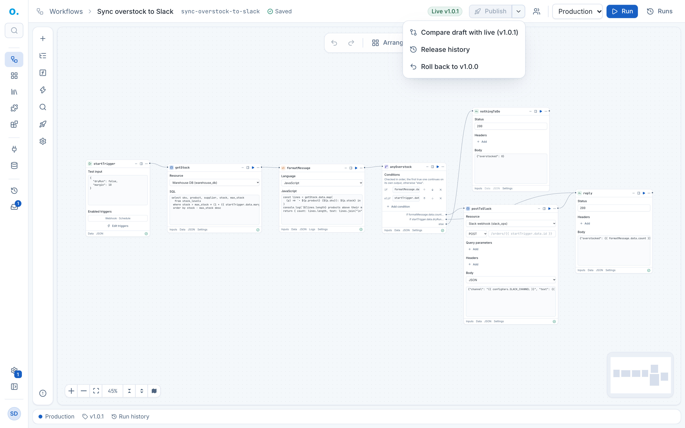

The draft becomes the live release at once. Webhooks, schedules, apps and other workflows now run it. Your editor runs
keep using the draft.

The **▾** menu next to Publish has:

- **Compare draft with live:** shows what changed since the live release.
- **Release history:** every release with its notes, author and date. **Compare** shows the differences between any
  two; **Make live** makes an older release live again.
- **Roll back to …:** makes the previous release live, after a confirmation.

There is one live release for all environments. The environment is chosen per run.

**Publish** is disabled when there are problems to fix, or when nothing changed since the live release.

> **Note:** Publishing checks that you may use every resource the workflow uses, in every environment it runs in.

### 4.13 Runs and run history

The **Runs** section lists every run of the workflows you can see, newest first, and refreshes by itself. Filter by
status: **All**, **Queued**, **Running**, **Waiting**, **Succeeded**, **Failed**, **Cancelled**.

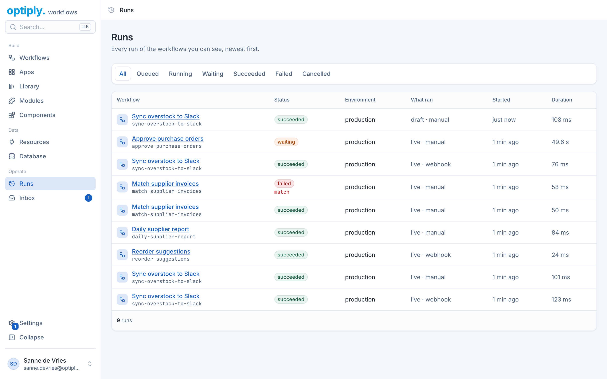

Each row shows the workflow, the status (and the failed block), the environment, what ran (draft or live, and the
trigger: manual, webhook, schedule, workflow or app), when it started, and how long it took.

Click a run to open it in the workflow's run panel, with every block's data, logs and timing.

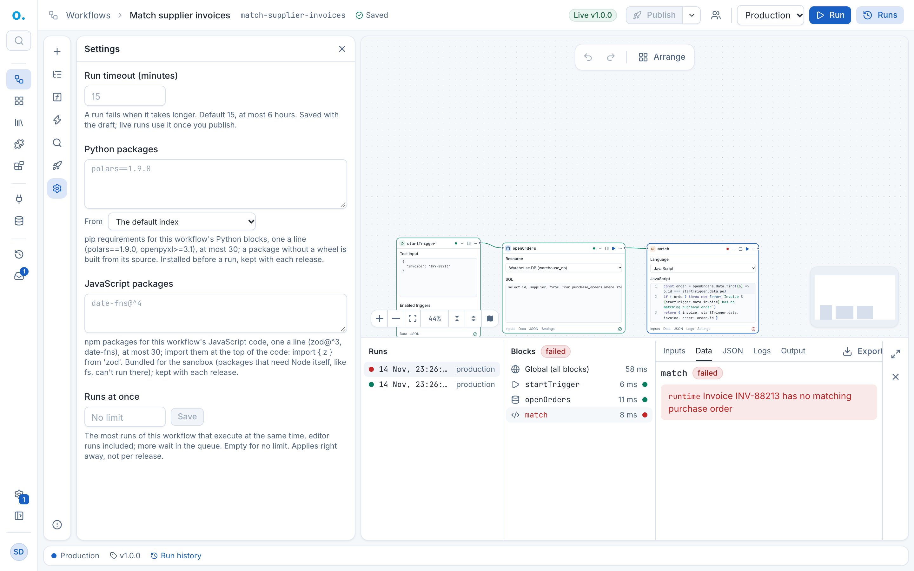

Run statuses:

| Status | Meaning |
|---|---|
| **Queued** | Waiting for a free worker (or for the concurrency limit) |
| **Running** | Busy |
| **Waiting** | Paused: a Wait block, a user task, or another workflow it called |
| **Succeeded** | Finished without errors |
| **Failed** | Stopped by an error or the run timeout |
| **Cancelled** | Stopped by someone |

Runs are kept for 30 days. There is no "run again" button: run the workflow again from the editor, or call it again.

### 4.14 The Inbox and user tasks

When a workflow reaches a **User task** block, the task appears in the **Inbox** of everyone it's assigned to.

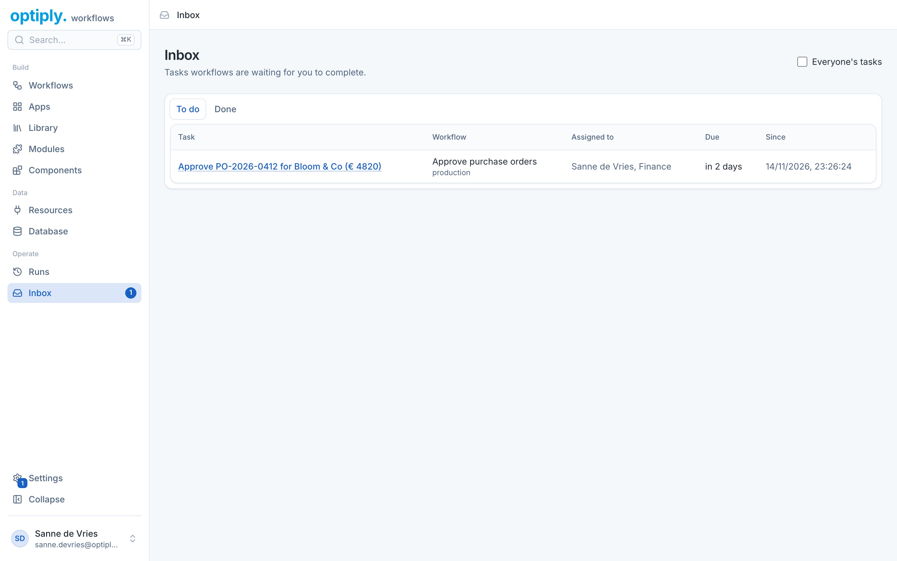

- **To do** lists open tasks; **Done** lists finished ones.
- Each row shows the task, the workflow and environment, who it's assigned to, and when it's due.

To complete a task:

1. Click it to open it.
2. Fill in the form (fields marked * are required).
3. Click one of the buttons, for example **Approve** or **Reject**.

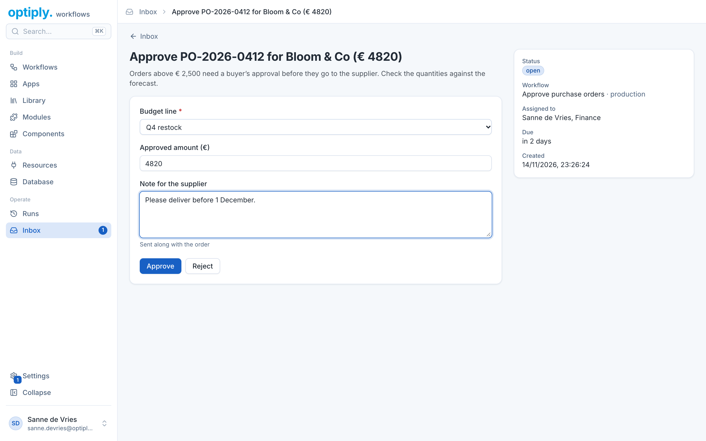

The workflow continues right away with your answer. If a task is past its due date, it has expired and can no longer
be completed. If a task isn't assigned to you, you can see it but not complete it. There are no email notifications;
check your Inbox (the sidebar shows how many tasks are open).

### 4.15 Workflows kept in Git

Important workflows (and apps) can be **protected in Git**: changes are then made on a branch and reviewed in a
GitHub pull request before they go live. This is only available when an admin has connected a Git repository. Owners
find **Protect in Git** in the workflow's **Settings** (or the ⋯ menu in the list).

On a protected workflow:

- The list shows an **In Git** badge, and the editor shows a **Git bar** with a branch picker.
- On the main branch the workflow is read-only. Pick a branch, or **New branch…**, to edit.
- Your edits are saved on the branch draft, and you can run them as usual.
- **Commit** shows the changed files and asks for a message, then offers **Open pull request**.
- Once the pull request is merged, the change is published automatically.

### 4.16 Sharing, folders, duplicating and deleting

**Sharing.** Owners click the **Access** icon (people) in the editor's top bar.

1. Choose a group or a person.
2. Choose the level: **Use**, **Edit** or **Own**.
3. Click **Grant**.

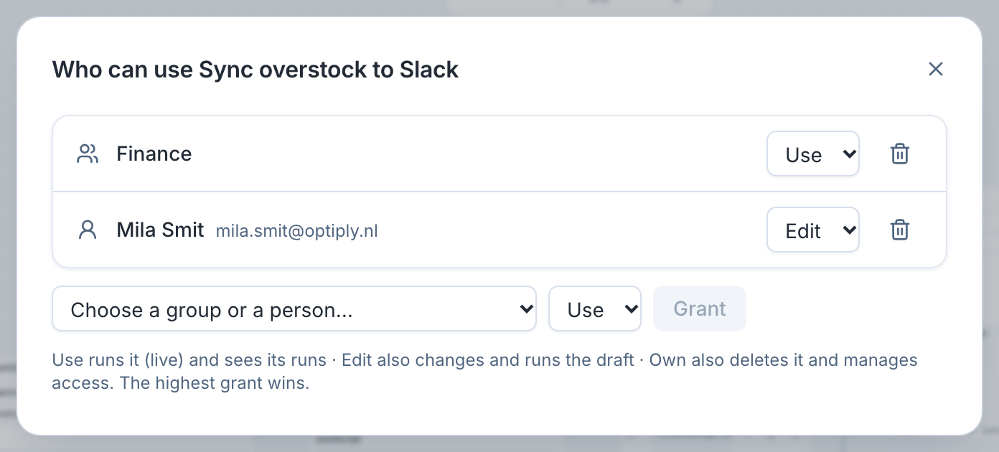

To change a level, pick another one in the list; to take access away, click the bin.

> **Note:** Something you create is shared with everyone (Use) and you can edit it, but you don't own it: sharing it
> differently or moving it between folders needs **Own**. Ask an admin to change its access or to give you Own.

**Folders.** **New folder** creates one (if you may). Owners move a workflow by dragging it onto a folder, or with
**Move to a folder…** in the row's ⋯ menu. Moving changes who can see it, because folder access applies to what's
inside.

**Duplicating.** Click the copy icon on a row and give the copy a name and slug. The copy gets the draft with its
triggers **turned off**; releases and run history stay with the original.

**Deleting.** **Delete…** in the row's ⋯ menu (owners). This removes the workflow with its releases and runs, and its
schedules and webhooks stop at once. It can't be undone.

## 5. Apps

An app is a page (or several pages) built from **components** on a grid, with **queries** that read and write data.
Components and queries are connected with `{{ }}` expressions: a table shows `{{ query1.data }}`, a query filters on
`{{ textInput1.value }}`, and so on. When a value changes, everything that depends on it updates by itself.

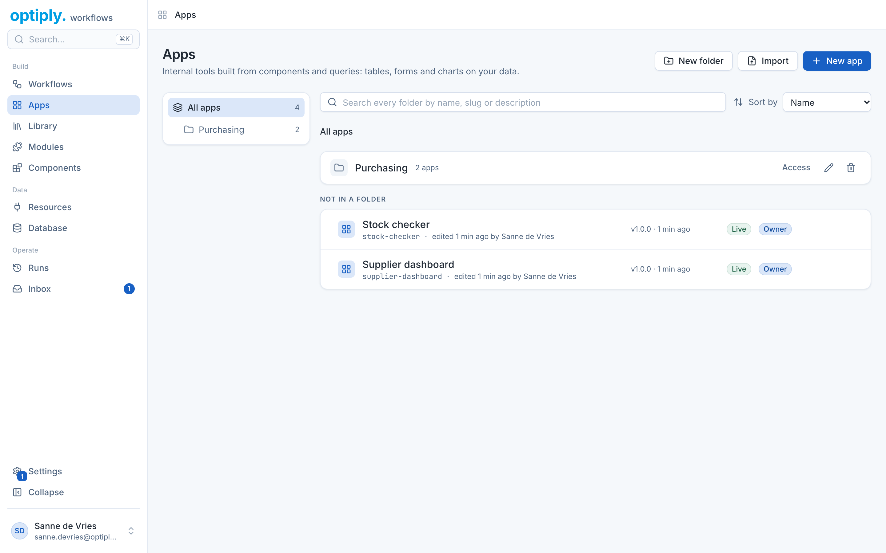

### 5.1 Creating an app

1. In **Apps**, click **New app**.
2. Enter a **Name** (for example "Customer lookup") and check the **Slug**. The app's address will be
   `/apps/<slug>`; the slug can't change later.
3. Optionally pick a **Folder**, and click **Create app**. The editor opens.

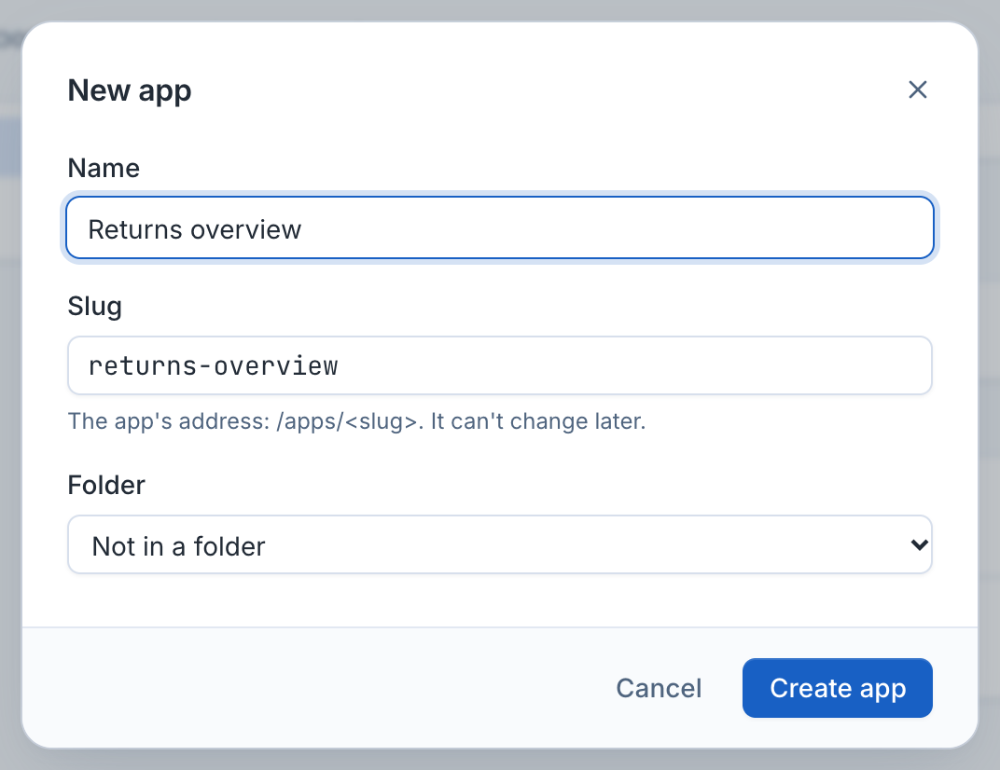

**Importing from Retool** works like it does for workflows (4.2): in Retool use **Export to JSON**, then click
**Import** in **Apps**. Import the workflows an app runs first, so you can link them. Some Retool parts are
approximated (for example a chart keeps its type and data but not its exact styling); the import report lists them.

In the Apps list, clicking a published app opens it; an unpublished app opens in the editor if you can edit it. The
pencil icon opens the editor, if you can edit the app.

### 5.2 The editor


**The top bar:**

- the save status (saved automatically) and other editors' avatars;
- **Undo** and **Redo**;
- the **Environment** the draft runs against;
- **Preview** / **Edit**: use the app as people will, with every panel hidden;
- the release status (**Live vX.Y.Z** or **Not published**, and **Unpublished changes**);
- **Publish**, **Releases** and **Open app** (once it's live);
- **Access** (owners) and the gear for the app's settings (name, description, delete).

**The left rail** opens one panel at a time:

| Panel | What it's for |
|---|---|
| **Add components** | The component palette, plus modules and custom components |
| **Pages** | Add, rename and order pages |
| **Component tree** | Every component, nested as on the page |
| **Code** | Queries, transformers and variables |
| **Search** | Search names and code |
| **State** | Every live value, to see what `{{ }}` can read |
| **History** | Earlier saves: compare, restore, or start a new app from one |
| **App settings** | Theme (colours, corner radius, font), custom CSS, JavaScript packages |

**The canvas** is a 12-column grid. Components stay where you put them; dropping or resizing onto another component
pushes it down.

**The inspector** on the right shows the settings of the selected component (⌘U hides or shows it).

**The status bar** at the bottom shows which queries are running, the number of problems, and the **Console** with
`console.log` output from your code.

**Multiplayer** works as in workflows: avatars, named pointers, and other people's selections.

#### Keyboard shortcuts in the app editor

| Shortcut | What it does |
|---|---|
| ⌘Z / ⇧⌘Z (Ctrl+Y) | Undo / redo |
| ⌘C / ⌘X / ⌘V | Copy, cut, paste components |
| ⌘D | Duplicate |
| Delete / Backspace | Delete the selection |
| Arrow keys | Move the selection one cell |
| ⌘A | Select every component on the page |
| Esc | Clear the selection |
| ⌘U | Show or hide the inspector |
| ⌘K | The editor's palette: jump to anything, add components or queries, preview, reset the app state |

### 5.3 Adding and arranging components

1. Open **Add components**. Search, or browse the categories.
2. Drag a component onto the canvas, or click it. A click puts it inside the selected container, or at the bottom of
   the page.
3. Move a component by its name tab; drag the grip to put it into another container, a form or the page.
4. Resize from the right edge, the bottom edge or the corner.

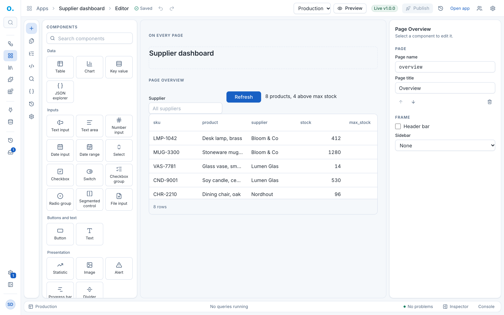

#### The components

| Component | Category | What it's for | Read in `{{ }}` |
|---|---|---|---|
| **Table** | Data | Rows with selection, editing, search, filters and paging | `selectedRow`, `selectedRows`, `changesetArray`, `newRows`, `searchText`, `pagination` |
| **Chart** | Data | Bar, line, area or pie chart | – |
| **Key value** | Data | Shows an object, one row per key | – |
| **JSON explorer** | Data | A collapsible view of JSON | – |
| **Text input** | Inputs | One line of text | `value` |
| **Text area** | Inputs | Several lines of text | `value` |
| **Number input** | Inputs | A number, with min, max and step | `value` |
| **Date input** | Inputs | One date | `value` |
| **Date range** | Inputs | A start and end date | `value.start`, `value.end` |
| **Select** | Inputs | A dropdown | `value` |
| **Checkbox** / **Switch** | Inputs | True or false | `value` |
| **Checkbox group** | Inputs | Several choices | `value` (a list) |
| **Radio group** / **Segmented control** | Inputs | One choice | `value` |
| **File input** | Inputs | Upload files (at most 5 MB each) | `value` (name, type, size, base64) |
| **Button** | Buttons and text | Something to click | – |
| **Text** | Buttons and text | Text, optionally Markdown | – |
| **Statistic** | Presentation | A KPI number with a caption and trend | – |
| **Image** | Presentation | A picture from a URL | – |
| **Alert** | Presentation | An info, success, warning or error banner | – |
| **Progress bar** | Presentation | A bar from 0 to 100 | – |
| **Divider** | Presentation | A line, with an optional label | – |
| **Container** | Containers and forms | Groups components; optional views (tabs), header and footer; collapsible | `currentView`, `expanded` |
| **Form** | Containers and forms | Collects the inputs inside it and checks required fields | `data` |
| **Modal** | Containers and forms | A dialog over the page | `isOpen` |
| **Navigation** | Navigation | Links to pages or web addresses | `clickedItem` |
| **Module** | Reusable | A module placed in the app (chapter 6) | its outputs |
| **Custom component** | Reusable | A component from a component library (chapter 6) | its state |

Every component can be hidden (the **hidden** setting, or `setHidden(true)`). Every input has **label**, **disabled**,
**required** and a **Form data key** (its name in the form's `data`), and can be set from code with
`setValue(...)` and `clearValue()`.

Some useful component methods, for event handlers and JavaScript:

| Component | Methods |
|---|---|
| Table | `selectRow(i)`, `clearSelection()`, `saveChanges()`, `clearChangeset()`, `addRow(row)`, `setPage(n)`, `setSort(column, desc)`, `setSearchText(text)`, `setFilters(...)`, `clearFilters()` |
| Container | `setView(view)`, `nextView()`, `previousView()`, `expand()`, `collapse()`, `toggle()` |
| Form | `submit()`, `reset()` |
| Modal | `open()`, `close()` |

**Tables** in a little more detail:

- **List the columns of the current data** fills in the columns from the data. Each column has a key, label, type
  (text, number, boolean, date, datetime, json), width, and **Editable**, **Hidden** and **Filterable** switches.
- With editable columns, people change cells; the changes collect in `table1.changesetArray`. **Save changes** fires
  the table's **save** event: handle it with a query that writes the changes, and the table clears them once that
  succeeds.
- Paging can be by scrolling, by pages, or done by the server (your query reads `table1.pagination` and
  `table1.sort`).

### 5.4 The inspector, properties and `{{ }}`

Select a component to see its settings, grouped as **Content**, **Interaction** (including **Event handlers**),
**Appearance** and **Layout**. The ⋯ menu has copy, cut, duplicate, rename, **Switch to** (change one input type into
another) and delete. **Add a note** leaves a note for other editors.

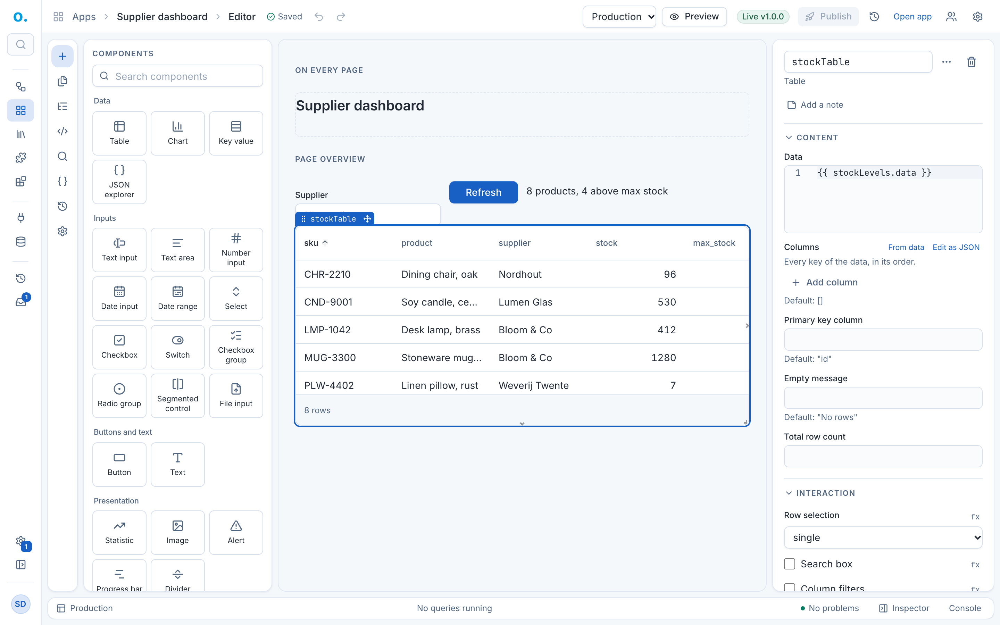

Any setting can be a fixed value or a `{{ }}` expression (**Use a {{ }} expression** / **Use a fixed value**). While
you type, autocomplete suggests components, queries and their fields, and the field shows what the expression gives
right now.

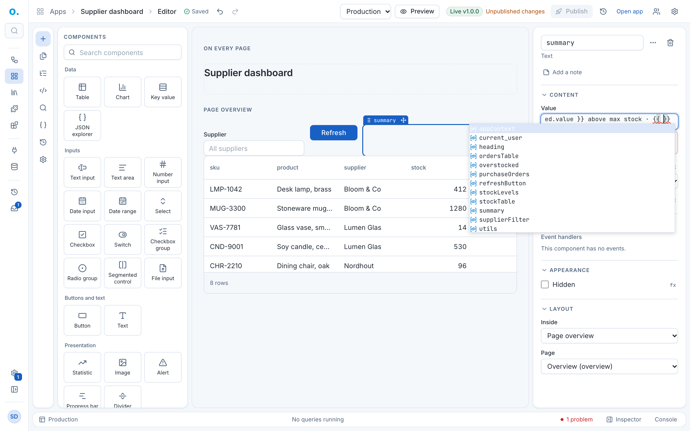

Examples:

- A table's data: `{{ query1.data }}`
- A text: `Hello {{ current_user.name }}`
- A button that's disabled until something is selected: `{{ !table1.selectedRow }}`
- A text input's default: `{{ table1.selectedRow?.email }}`

What you can read in `{{ }}` and in JavaScript:

| Name | What it is |
|---|---|
| Components, queries, transformers, variables | By their names, for example `table1.selectedRow`, `query1.data`, `variable1.value` |
| `current_user` | The person using the app: `id`, `email`, `name`, `groups` |
| `url.page`, `url.params` | The page shown and the address's query parameters |
| `appContext` | The app's slug, the environment, and the version |
| `localStorage.values` | Values the app stored in this browser |
| `utils` | Helper functions (below) |
| `_`, `dayjs`, `moment`, `numbro`, `Papa`, `uuid` | Bundled libraries: lodash, dates, number formatting, CSV, unique ids |

`utils` functions:

| Function | What it does |
|---|---|
| `utils.notify(message, tone)` | Shows a notification; tone is `info`, `success` or `error` |
| `utils.showNotification({ title, description, notificationType })` | The same, Retool-style |
| `utils.openUrl(url, { newTab })` | Opens a web address |
| `utils.openPage(page, { params, newTab })` | Goes to a page of the app |
| `utils.copyToClipboard(text)` | Copies text |
| `utils.downloadFile(data, fileName)` | Downloads data; a list of rows becomes CSV for a `.csv` name, otherwise JSON |

App code runs in a protected sandbox in your browser with no network access of its own. All data goes through
queries. If code gets stuck in an endless loop, the app stops it and offers **Restart**.

### 5.5 Queries

Queries live in the **Code** panel. Add one with:

| Button | Kind | What it does |
|---|---|---|
| **Add a resource query** | Resource query | SQL, a request or an action on a resource. Runs on the server. |
| **Add a JS query** | JavaScript | Code that runs in the browser; can trigger other queries |
| **Add a query from the library** | Library query | A published query from the Query Library |
| **Add a workflow query** | Workflow query | Runs a workflow's live release |

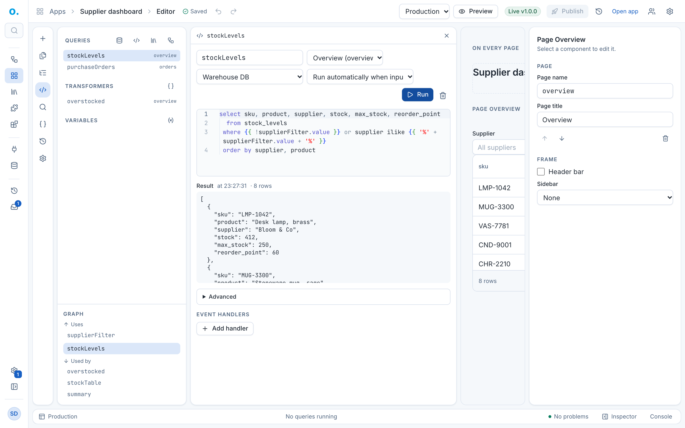

**When a query runs** (the **Run** setting):

- **Run automatically when inputs change** (the default for resource and library queries): it runs when the app (or
  its page) opens, and again whenever a value it reads changes. Use this for reading data.
- **Run only when triggered** (the default for workflow queries): it runs only when an event handler or code triggers
  it. Use this for writing data, so nothing is saved by accident.

**Advanced** settings:

- **Also run when the app opens** (for queries that run only when triggered).
- **Ask to confirm:** a message people must confirm before it runs.
- **Disabled when:** a `{{ }}` that stops the query from running.
- **Transform the result:** JavaScript that reshapes `data` before the app sees it.
- **Timeout (ms).**

A query has **Event handlers** for **success** and **failure**. A failed write query shows an error notification by
itself.

Reading results: `query1.data`, `query1.error`, `query1.isFetching` (true while it runs) and `query1.lastRunAt`. In
JavaScript, `await query1.trigger()` runs a query and gives its data; `query1.reset()` clears it.

**Workflow queries** pick a workflow and an **Input** (JSON with `{{ }}`, which becomes `startTrigger.data`). Choose
**Wait for its response** (the data is the Response block's body) or **Start it and go on** (the data is the run id).
The workflow runs in the app's environment and must be published.

> **Note:** People who use a published app don't need access to its resources. The app's queries run with the access of
> whoever published it. That's why only people with Use on a resource can publish an app that uses it.

### 5.6 Transformers and variables

- A **transformer** is a small piece of JavaScript that computes a value from other values, for example totals from
  `query1.data`. It's recalculated whenever what it reads changes. Read it as `transformer1.value`.
- A **variable** holds a value the app can change, for example the selected customer. Give it an **Initial value**,
  read it as `variable1.value`, and change it with `variable1.setValue(...)` or the **Set variable** action.

### 5.7 Events and actions

Components and queries fire **events**: a button's **click**, an input's **change**, a table's **rowSelect** or
**save**, a form's **submit**, a query's **success** or **failure**. Attach handlers in the inspector under
**Event handlers** → **Add handler**.

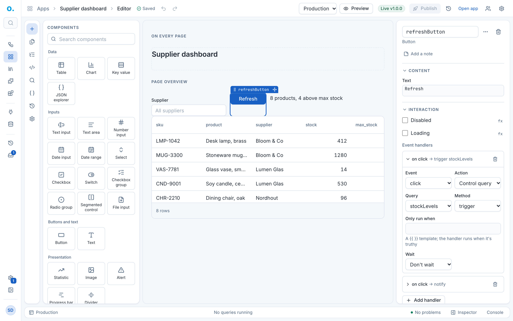

| Action | What it does |
|---|---|
| **Control query** | Trigger or reset a query |
| **Control component** | Call a component's method, for example open a modal |
| **Set variable** | Give a variable a new value |
| **Run script** | Run JavaScript (it may `await` queries) |
| **Show notification** | Show a message (info, success or error) |
| **Go to page** | Open another page of the app, with URL parameters |
| **Open URL** | Open a web address |
| **Set URL parameters** | Change the address's query parameters |
| **Copy to clipboard** | Copy text |
| **Export data** | Download data as a CSV (for a `.csv` file name) or JSON file |
| **Set local storage** / **Clear local storage** | Remember values in this browser |

Each handler can also have **Only run when** (a condition) and a **Wait** of **Debounce** or **Throttle** (useful on a
search box). Several handlers on the same event run at the same time.

**Example: a search box and a table**

1. Add a **Text input** (`textInput1`) and a **Table** (`table1`).
2. Add a resource query on your database:
   `select * from customers where name ilike '%' || {{ textInput1.value }} || '%' limit 100`
   and leave it on **Run automatically when inputs change**.
3. Set the table's data to `{{ query1.data }}`.

The table now follows what people type.

**Example: saving a form**

1. Add a **Form** with inputs inside it, each with a **Form data key**.
2. Add a resource query that inserts `{{ form1.data.name }}` and so on, set to **Run only when triggered**.
3. On the form's **submit** event, add **Control query** → `query2` → trigger.
4. On `query2`'s **success** event, add **Show notification** and **Control query** → `query1` → trigger, to refresh the
   list.

### 5.8 Pages

An app starts with one page. Open **Pages** and click **Add a page** to make it a multipage app; what you built so far
goes on the first page.

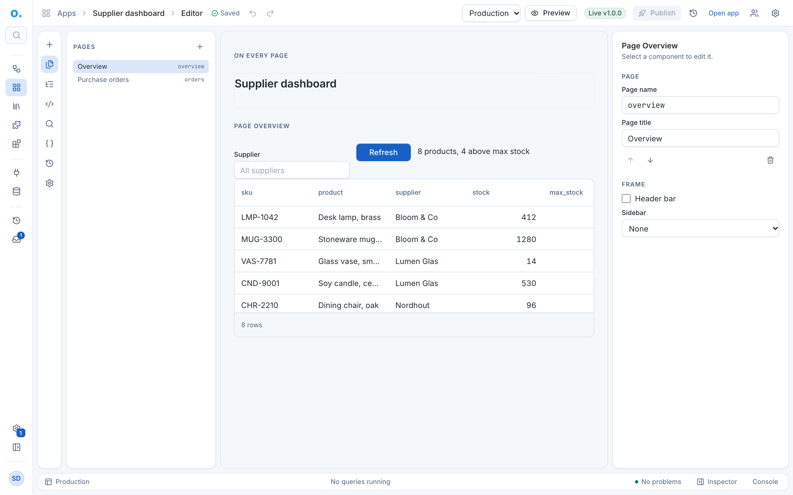

- Components, queries and transformers belong to one page, or to **Every page** (for example a header). Variables are
  always shared by all pages.
- A query on a page runs only while that page is open.
- Use a **Navigation** component, the **Go to page** action, or `utils.openPage('orders', { params: { id: 7 } })` to
  move between pages. The page reads its parameters from `url.params`.
- With nothing selected, the inspector shows the page settings (**Page name**, **Page title**) and the **Frame**:
  **Header bar**, **Sidebar** (none, narrow, medium, wide), **Show the app's name**, **Show who's signed in**.

### 5.9 Look and feel

Apps use the Optiply look, in light and dark. Under **App settings** you can change the **Theme** (primary, background,
text and status colours, corner radius, font) and add **Custom CSS**. **JavaScript packages** adds npm packages for the
app's code (at most 30), which you then import at the top of a JS query.

### 5.10 Publishing and using an app

1. Click **Publish**.
2. Choose **Patch**, **Minor**, **Major** or **Custom**, and add **Release notes**.
3. Click **Publish vX.Y.Z**.

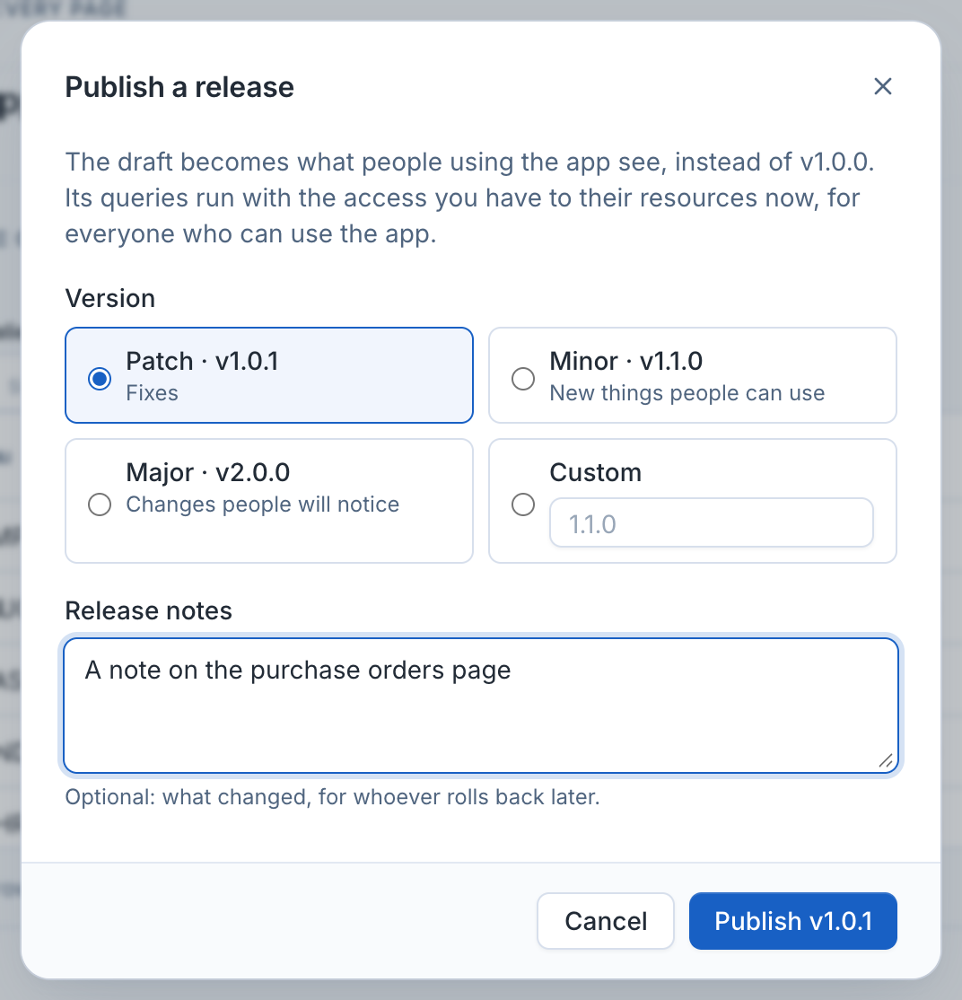

The app is then live at `<your address>/apps/<slug>`. A multipage app adds the page to the address, for example
`/apps/customer-lookup/orders`. Add `?env=staging` to open it against staging data, or use the **Environment** choice
in the app's header (shown when there is more than one environment).

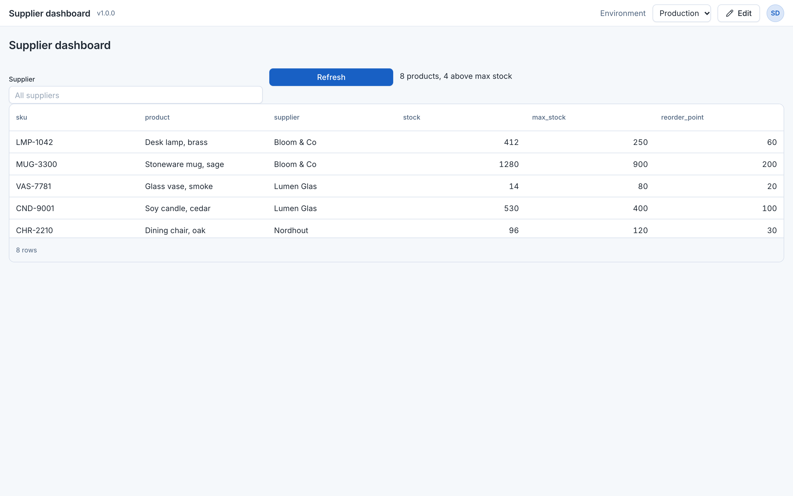

The published app shows only the app, with a slim header: its name, the environment, **Edit** for editors, and your
avatar.

**Releases** lists every release; **Compare** shows the differences, and **Make live** rolls back to an older one. If
someone publishes while people have the app open, their next query asks them to reload.

Who sees what:

- No access: "You don't have access to this app".
- Use, but the app isn't published yet: "You can use this app once its owner publishes it."
- Use: the published app. The editor isn't available to them.
- Edit or Own: the app, and the editor.

### 5.11 Sharing an app

Owners click **Access** in the editor's top bar, pick a group or a person and a level, and click **Grant**. Use is
enough for people who only need to work with the app.

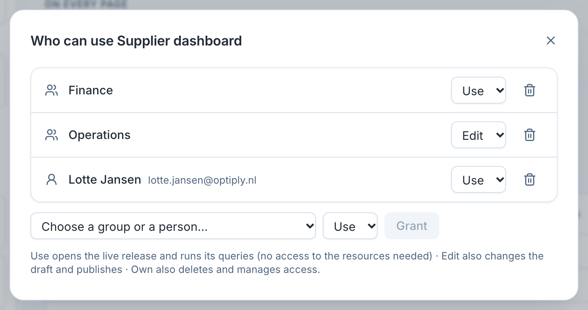

Duplicating, moving to a folder and deleting work as for workflows (4.16). Deleting an app removes it for everyone at
once.

## 6. Reuse: the Query Library, Modules and Component libraries

When the same query or the same piece of screen keeps coming back, make it once and reuse it. All three kinds below
have their own section in the sidebar, their own releases (like apps) and their own Access.

Where you use them, you choose a **version**: **Latest** follows whatever release is live (so improvements arrive by
themselves), or a pinned version such as `v1.2.0` stays the same until you change it.

### 6.1 The Query Library

A library query is a resource query with **parameters**, written once and used in many apps and workflows.

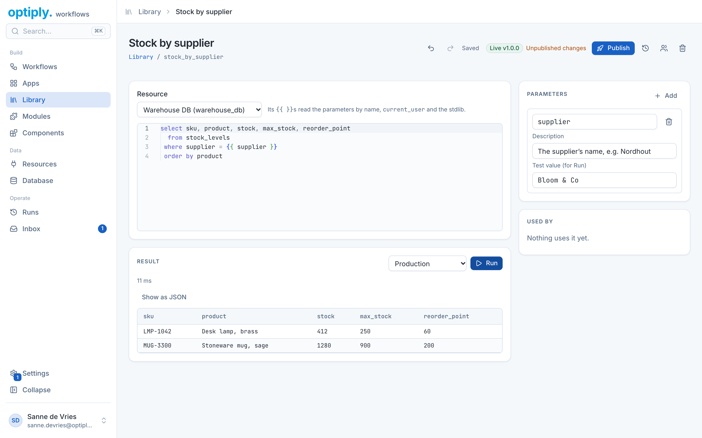

To create one:

1. In **Library**, click **New query** and give it a name (for example "Orders by customer") and a slug.
2. Choose the **Resource** and write the SQL (or the request).
3. Under **Parameters**, click **Add** for each value it needs, with a **Description** and a **Test value**. In the
   query, write a parameter by its name: `where customer_id = {{ customerId }}`.
4. Choose the environment under **Result** and click **Run** to test it with the test values.
5. Publish it.

A library query can only read its own parameters (plus `current_user`), so it means the same everywhere.

To use one:

- **In an app:** **Add a query from the library**, pick it and a version, and fill in each parameter with a `{{ }}`.
- **In a workflow:** add a **Library query** block, pick it and a version, and fill in the parameters.

**Used by** on the library query shows the apps, modules and workflows that use it.

### 6.2 Modules

A module is a piece of an app (for example a customer picker with its own queries) that you build once and place in
many apps.

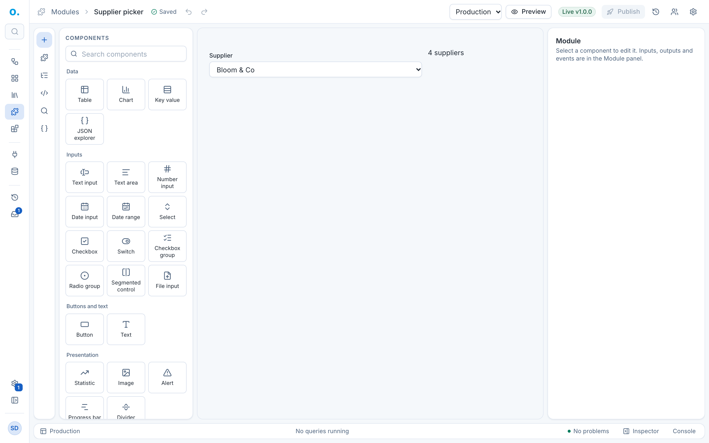

1. In **Modules**, click **New module**. The module editor is the app editor, without pages.
2. In the **Module** panel, define:
   - **Inputs:** what apps pass in, read inside as `inputs.<name>`. Give each a **Default** and a **Test value**.
   - **Outputs:** what apps can read from it, each a `{{ }}`.
   - **Events:** what apps can react to, fired with the **Fire module event** action.
3. Build it with components and queries, then publish it.

To place one in an app, open **Add components** → **Add a module**, then choose the **Module** and **Version** in the
inspector. Its inputs appear as settings, its outputs are read as `customerPicker1.selectedId` (instance name, then
output name), and its events appear under **Event handlers**.

### 6.3 Component libraries

When the built-in components aren't enough, a developer can write custom React components in a **component library**,
under **Components**. The library is built on the platform and published like an app.

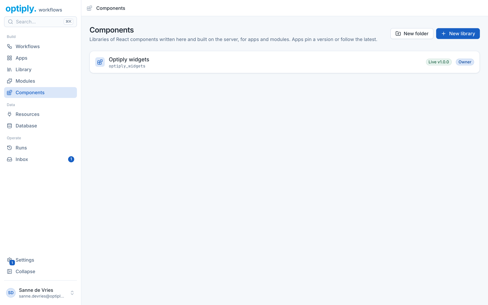

To use a custom component in an app, open **Add components** → **Add a custom component**, pick one, and set its
**Version** and its settings in the inspector. Its state and events work like those of built-in components.

Writing component libraries is developer work; the library's **Use the CLI** panel explains how to work on one from
your own computer. The command-line tool signs in with a personal access token, which an admin creates.

## 7. The Database

The Database section holds simple tables managed inside Optiply Workflows: think of reference lists, mappings or
small logs that don't belong in another system. Each environment (Production, Staging) has its own, separate tables.

You see the Database section once an admin gives you Use on the **Optiply Database** resource in an environment. That
access covers everything there: reading and editing rows, creating and changing tables, and importing and exporting.

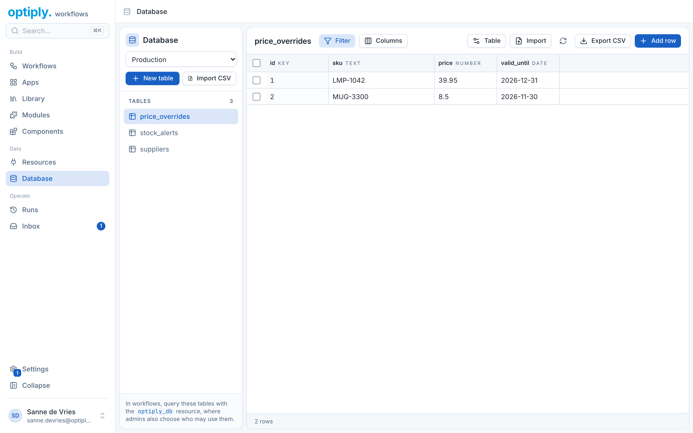

### 7.1 Tables

- Choose the **environment** at the top of the left panel. Your tables are listed under **Tables**.
- **New table:** enter a **Name** (lowercase letters, digits and underscores, for example `purchase_orders`), add
  columns with **+ Add column**, and click **Create table**. Every table gets an `id` column, numbered automatically.
- For each column choose a **Preset**: UUID, Auto-incrementing Integer ID, Created time, Text, Checkbox, Enum (a fixed
  list of values), Number, Integer, Big integer, JSON, Date, Date + Time, Foreign key (a link to another table's rows)
  or Custom. Each column can be **Required** and **Unique**, and can have a **Default**.
- The **Table** button opens the table's settings: rename it, add, edit or delete columns, or **Delete table**. When
  you change a column's type, existing values are converted; if one doesn't fit, nothing changes.

### 7.2 Rows

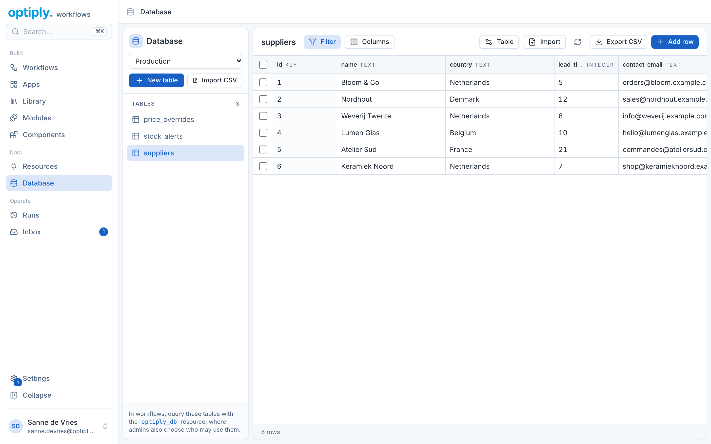

The grid works like a spreadsheet:

- Select a cell and double-click it, press Enter or F2 to edit. **Enter** saves and moves down, **Tab** saves and
  moves right, **Esc** cancels. Every edit is saved right away.
- **Add row** opens a form with one field per column.
- Tick rows and click **Delete** to remove them (this can't be undone).
- Click a column header to sort; click again to reverse, and once more to stop sorting.
- **Filter** adds conditions (contains, is, is greater than, is empty, …), combined with **and** or **or**.
- **Columns** hides columns you don't need (remembered in this browser).
- An empty cell shows NULL.

### 7.3 Importing and exporting CSV

- **Import CSV** loads a file into **A new table** or **An existing table**. Check the delimiter, whether the first row
  holds the column names, the date order and decimal commas, then match the columns. The import is all or nothing: if
  one row has a problem, nothing is imported and you see which lines to fix. Files can be up to 50 MB and 500,000 rows.
- **Export CSV** downloads every row that matches the current filters and sort, not just the rows on screen.

### 7.4 Using the tables in workflows and apps

There's no SQL editor on the Database page. To use the tables in a query, pick the **Optiply Database** resource
(`optiply_db`) in a workflow's resource query block, an app's resource query, the Query Library or the resource's
playground, and write SQL:

```sql
select * from purchase_orders where supplier_id = {{ startTrigger.data.supplierId }}
```

The query runs against the tables of the run's environment.

## 8. Using the API

Other systems (a script, a scheduler, another service) can start workflows and check on their runs over HTTP.

### 8.1 What you need

- **A published workflow with its webhook enabled** (see 4.11).
- **An API key**, unless the webhook uses a signature or is public. API keys are created in Settings, which only admins
  see, so **ask an admin for a key**. Tell them which workflows and environments it's for; a key can be limited to
  those, and can have an expiry date.

API keys start with `ow_`. Treat a key like a password: keep it in a secret store, never in code, chat or Git.

> **Note:** Personal access tokens (starting with `owpat_`) are something else: they are only for the component
> libraries' command-line tool, and can't call workflows. An admin creates them too.

### 8.2 Calling a workflow

Send a request to the workflow's webhook address with the key in the `X-Api-Key` header. (`Authorization: Bearer
ow_…` works too.)

```sh
curl -X POST 'https://<your address>/api/v1/workflows/sync-orders/webhook' \
  -H 'X-Api-Key: <your API key>' \
  -H 'Content-Type: application/json' \
  -d '{"orderId": 123}'
```

The editor's **Copy curl** button gives you this example for your own workflow.

- The body arrives in the workflow as `startTrigger.data`, the headers as `startTrigger.headers` (without the API key),
  and other query parameters as `startTrigger.urlParams`.
- JSON, forms, `multipart/form-data` (files arrive with their name, type, size and base64 content) and plain text are
  accepted, up to 10 MB.
- Add `?environment=staging` to run in Staging (if the webhook allows it). Without it, Production is used.
- If the webhook has an alias, you can also call `https://<your address>/api/v1/hooks/<alias>`.

### 8.3 The reply: waiting or not

By default the call **waits** for the workflow:

| What happens | The reply |
|---|---|
| A Response block runs | Its status, headers and body |
| The run finishes without a Response block | `200` with `{ "runId": "…", "status": "succeeded" }` |
| The run fails first | `500` with `{ "runId", "status", "error": { "code", "message" } }`, or the error handler's Response |
| The run takes longer than **Wait for the reply**, or pauses (a wait or a user task) | `202` with `{ "runId", "status" }` and a `Location` header |

To get `202` straight away, without waiting, send the header `Prefer: respond-async`. Every reply has an `X-Run-Id`
header.

### 8.4 Checking on a run

With the run id from a `202` reply, ask for the run with the same API key:

```sh
curl 'https://<your address>/api/v1/runs/<runId>' \
  -H 'X-Api-Key: <your API key>'
```

The reply is `{ "run": { … } }`. Useful fields: `status` (`queued`, `running`, `waiting`, `succeeded`, `failed`,
`cancelled`), `response` (the Response block's reply), `error`, `environment`, `createdAt`, `startedAt` and
`finishedAt`. Ask again every few seconds until the status is `succeeded`, `failed` or `cancelled`.

### 8.5 Endpoints you can call with an API key

| Method and path | What it does |
|---|---|
| `POST` (or the webhook's other methods) `/api/v1/workflows/<slug>/webhook` | Start a run of the live release |
| `POST` … `/api/v1/hooks/<alias>` | The same, through the webhook's alias |
| `GET /api/v1/runs/<runId>` | A run's status and result |
| `POST /api/v1/runs/<runId>/cancel` | Cancel a run (`200` if it stopped at once, `202` while a running run stops, `409` if it already finished) |
| `GET /api/v1/runs/<runId>/children` | The runs this run started (Workflow blocks, loops, agent tool calls) |
| `GET /api/v1/openapi.json` | An OpenAPI description of the webhooks this key may call |

A key only sees runs of the workflows and environments it's limited to. Other parts of the API are used by the web app
itself and need you to be signed in; they're not meant for scripts. The full list, with every field, is in the Admin
Guide's API reference (A11).

### 8.6 Idempotency: calling safely more than once

If a caller might send the same request twice (after a timeout, for example), send an `Idempotency-Key` header with a
unique value per piece of work, such as the order number:

```sh
curl -X POST 'https://<your address>/api/v1/workflows/sync-orders/webhook' \
  -H 'X-Api-Key: <your API key>' \
  -H 'Idempotency-Key: order-123' \
  -H 'Content-Type: application/json' \
  -d '{"orderId": 123}'
```

A repeat with the same key (same workflow and environment) doesn't start a second run. It gets the first run's reply,
marked with the header `Idempotent-Replayed: true`. Inside the workflow, the key is available as `idempotencyKey`.
Public webhooks ignore idempotency keys.

### 8.7 Status codes

| Code | Meaning |
|---|---|
| `200`, `201`, … | The run replied (from its Response block, or `200` without one) |
| `202` | The run started and is still going; check it with `GET /api/v1/runs/<runId>` |
| `400` | The body isn't valid JSON, doesn't match the webhook's body schema, or a resource isn't set up in that environment |
| `401` | No API key, an unknown, revoked or expired key, or a signature that doesn't match |
| `403` | The key may not start this workflow in this environment, or the webhook doesn't run in that environment |
| `404` | No live webhook at that address (publish the workflow with its webhook enabled), or no such environment |
| `405` | The webhook doesn't accept this method |
| `413` / `415` | The body is too large (over 10 MB) or of an unsupported type |
| `429` | Too many calls; wait for the number of seconds in the `Retry-After` header |
| `500` | The run failed before it replied |

Errors have the shape `{ "error": { "code": "…", "message": "…" } }`.

### 8.8 Webhooks from other services

Services such as Stripe, GitHub, Slack, HubSpot and Shopify can't send an API key, but they sign their calls. Set the
webhook's **Authentication** to **Signature** and pick the service, ask an admin to put the signing secret in a secret
config var, and paste the webhook address into the service's settings. Amazon SNS is supported too: enter the topic
ARNs, and the subscription is confirmed automatically. If calls are refused, the webhook's **Refused calls** list says
why (for example "signature didn't match").

## 9. Troubleshooting and FAQ

**I don't see a section (Workflows, Apps, Database …).**
Sections only show when something in them is shared with you. Ask an admin or the owner for access. After they give
it, change page or reload.

**I see "No access to …".**
You opened a link to a section where nothing is shared with you. Ask an admin.

**I don't see Settings.**
Settings is only for admins. Ask an admin for what you need: an API key, a config var, a package index, a new person.

**I don't see the New workflow (or New app, New resource) button.**
Creating needs a right an admin gives you. Ask an admin, or ask someone who has it.

**I can open a workflow but can't change anything ("Read only").**
You have Use. Ask the owner for Edit.

**I can't share something I made.**
Only owners and admins see **Access**. Ask an admin to give you Own.

**"You can use this app once its owner publishes it."**
The app has no published release yet. Ask its owner to publish it.

**My run failed.**
1. Open the run (from **Runs**, or the run panel in the editor). The failed block is marked.
2. Look at the block's error, then its **Inputs** and the **Logs** tab.
3. Common causes: a typo in a block or field name; a query error from the database; a resource not set up in that
   environment ("isn't configured in …": ask the resource's owner); a timeout (raise the block's **Timeout**, or
   process less data per run); a secret config var that is empty in draft runs (it's only filled in for published
   runs).
4. Fix it, run the single block with **▶** to check, then run the whole workflow.

**The Run (or Publish) button is disabled.**
There are problems to fix. Open **Problems** in the rail. Publish is also disabled when nothing changed since the
live release.

**A block says it can't use another block's data.**
A block can only read blocks before it (connected upstream). Connect it after the block whose data it needs.

**My webhook answers 404.**
The workflow has no live release with the webhook enabled. Enable it in **Triggers** and publish.

**My webhook answers 401.**
The caller sent no API key, a wrong or expired key, or (for signed webhooks) a signature that doesn't match. Check
**Refused calls** in the webhook settings.

**My schedule doesn't run.**
Check that the workflow is published, the schedule is **On**, and the **Next** times are what you expect (mind the
time zone). With **Skip this run**, a schedule is skipped while the previous run is still going.

**My Python block fails with a network error, or can't call a function.**
Python has no network access. Fetch the data with a resource query block first, then pass it on.

**A workflow that uses a per-person account can't be published.**
Resources set to "each person's own account" can't be used by published workflows. Ask the resource's owner for a
resource with one shared account.

**The editor says "Offline: changes will sync".**
Your connection dropped. Keep working; your changes are sent when it's back. If it says **Disconnected: reload**,
reload the page.

**Someone else is editing the same workflow or app.**
That's fine: you can edit together, and your changes merge. You see their avatar, pointer and selection. Undo only
undoes your own changes.

**My app says "This version of the app is no longer live; reload".**
Someone published a new release. Click **Reload**.

**My app says "The app's code stopped responding".**
Some code ran in an endless loop. Click **Restart**, then fix the code.

**My app's query works in the editor but not for other people.**
Check that the app is published (the editor runs the draft; people get the live release), and that the environment
is the same.

**The Database section says "No access in Staging".**
Your access to the Optiply Database is per environment. Ask an admin.

**My CSV import says "Nothing was imported".**
The import is all or nothing. Fix the lines it lists (wrong dates, text in a number column, a missing required
value) and try again.

**I'm waiting for approval and nothing happens.**
No email is sent. Let an admin know you've signed in.

**How do I run a workflow again with the same input?**
There's no re-run button. Open the run, copy its input into the start trigger's **Test input**, and click **Run**; or
call the webhook again.

**Can a workflow listen to a queue (Kafka, Pub/Sub, SQS …)?**
No. Workflows start from webhooks, schedules, the Run button, apps and other workflows. Have the other system call a
webhook instead.

## 10. Glossary

| Term | Meaning |
|---|---|
| **Access level** | Use, Edit or Own: what someone may do with a workflow, app, resource or other object |
| **Admin** | A member of the Admins group with an @optiply.nl account; can do everything and sees Settings |
| **Alias** | An extra, friendlier webhook address under `/api/v1/hooks/` |
| **API key** | A secret (`ow_…`) that lets another system call workflow webhooks and read their runs |
| **App** | A web page built from components and queries |
| **Block** | One step of a workflow |
| **Branch** | A block that picks a path based on conditions |
| **Config var** | A value set per environment by an admin, read as `configVars.NAME`; can be secret |
| **Component** | A building block of an app: a table, an input, a button … |
| **Cron** | A way to write a schedule, such as `0 3 * * *` (every day at 03:00) |
| **Draft** | The version you are editing; not used by webhooks, schedules or app users |
| **Environment** | Production or Staging: which set of resource settings and database tables a run uses |
| **Event handler** | An action an app takes when something happens, such as a click |
| **Folder** | A way to group objects; access on a folder applies to everything in it |
| **Function** | A reusable sub-flow inside a workflow |
| **Idempotency key** | A value that makes a repeated call return the first run instead of starting another |
| **Inbox** | Where user tasks wait for you |
| **Library query** | A query in the Query Library, reused by apps and workflows |
| **Live release** | The published version that is in use |
| **Module** | A reusable piece of an app with inputs, outputs and events |
| **Playground** | The resource's Query tab, to try queries |
| **Release** | A published, numbered version (such as v1.2.0) of a workflow, app, module or library query |
| **Resource** | A saved connection to a database, API or service |
| **Run** | One execution of a workflow |
| **Slug** | The short, fixed name used in addresses and references, such as `sync-orders` |
| **Start trigger** | The first block of a workflow; holds the test input |
| **Transformer** | A small piece of app code that computes a value |
| **User task** | A workflow step that waits for a person to answer in their Inbox |
| **Variable** | A value an app keeps and can change |
| **Webhook** | A web address that starts a workflow when it is called |
| **`{{ }}`** | An expression: a bit of JavaScript inside a field, such as `{{ query1.data }}` |
